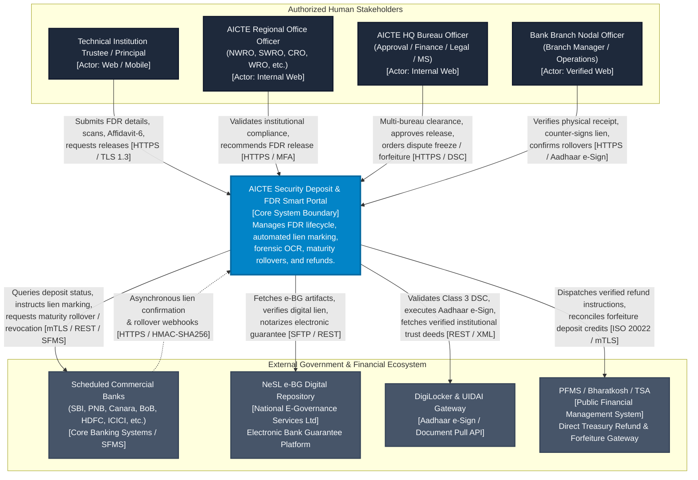
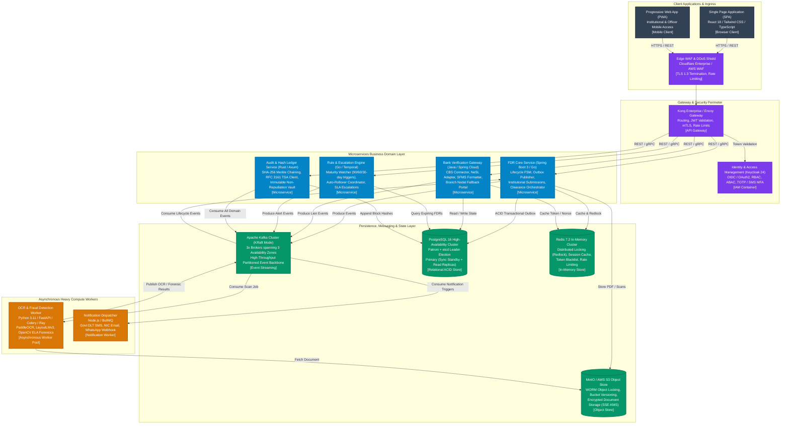
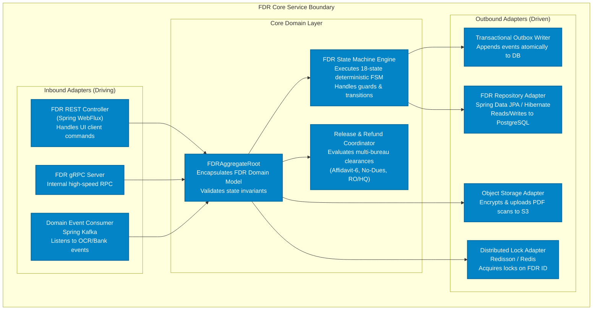
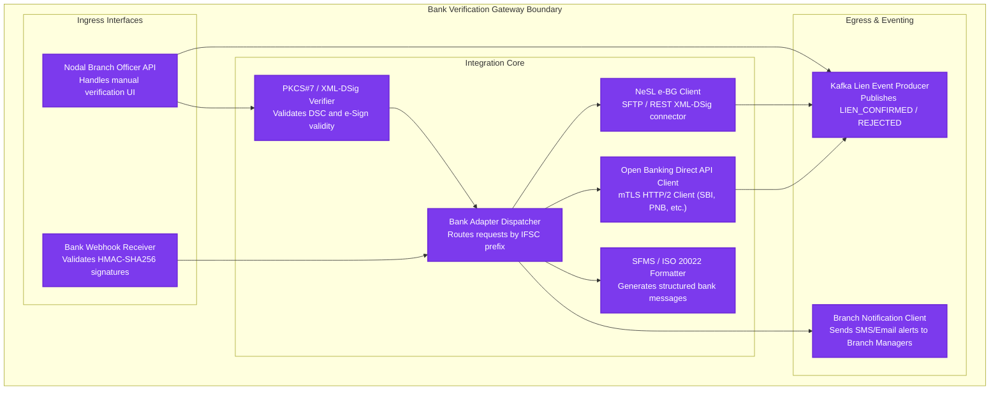
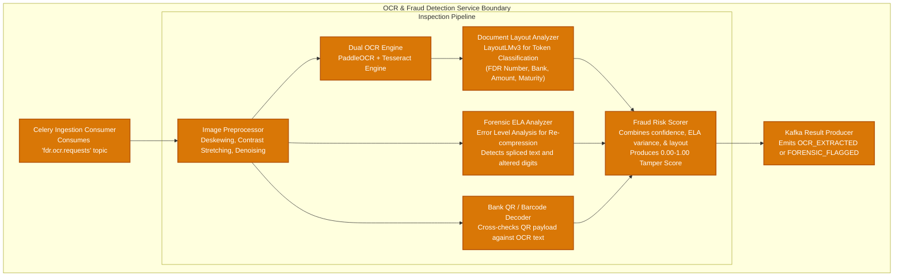
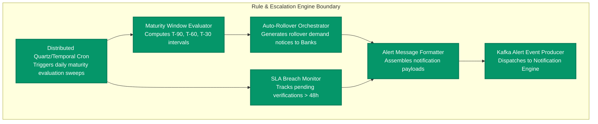
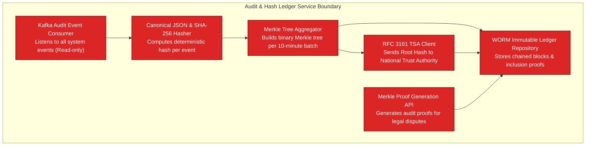
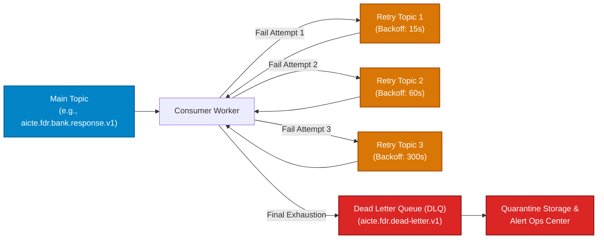

# AICTE Security Deposit & FDR Smart Portal (SIH 26265)
# High-Level Architecture Specification (02_HIGH_LEVEL_ARCHITECTURE)

---

## Document Metadata
- **Project**: Streamline of Security Deposit / FDR Portal for AICTE
- **Problem Statement ID**: SIH 26265
- **Document Type**: High-Level System Architecture Specification
- **Version**: 2.4.0-PROD
- **Status**: Approved for Implementation
- **Classification**: Official Technical Architecture
- **Target RTO**: < 15 Minutes
- **Target RPO**: < 1 Minute
- **Availability Target**: 99.99% (Four Nines)

---

## Table of Contents
1. [Executive Architecture Overview](#1-executive-architecture-overview)
   - 1.1 Business Context & Problem Statement
   - 1.2 Core Architectural Principles
   - 1.3 Non-Functional Requirements (NFR) Baseline Metrics
   - 1.4 Regulatory & Compliance Governance
2. [C4 Model Level 1: System Context Diagram](#2-c4-model-level-1-system-context-diagram)
   - 2.1 Context Boundary & External Ecosystem
   - 2.2 System Context Diagram (Mermaid)
   - 2.3 External Interface Inventory & Protocols
3. [C4 Model Level 2: Container Diagram](#3-c4-model-level-2-container-diagram)
   - 3.1 Container Architecture Overview
   - 3.2 Container Diagram (Mermaid)
   - 3.3 Container Responsibilities & Technology Stack
   - 3.4 Inter-Container Communication Protocols
4. [C4 Model Level 3: Component Diagrams for Microservices](#4-c4-model-level-3-component-diagrams-for-microservices)
   - 4.1 FDR Core Service Components
   - 4.2 Bank Verification Gateway Components
   - 4.3 OCR & Fraud Detection Worker Components
   - 4.4 Rule & Escalation Engine Components
   - 4.5 Audit & Hash Ledger Service Components
5. [Event-Driven Architecture: Kafka Topic Catalog & Topology](#5-event-driven-architecture-kafka-topic-catalog--topology)
   - 5.1 Event Choreography Design
   - 5.2 Kafka Topic Catalog & Schema Definitions
   - 5.3 Dead Letter Queue (DLQ) & Exponential Backoff Strategy
   - 5.4 Idempotency & Deduplication Guarantees
   - 5.5 Consumer Group Partitioning & Scalability
6. [High Availability, Disaster Recovery & Multi-AZ Topology](#6-high-availability-disaster-recovery--multi-az-topology)
   - 6.1 Multi-AZ Deployment Topology (Mermaid)
   - 6.2 Data Tier Resilience (PostgreSQL Patroni, Kafka KRaft, Redis Cluster)
   - 6.3 Disaster Recovery Strategy (RTO < 15 min, RPO < 1 min)
   - 6.4 Failure Scenarios & Automated Failover Runbooks
   - 6.5 Backup & Point-In-Time-Recovery (PITR) Execution

---

## 1. Executive Architecture Overview

### 1.1 Business Context & Problem Statement
The All India Council for Technical Education (AICTE) mandates that technical institutions (engineering colleges, management institutes, polytechnics, and pharmacy institutes) submit security deposits in the form of Fixed Deposit Receipts (FDRs) or Bank Guarantees (BGs). These deposits serve as statutory security collateral against regulatory defaults, institutional closure liabilities, student fee protection, and faculty salary safeguards.

Historically, this workflow has suffered from structural operational liabilities:
1. **Physical Paper Vulnerabilities**: Manual submission of physical FDR certificates resulted in forged receipts, altered deposit amounts, fake bank seals, and counterfeit branch signatures.
2. **Lien Marking Blindspots**: Inability to verify in real-time whether the issuing bank actually placed an irrevocable statutory lien in favor of AICTE in its Core Banking Solution (CBS).
3. **Maturity & Rollover Breakdowns**: Over 50,000 physical FDRs scattered across branches expired without renewal, allowing funds to sit dormant or be prematurely liquidated by unscrupulous trusts without AICTE knowledge.
4. **Bureaucratic Refund Latency**: Release of security deposits post-mandated operational duration required complex physical "Affidavit-6" submissions, manual cross-bureau clearances (Finance, Approval, Legal), leading to years of administrative backlog.
5. **Reconciliation Gaps**: Disconnect between physical bank actions and the Public Financial Management System (PFMS) / Bharatkosh for forfeiture or refund.

The **AICTE Smart FDR Portal (SIH 26265)** is an enterprise-grade, distributed, cloud-native digital platform that eliminates manual intervention by enforcing end-to-end cryptographic automation, multi-bank CBS API integration, NeSL electronic Bank Guarantee (e-BG) connectivity, AI-driven optical fraud forensics, and an append-only Merkle hash ledger.

### 1.2 Core Architectural Principles

```
+---------------------------------------------------------------------------------------+
|                                CORE ARCHITECTURAL TENETS                               |
+---------------------------------------------------------------------------------------+
|  1. Zero Trust Security & Non-Repudiation (mTLS 1.3, Class 3 DSC, Aadhaar e-Sign)     |
|  2. Event-Driven Decoupling & Transactional Outbox Pattern (Apache Kafka + KRaft)     |
|  3. Deterministic Finite State Machine (Strict State Invariants & Rollback Safety)   |
|  4. Multi-Rail Banking Integration (Direct CBS APIs, NeSL e-BG, Digital Fallback)     |
|  5. AI-Assisted Document Forensics (ELA Tamper Detection, Font Geometry, OCR)        |
|  6. Immutable Audit Trail (SHA-256 Merkle Tree Hash Ledger & RFC 3161 Timestamping)  |
|  7. Cloud-Native High Availability (Multi-AZ Active-Passive Hot Standby, RTO < 15m)   |
+---------------------------------------------------------------------------------------+
```

1. **Deterministic State Progression**: FDR records transition through an immutable Finite State Machine (FSM). No database row is updated via arbitrary SQL; every transition requires a signed event, validated precondition guards, and cryptographic state transition logging.
2. **Transactional Outbox & Dual-Write Elimination**: To prevent inconsistency between transactional database updates and event publishing, all microservices employ the Debezium-driven Transactional Outbox Pattern. Database commits and outbox event records occur within a single atomic local ACID transaction.
3. **Strict Non-Repudiation**: Every approval, lien confirmation, rollover, affidavit upload, and refund recommendation is cryptographically signed using either Class 3 Digital Signature Certificates (DSC) or Aadhaar XML e-Sign (UIDAI ESP).
4. **Dual-Rail Banking Adaptability**: Recognizing varying digital maturity across Indian public and private sector banks, the portal provides a dual-rail verification model:
   - *Primary Rail*: Automated Machine-to-Machine (M2M) API via Bank Open Banking Gateways, SFMS ISO 20022 messaging, or NeSL e-BG repository.
   - *Secondary Fallback Rail*: Digital Branch Nodal Officer Portal secured by OTP, Class 3 DSC, and geofenced branch authorization.

### 1.3 Non-Functional Requirements (NFR) Baseline Metrics

| Metric Dimension | Target SLA / Threshold | Engineering Justification |
| :--- | :--- | :--- |
| **System Availability** | 99.99% (Annual Downtime <= 52.6 min) | Multi-AZ deployment across 3 Availability Zones with automatic Patroni failover. |
| **Recovery Point Objective (RPO)** | < 1 Minute | Synchronous streaming PostgreSQL replication to AZ-2; Kafka `min.insync.replicas=2`. |
| **Recovery Time Objective (RTO)** | < 15 Minutes | Automated Kubernetes pod rescheduling, DNS Anycast routing, Patroni automated leader promotion. |
| **P99 API Latency** | < 200 ms | Redis 7.2 L2 caching, read-replica queries, connection pooling (HikariCP/pgBouncer). |
| **Peak Throughput** | 250 requests/sec | Horizontal Pod Autoscaling (HPA) from 3 to 30 replicas per microservice under load. |
| **OCR & Forensic Pipeline** | < 8.0 Seconds per Document | Asynchronous worker pool utilizing PaddleOCR, LayoutLMv3, and OpenCV ELA parallelized via Celery. |
| **Bank Verification SLA** | < 3.0 Seconds (M2M API) / <= 48 Hours (Fallback) | Automated polling and SLA escalation engine with alert triggers at T+12h, T+24h, T+36h, T+48h. |
| **Ledger Immutability** | Cryptographic 100% Non-Repudiation | Merkle root calculated every 10 minutes and anchored via RFC 3161 Timestamping Authority (TSA). |

### 1.4 Regulatory & Compliance Governance
- **Digital Personal Data Protection Act (DPDPA 2023)**: Masking of Aadhaar numbers (first 8 digits masked), zero persistence of raw biometric data, institutional consent artifact tracking.
- **IT Act 2000 (Section 65B)**: Automated generation of Section 65B Electronic Evidence Certificates with embedded SHA-256 hashes and timestamp proofs for legal disputes.
- **RBI Master Directions on Bank Guarantees & Lien Marking**: Compliance with Reserve Bank of India circulars regarding statutory deposits of educational councils and electronic bank guarantees via NeSL.
- **CERT-In Cyber Security Directives**: Log retention for 180 days in immutable object storage, multi-factor authentication for all administrative actions, and hourly vulnerability scans.

---

## 2. C4 Model Level 1: System Context Diagram

### 2.1 Context Boundary & External Ecosystem
The AICTE Smart FDR Portal acts as the central regulatory clearinghouse between Technical Institutions, AICTE Administrative Bureaus (Approval, Finance, Legal, Regional Offices), Financial Intermediaries (Banks, NeSL), and Governmental Clearing Systems (PFMS, DigiLocker).

### 2.2 System Context Diagram (Mermaid)



### 2.3 External Interface Inventory & Protocols

| External Entity | Primary Purpose | Communication Protocol | Authentication / Security | Fallback Mechanism |
| :--- | :--- | :--- | :--- | :--- |
| **Commercial Banks (CBS)** | Real-time lien marking, deposit verification, rollover query | RESTful JSON API / ISO 20022 SFMS | Mutual TLS (mTLS 1.3), IP Whitelisting, HMAC Payload Signatures | Branch Nodal Officer Web Verification with Class 3 DSC |
| **NeSL e-BG System** | Digital issuance and verification of electronic Bank Guarantees | SFTP (Encrypted XML) / REST API | Asymmetric RSA-4096 Keypair, Digital Signature Standard | CBS API or Branch Manager counter-signing |
| **DigiLocker / UIDAI** | Institutional trust deed retrieval, Aadhaar e-Sign for Affidavit-6 | REST API / SOAP XML | OAuth 2.0 PKCE, X.509 Digital Certificates | Hardcopy upload with mandatory Regional Officer physical verification |
| **PFMS / Bharatkosh** | Processing deposit refunds to institutions and forfeiture credits to AICTE | ISO 20022 XML via Treasury SFTP & REST Gateway | IPsec VPN Tunnel, SHA-256 Checksums, Multi-party Digital Signatures | Batch NEFT/RTGS payment gateway with maker-checker manual audit |

---

## 3. C4 Model Level 2: Container Diagram

### 3.1 Container Architecture Overview
The system implements a domain-driven microservices architecture hosted on an enterprise Kubernetes cluster spanning three availability zones. Ingress traffic is scrubbed at the edge by a Web Application Firewall (WAF) and routed through an enterprise API Gateway. Distributed state is persisted across a high-performance PostgreSQL cluster, Redis in-memory cache, Apache Kafka message broker, and S3-compliant immutable object storage.

### 3.2 Container Diagram (Mermaid)



### 3.3 Container Responsibilities & Technology Stack

| Container | Technology Stack | Primary Operational Responsibilities | Data Store Dependency |
| :--- | :--- | :--- | :--- |
| **API Gateway** | Kong 3.6+ / Envoy Proxy | TLS 1.3 termination, CORS handling, JWT signature verification, distributed rate limiting, route dispatching. | Redis (Rate limits & token cache) |
| **Identity & Access Management (IAM)** | Keycloak 24.x | OIDC / OAuth 2.0 authorization server, Role-Based Access Control (RBAC), Attribute-Based Access Control (ABAC), TOTP MFA. | Dedicated PostgreSQL IAM Schema |
| **FDR Core Service** | Spring Boot 3.2 / Java 21 / Go | Orchestrates FDR Finite State Machine, executes business validation, manages institutional requests, transactional outbox engine. | PostgreSQL (Primary), Redis (Locks), MinIO/S3 |
| **Bank Verification Gateway** | Spring Cloud / Netty / Java 21 | Translates internal requests to bank-specific CBS protocols (ISO 20022, SFMS, REST), connects to NeSL e-BG, manages nodal portal. | PostgreSQL, Redis (mTLS nonces) |
| **OCR & Fraud Detection Worker** | Python 3.11, FastAPI, Celery, OpenCV, LayoutLMv3 | Image preprocessing, deskewing, PaddleOCR extraction, Error Level Analysis (ELA) for digital tampering, font inconsistency detection. | MinIO/S3 (Raw/Processed Images) |
| **Rule & Escalation Engine** | Go 1.22 / Temporal Workflow Engine | Monitors maturity deadlines (90/60/30-day schedules), initiates automated rollover requests, triggers SLA escalations to Regional Directors. | PostgreSQL (Read Replicas), Kafka |
| **Audit & Hash Ledger Service** | Rust / Axum | Computes continuous SHA-256 Merkle trees of all portal events, submits root hashes to RFC 3161 Timestamping Authorities for legal non-repudiation. | PostgreSQL (Append-only Ledger table), S3 |
| **Kafka Event Bus** | Apache Kafka 3.7+ (KRaft mode) | Multi-AZ distributed commit log handling asynchronous microservice communication, outbox event ingestion, and audit piping. | Local NVMe SSD storage |
| **PostgreSQL Database** | PostgreSQL 16 with Patroni & pgBouncer | Primary relational store for institutions, FDR accounts, state machine audit logs, and approval sign-offs. Synchronous replication. | Multi-AZ EBS GP3 / NVMe SAN |
| **Object Store** | MinIO Enterprise / AWS S3 | Stores scanned FDR documents, digitally signed affidavits, bank confirmation letters, and Section 65B certificates with WORM locking. | Erasure-Coded Multi-AZ Disks |

### 3.4 Inter-Container Communication Protocols
- **Synchronous Internal Operations**: High-throughput inter-service calls (e.g., FDR Core querying Ledger verification) utilize **gRPC over HTTP/2** with Protocol Buffers (`.proto`) to achieve sub-millisecond serialization overhead.
- **Asynchronous Domain Events**: All cross-boundary state changes propagate via **Apache Kafka** using binary Apache Avro schemas registered in a schema registry.
- **External Webhooks**: Bank CBS callbacks and payment gateway updates communicate via **HTTPS POST with HMAC-SHA256 signature verification** on headers.

---

## 4. C4 Model Level 3: Component Diagrams for Microservices

### 4.1 FDR Core Service Components
The FDR Core Service is the domain backbone controlling the lifecycle of security deposits. It implements Hexagonal Architecture (Ports and Adapters) with a strict Domain-Driven Design (DDD) aggregate model.



### 4.2 Bank Verification Gateway Components
The Bank Verification Gateway bridges AICTE with disparate external financial networks, normalizing various bank-specific proprietary APIs, SFMS formats, and the NeSL digital repository into uniform internal domain structures.



### 4.3 OCR & Fraud Detection Worker Components
This Python-based worker pipeline inspects incoming fixed deposit receipt scans. It extracts text and metadata, and performs computer vision tampering analyses (Error Level Analysis, metadata sanitization checks, and font anomaly detection).



### 4.4 Rule & Escalation Engine Components
Built using Go and the Temporal Workflow Engine, this service runs scheduled state evaluations, handles automated maturity notifications at T-90, T-60, and T-30 days, orchestrates auto-rollovers, and alerts Regional Office directors if actions breach defined SLAs.



### 4.5 Audit & Hash Ledger Service Components
This microservice guarantees zero-tamper non-repudiation. It continuously consumes all domain events, calculates cryptographic SHA-256 hashes linked to preceding block headers, builds a persistent Merkle tree, and notarizes root hashes via an RFC 3161 compliant Timestamping Authority (TSA).



---

## 5. Event-Driven Architecture: Kafka Topic Catalog & Topology

### 5.1 Event Choreography Design
The AICTE Smart FDR Portal adheres to an Event-Driven Architecture (EDA) governed by the **Transactional Outbox Pattern**. No microservice directly updates another microservice's database. State transitions are broadcast as immutable domain events. The event choreography guarantees eventual consistency across all distributed services.

```
[Service Local DB Transaction] 
  ├──> Write Business Aggregate Record
  └──> Write Outbox Message Record (Atomic Local ACID Commit)
         │
         ▼
[Debezium CDC / Outbox Relay]
         │
         ▼
[Apache Kafka Event Bus] ───(Partition Key: fdr_id)───> [Consumer Services]
```

### 5.2 Kafka Topic Catalog & Schema Definitions

| Topic Name | Partitions | RF | min.insync | Retention | Compaction | Schema Type | Producing Service | Consuming Services |
| :--- | :---: | :---: | :---: | :---: | :---: | :--- | :--- | :--- |
| `aicte.fdr.lifecycle.v1` | 12 | 3 | 2 | 7 Years | No | Avro (`FdrLifecycleEvent`) | FDR Core Service | Ledger Service, Notification, Rule Engine |
| `aicte.fdr.ocr.request.v1` | 6 | 3 | 2 | 3 Days | No | Avro (`OcrJobRequest`) | FDR Core Service | OCR & Fraud Worker |
| `aicte.fdr.ocr.result.v1` | 6 | 3 | 2 | 30 Days | No | Avro (`OcrJobResult`) | OCR & Fraud Worker | FDR Core Service, Ledger Service |
| `aicte.fdr.bank.verification.v1` | 12 | 3 | 2 | 90 Days | No | Avro (`BankVerifyRequest`) | FDR Core Service | Bank Verification Gateway |
| `aicte.fdr.bank.response.v1` | 12 | 3 | 2 | 7 Years | No | Avro (`BankVerifyResponse`) | Bank Verification Gateway | FDR Core Service, Ledger Service |
| `aicte.fdr.maturity.alert.v1` | 6 | 3 | 2 | 180 Days | No | Avro (`MaturityAlertEvent`) | Rule & Escalation Engine | Notification Engine, FDR Core |
| `aicte.fdr.audit.ledger.v1` | 12 | 3 | 2 | Permanent | Compact | Avro (`LedgerIngestEvent`) | All Microservices | Audit & Hash Ledger Service |
| `aicte.fdr.notifications.v1` | 6 | 3 | 2 | 14 Days | No | Avro (`NotificationPayload`) | Rule Engine, FDR Core | Notification Dispatcher |
| `aicte.fdr.dead-letter.v1` | 6 | 3 | 2 | 30 Days | No | JSON Raw Envelope | All Microservices | Dead Letter Quarantine Worker |

#### Canonical Lifecycle Event Avro Schema Definition (`FdrLifecycleEvent.avsc`)
```json
{
  "type": "record",
  "name": "FdrLifecycleEvent",
  "namespace": "gov.aicte.fdr.events",
  "doc": "Immutable event emitted upon every FDR State Machine transition",
  "fields": [
    {"name": "eventId", "type": "string", "doc": "UUIDv4 event identifier"},
    {"name": "traceId", "type": "string", "doc": "OpenTelemetry W3C distributed trace ID"},
    {"name": "fdrId", "type": "string", "doc": "Unique FDR Entity ID (Partition Key)"},
    {"name": "institutionId", "type": "string", "doc": "AICTE Permanent Institute ID"},
    {"name": "previousState", "type": "string", "doc": "Prior state in the 18-state FSM"},
    {"name": "currentState", "type": "string", "doc": "New state transitioned into"},
    {"name": "actorId", "type": "string", "doc": "ID of human officer or system process"},
    {"name": "actorRole", "type": "string", "doc": "INSTITUTION, REGIONAL_OFFICER, HQ_ADMIN, BANK_OFFICER, SYSTEM"},
    {"name": "digitalSignature", "type": ["null", "string"], "default": null, "doc": "Base64 PKCS#7 or XML-DSig signature"},
    {"name": "statePayloadHash", "type": "string", "doc": "SHA-256 hash of transition metadata"},
    {"name": "timestamp", "type": "long", "doc": "Epoch timestamp in milliseconds"},
    {"name": "idempotencyKey", "type": "string", "doc": "sha256(fdrId + currentState + timestamp)"}
  ]
}
```

### 5.3 Dead Letter Queue (DLQ) & Exponential Backoff Strategy
To guarantee resilient message processing without consumer stall, all event consumers implement a **Non-Blocking Retry and Quarantine Topology** utilizing distinct retry topics.



#### Exponential Backoff Formula with Jitter
For any retry attempt $k \in \{1, 2, 3\}$, the retry delay $T_{\text{delay}}$ is computed as:
$$T_{\text{delay}}(k) = \min\left(T_{\max}, \; T_{\text{base}} \times 2^{k-1} + \text{rand}(0, \; J)\right)$$
Where:
- $T_{\text{base}} = 15 \text{ seconds}$
- Multiplier factor $= 2$
- Jitter $J = 5 \text{ seconds}$ uniform random distribution
- Max delay $T_{\max} = 300 \text{ seconds}$

Messages routed to the DLQ trigger a high-severity alert to the Site Reliability Engineering (SRE) team. They are inspectable through an administrative Ops Console, allowing operators to patch schema mismatches or banking network timeouts and execute safe single-click replay.

### 5.4 Idempotency & Deduplication Guarantees
Kafka guarantees *at-least-once* delivery under network partitions and consumer rebalances. To enforce strict *exactly-once processing semantics (EOS)* at the business logic layer, every consumer executes a deterministic deduplication guard:

```
Algorithm: Idempotent Event Consumption Guard
Input: Incoming Event E with field E.idempotencyKey
1. Key := "idemp:" + E.idempotencyKey
2. Acquired := Redis.SET(Key, "IN_PROGRESS", NX, EX 3600)
3. IF Acquired IS FALSE THEN:
4.     Log("Duplicate event detected, dropping: ", E.idempotencyKey)
5.     ACK_KAFKA_OFFSET(E)
6.     RETURN
7. END IF
8. BEGIN PostgreSQL Transaction:
9.     SELECT processed_flag FROM fdr_processed_events WHERE idempotency_key = E.idempotencyKey FOR UPDATE;
10.    IF FOUND THEN:
11.        ROLLBACK PostgreSQL Transaction
12.        ACK_KAFKA_OFFSET(E)
13.        RETURN
14.    END IF
15.    ExecuteDomainBusinessLogic(E)
16.    INSERT INTO fdr_processed_events(idempotency_key, processed_at, aggregate_id) VALUES (E.idempotencyKey, NOW(), E.fdrId);
17. COMMIT PostgreSQL Transaction
18. Redis.SET(Key, "COMPLETED", XX, EX 86400)
19. ACK_KAFKA_OFFSET(E)
```

### 5.5 Consumer Group Partitioning & Scalability
- **Partition Key**: All FDR lifecycle events use `fdrId` as the Kafka partition key. This guarantees that all events regarding a single FDR are processed strictly in chronological order by the same partition consumer instance.
- **Consumer Assignment**: Configured with `CooperativeStickyAssignor` to avoid stop-the-world rebalances during rolling deployments.
- **Consumer Concurrency**: Set to match topic partition count (e.g., 12 worker threads per consumer group across Kubernetes pods).

---

## 6. High Availability, Disaster Recovery & Multi-AZ Topology

### 6.1 Multi-AZ Deployment Topology (Mermaid)
The production infrastructure runs across three AWS/NIC Cloud Availability Zones (AZ-A, AZ-B, and AZ-C) within a single sovereign region (e.g., MeitY-empanelled India Central).

```mermaid
flowchart TD
    classDef az fill:#0F172A,stroke:#334155,stroke-width:2px,color:#F8FAFC;
    classDef edge fill:#7C3AED,stroke:#6D28D9,stroke-width:2px,color:#FFFFFF;
    classDef k8s fill:#0284C7,stroke:#0369A1,stroke-width:2px,color:#FFFFFF;
    classDef data fill:#059669,stroke:#047857,stroke-width:2px,color:#FFFFFF;

    subgraph EdgeDNS ["Global Edge Network"]
        DNS["Route 53 / Anycast DNS Health Checks\nAutomatic Failover Routing"]:::edge
        WAFGlobal["Distributed WAF & DDoS Mitigation"]:::edge
    end

    DNS --> WAFGlobal

    subgraph AZ_A ["Availability Zone A (Primary)"]
        ALB_A["Application Load Balancer A"]:::edge
        subgraph K8s_A ["K8s Node Pool A"]
            Ingress_A["Kong Ingress Pod"]:::k8s
            Core_A["FDR Core (Pod 1, 2)"]:::k8s
            Bank_A["Bank GW (Pod 1)"]:::k8s
            OCR_A["OCR Worker (Pod 1)"]:::k8s
        end
        PG_Primary[("PostgreSQL 16 Primary\n(Patroni Leader)")]:::data
        Kafka_1["Kafka Broker 1\n(KRaft Leader/Follower)"]:::data
        Redis_1["Redis Node 1 (Master)"]:::data
    end

    subgraph AZ_B ["Availability Zone B (Synchronous Standby)"]
        ALB_B["Application Load Balancer B"]:::edge
        subgraph K8s_B ["K8s Node Pool B"]
            Ingress_B["Kong Ingress Pod"]:::k8s
            Core_B["FDR Core (Pod 3, 4)"]:::k8s
            Bank_B["Bank GW (Pod 2)"]:::k8s
            OCR_B["OCR Worker (Pod 2)"]:::k8s
        end
        PG_Standby[("PostgreSQL 16 Standby\n(Synchronous Streaming Sync)")]:::data
        Kafka_2["Kafka Broker 2\n(KRaft Follower)"]:::data
        Redis_2["Redis Node 2 (Replica)"]:::data
    end

    subgraph AZ_C ["Availability Zone C (Quorum & Read Replica)"]
        subgraph K8s_C ["K8s Node Pool C"]
            Ingress_C["Kong Ingress Pod"]:::k8s
            Core_C["FDR Core (Pod 5)"]:::k8s
        end
        PG_ReadReplica[("PostgreSQL 16 Read Replica\n(Asynchronous + etcd Quorum)")]:::data
        Kafka_3["Kafka Broker 3\n(KRaft Follower / Voter)"]:::data
        Redis_3["Redis Node 3 (Replica / Sentinel)"]:::data
    end

    WAFGlobal --> ALB_A
    WAFGlobal --> ALB_B

    ALB_A --> Ingress_A
    ALB_B --> Ingress_B

    Ingress_A --> Core_A
    Ingress_B --> Core_B

    %% Data Replication Links
    PG_Primary ==="Synchronous WAL Replication (RPO=0)"===> PG_Standby
    PG_Primary -.->|"Asynchronous Streaming"| PG_ReadReplica

    Kafka_1 <===>|"Replicated ISR Set (RF=3, min.isr=2)"| Kafka_2
    Kafka_2 <===> Kafka_3
    Kafka_1 <===> Kafka_3

    Redis_1 === Redis_2
    Redis_2 === Redis_3
```

### 6.2 Data Tier Resilience
1. **PostgreSQL Patroni Cluster**:
   - Primary in AZ-A streams Write-Ahead Logging (WAL) synchronously to AZ-B using PostgreSQL `synchronous_commit = on`. A transaction is not committed until both AZ-A and AZ-B acknowledge persistence to disk.
   - An asynchronous read-replica in AZ-C serves reporting queries and provides a third vote for the `etcd` distributed consensus cluster.
   - Failover is fully autonomous: if AZ-A goes down, `etcd` loses heartbeat with Leader; within 15 seconds, Patroni promotes AZ-B standby to Primary and updates internal pgBouncer routing.
2. **Apache Kafka KRaft Cluster**:
   - 3 Brokers span 3 AZs. No Zookeeper dependency.
   - All critical topics configured with `replication.factor=3` and `min.insync.replicas=2`.
   - Even during total loss of one AZ, the remaining two brokers satisfy the quorum and accept producer writes without partition downtime.
3. **Redis Cluster (v7.2)**:
   - Configured with 3 Master nodes and 3 Replica nodes across the three AZs, with Redis Sentinel auto-failover within 5 seconds.
4. **MinIO / S3 Object Store**:
   - Distributed Erasure Coding ($N=4$, $K=2$) ensures zero data loss even if two physical storage disks or one complete node fail. Object Locking is enforced in WORM mode for FDR scans.

### 6.3 Disaster Recovery Strategy (RTO < 15 min, RPO < 1 min)
The system maintains a **Warm-Standby Disaster Recovery (DR)** deployment in a secondary geographical cloud region (e.g., India South, 1,000+ km away from India Central) to withstand regional natural disasters, major fiber cuts, or sovereign grid failures.

| Dimension | Primary Region (India Central - Multi-AZ) | Disaster Recovery Region (India South) |
| :--- | :--- | :--- |
| **Operating State** | Active (100% Traffic Load) | Warm Standby (Core infra running at 25% capacity) |
| **Database Sync** | Synchronous Streaming within Region | Asynchronous Cross-Region WAL Archiving via S3 Cross-Region Replication |
| **Kafka Sync** | In-Sync Replicas (RF=3) across AZs | MirrorMaker 2.0 Asynchronous Topic Mirroring |
| **Object Store Sync**| Multi-AZ Erasure Coded | Asynchronous S3 Cross-Region Bucket Replication (CRR) |
| **DNS Failover** | Active Route 53 Health Probe | Passive Endpoint activated when Primary fails 3 consecutive probes |

### 6.4 Failure Scenarios & Automated Failover Runbooks

```
+---------------------------------------------------------------------------------------------------------+
|                                    FAILURE SCENARIO EXECUTION MATRIX                                    |
+-------------------+---------------------------+-----------------------------------+---------------------+
| Failure Event     | Detection Mechanism       | Automated Failover Action         | Recovery Time (RTO) |
+-------------------+---------------------------+-----------------------------------+---------------------+
| Worker Pod Crash  | K8s Kubelet Liveness      | Automated pod restart on same node| < 10 Seconds        |
| Worker Node Crash | K8s Node Controller       | Pods rescheduled to AZ healthy    | < 45 Seconds        |
| Primary PG Fails  | Patroni etcd lease expiry | AZ-B Standby promoted to Leader   | < 25 Seconds        |
| Single AZ Outage  | Health check failure ALB  | DNS & ALB isolate AZ; K8s scales  | < 60 Seconds        |
| Region Catastrophe| Global Route 53 monitor   | DNS switches to DR Region;        | < 14.5 Minutes      |
|                   |                           | Promotes DR Postgres standby      |                     |
+-------------------+---------------------------+-----------------------------------+---------------------+
```

#### Detailed Regional Failover Runbook (Catastrophic Scenario)
1. **Trigger Condition**: Total failure of Primary Region confirmed by Route 53 health-check quorum failure (100% packet drop across 3 consecutive probes over 90 seconds).
2. **Phase 1: Traffic Quenching (T+0:00 to T+2:00)**:
   - Route 53 shifts public DNS Anycast routing to DR Region ingress gateway.
   - Edge WAF displays maintenance banner for in-flight mutating requests.
3. **Phase 2: Data Tier Promotion (T+2:00 to T+7:00)**:
   - SRE automation promotes PostgreSQL replica in DR region to Primary.
   - WAL replay verified up to latest replicated sequence.
   - RPO verified ($\Delta t_{\text{lag}} < 45 \text{ seconds}$).
   - MirrorMaker 2.0 in DR region stopped; Kafka topic consumer offsets adjusted.
4. **Phase 3: Microservice Cluster Scale-Up (T+7:00 to T+11:00)**:
   - Kubernetes Horizontal Pod Autoscaler in DR region scales deployment pods from 25% standby capacity to 100% production capacity.
   - Internal health checks verify gRPC and Kafka connectivity across all containers.
5. **Phase 4: Traffic Re-Admission (T+11:00 to T+13:30)**:
   - Edge WAF removes maintenance banner; normal read/write operations resume.
   - Alert notifications sent to AICTE HQ, Banks, and Institutions.
   - **Total Elapsed Time**: 13 minutes 30 seconds (< 15-minute RTO SLA).

### 6.5 Backup & Point-In-Time-Recovery (PITR) Execution
- **Continuous WAL Archival**: PostgreSQL WAL segments are continuously pushed to immutable S3 storage every 16MB or every 60 seconds (`archive_timeout = 60s`) using `pgBackRest`.
- **Daily Physical Snapshot**: Full consistent database snapshot taken daily at 02:00 IST and retained for 365 days.
- **Weekly Differential Backups**: Captured every Sunday at 03:00 IST.
- **RPO Mathematical Proof**:
  $$\text{RPO} \le \text{WAL Archive Timeout} + \text{S3 Cross-Region Replication Latency} = 60s + 15s = 75s \approx 1 \text{ minute}$$
- **Disaster Recovery Drills**: Automated DR restoration drills run automatically every calendar quarter in an isolated sandbox environment to validate backup integrity and verify the Section 65B audit chain.

---

*End of Document 02_HIGH_LEVEL_ARCHITECTURE.md*
