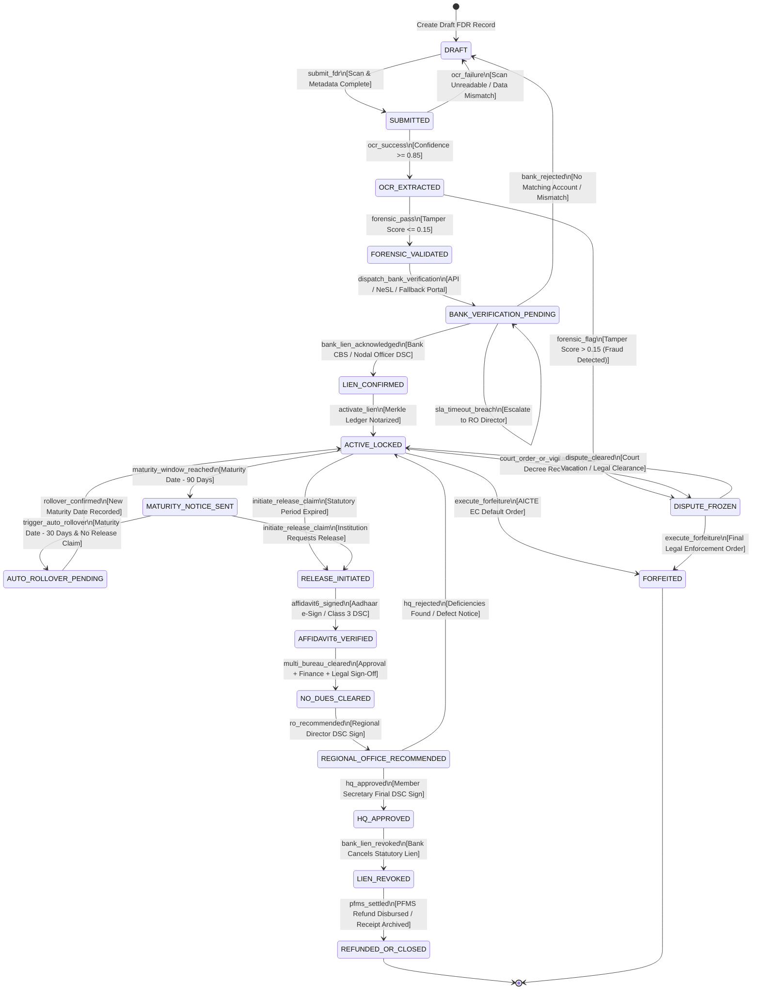
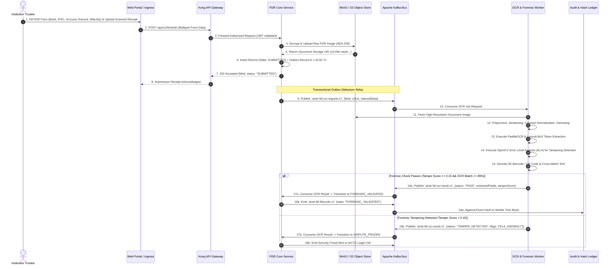
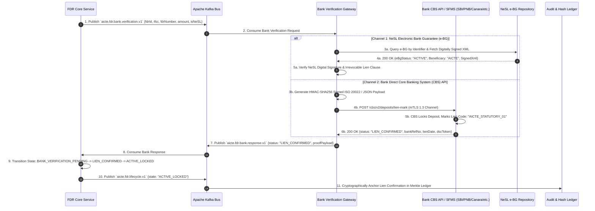
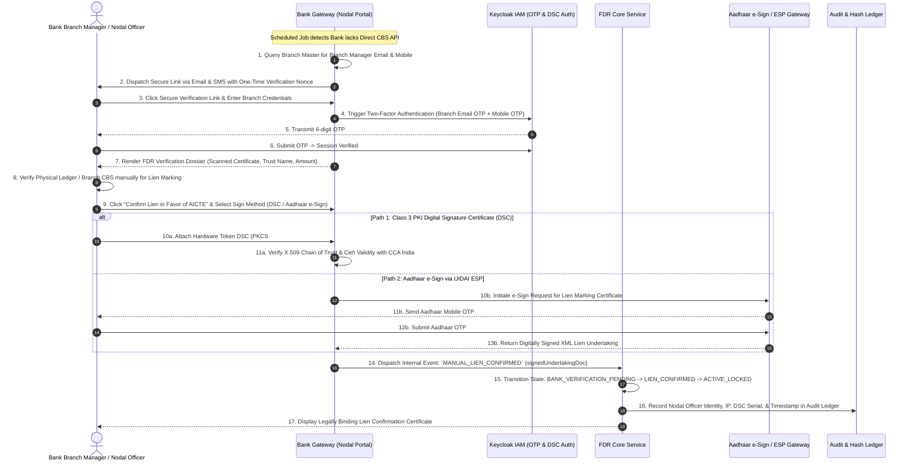
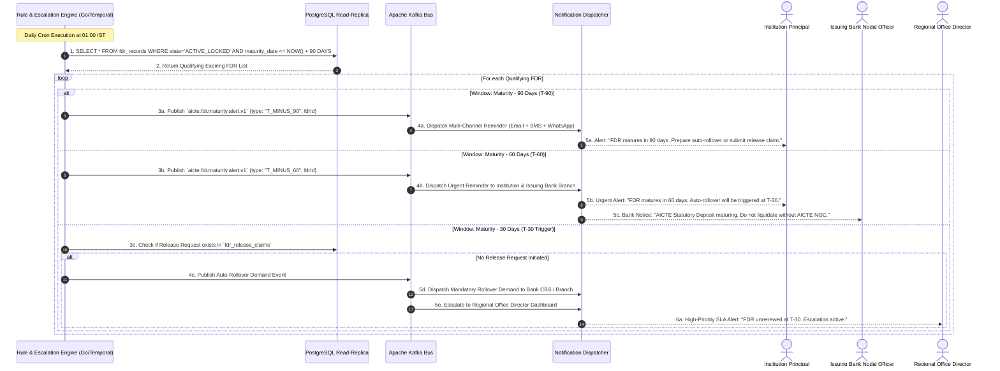
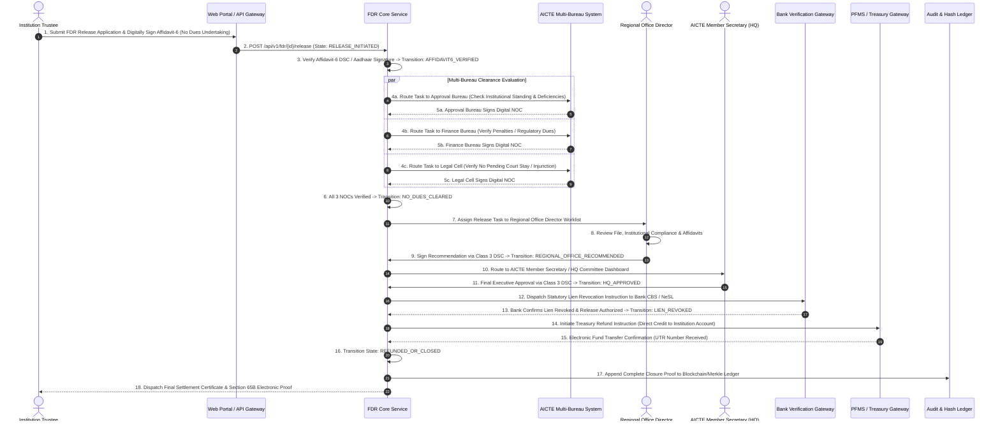
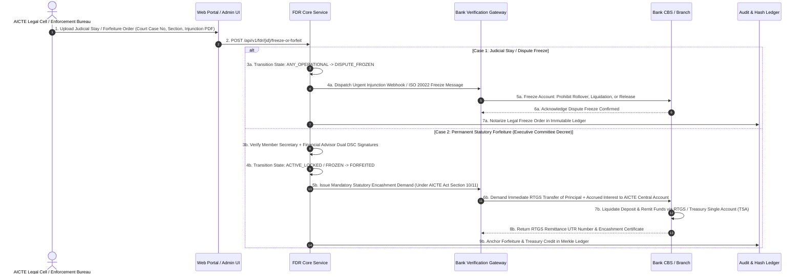

# AICTE Security Deposit & FDR Smart Portal (SIH 26265)
# Low-Level Design & State Machines Specification (03_LOW_LEVEL_DESIGN_AND_STATE_MACHINES)

---

## Document Metadata
- **Project**: Streamline of Security Deposit / FDR Portal for AICTE
- **Problem Statement ID**: SIH 26265
- **Document Type**: Low-Level System Design & State Machine Specification
- **Version**: 2.4.0-PROD
- **Status**: Approved for Implementation
- **Classification**: Official Technical Architecture

---

## Table of Contents
1. [Exhaustive FDR Lifecycle Finite State Machine (FSM)](#1-exhaustive-fdr-lifecycle-finite-state-machine-fsm)
   - 1.1 Complete 18-State Catalog & Taxonomy
   - 1.2 State Transition Matrix with Invariants, Guards, and Rollbacks
   - 1.3 Complete Mermaid State Diagram (stateDiagram-v2)
   - 1.4 State Invariant Proofs & Formal Consistency Guarantees
2. [End-to-End Core Sequence Diagrams](#2-end-to-end-core-sequence-diagrams)
   - 2.1 Flow A: Institution FDR Submission & Automated OCR/Forensic Validation Flow
   - 2.2 Flow B: Bank Direct API / NeSL e-BG Verification & Lien Marking Flow
   - 2.3 Flow C: Fallback Branch Nodal Officer Digital Signature Workflow
   - 2.4 Flow D: Automated 90-Day / 60-Day / 30-Day Maturity Tracking & Rollover Escalation Flow
   - 2.5 Flow E: FDR Release, Affidavit-6 Multi-Bureau Sign-Off & PFMS Refund Flow
   - 2.6 Flow F: Court Order / Dispute Freeze & Lien Forfeiture Execution Flow
3. [Service Interface Contracts (Protobuf / gRPC & DDL)](#3-service-interface-contracts-protobuf--grpc--ddl)
   - 3.1 FDR Core Service (`FdrService.proto`)
   - 3.2 Bank Verification Gateway Service (`BankGatewayService.proto`)
   - 3.3 OCR & Fraud Forensics Service (`OcrValidationService.proto`)
   - 3.4 Audit & Hash Ledger Service (`AuditLedgerService.proto`)
   - 3.5 Relational Data Schema (PostgreSQL 16 Production DDL)

---

## 1. Exhaustive FDR Lifecycle Finite State Machine (FSM)

### 1.1 Complete 18-State Catalog & Taxonomy

The FDR lifecycle is modeled as a deterministic, non-bypassable Finite State Machine consisting of exactly 18 distinct states. Every state enforces rigorous cryptographic invariants and operational entry/exit conditions.

```
+------------------------------------------------------------------------------------------------------------------+
|                                           18-STATE LIFECYCLE TAXONOMY                                            |
+----+--------------------------------+--------------------+-------------------------------------------------------+
| #  | State Identifier               | Category           | Functional Semantics                                  |
+----+--------------------------------+--------------------+-------------------------------------------------------+
| 01 | DRAFT                          | Ingestion          | Institution staging draft metadata & uploading scan.  |
| 02 | SUBMITTED                      | Ingestion          | Institution locked submission; queued for OCR.       |
| 03 | OCR_EXTRACTED                  | Inspection         | OCR worker extracted tokens & layout metadata.        |
| 04 | FORENSIC_VALIDATED             | Inspection         | Image forensic analysis passed (ELA, font, tamper).   |
| 05 | BANK_VERIFICATION_PENDING      | Verification       | Dispatched to Bank API / NeSL / Branch Nodal Portal.  |
| 06 | LIEN_CONFIRMED                 | Verification       | Bank / NeSL confirms irrevocable statutory lien.      |
| 07 | ACTIVE_LOCKED                  | Active Lock        | Deposit active, verified, liened in favor of AICTE.   |
| 08 | MATURITY_NOTICE_SENT           | Servicing          | T-90/60/30 day notice sent to Institution & Bank.     |
| 09 | AUTO_ROLLOVER_PENDING          | Servicing          | Rollover instruction dispatched; awaiting renewed FDR.|
| 10 | RELEASE_INITIATED              | Release / Refund   | Institution initiated deposit release claim.          |
| 11 | AFFIDAVIT6_VERIFIED            | Release / Refund   | Digital Affidavit-6 verified via Aadhaar/DSC.         |
| 12 | NO_DUES_CLEARED                | Release / Refund   | Approval, Finance, and Legal bureaus clear no dues.   |
| 13 | REGIONAL_OFFICE_RECOMMENDED    | Release / Refund   | Regional Officer signs off recommendation to HQ.      |
| 14 | HQ_APPROVED                    | Release / Refund   | AICTE Member Secretary / HQ Committee final approval. |
| 15 | LIEN_REVOKED                   | Release / Refund   | Statutory lien revocation notice issued to Bank.      |
| 16 | REFUNDED_OR_CLOSED             | Terminal Final     | Deposit released to trust or settled via PFMS.        |
| 17 | DISPUTE_FROZEN                 | Enforcement Lock   | Frozen by Court / Legal Cell / CBI / Vigilance order. |
| 18 | FORFEITED                      | Terminal Final     | Statutory encashment executed; credited to AICTE.     |
+----+--------------------------------+--------------------+-------------------------------------------------------+
```

---

### 1.2 State Transition Matrix with Invariants, Guards, and Rollbacks

```
+--------------------------------------------------------------------------------------------------------------------------------------------------------------+
|                                                      FDR STATE MACHINE TRANSITION SPECIFICATION                                                              |
+----+-----------------------------+----------------------------+---------------------------------------+-----------------------------+------------------------+
| ID | Source State                | Trigger Event              | Guard Invariant / Precondition        | Target State                | Action / Side-Effect   |
+----+-----------------------------+----------------------------+---------------------------------------+-----------------------------+------------------------+
| T01| DRAFT                       | INST_SUBMIT_EVENT          | PDF scan present, valid SHA256, IFSC  | SUBMITTED                   | Outbox to Kafka OCR    |
| T02| SUBMITTED                   | OCR_SUCCESS_EVENT          | OCR Confidence >= 0.85, Fields Match  | OCR_EXTRACTED               | Spawn ELA Forensics    |
| T03| SUBMITTED                   | OCR_FAILURE_EVENT          | Unreadable scan or field mismatch     | DRAFT (Rollback)            | Notify Institution     |
| T04| OCR_EXTRACTED               | FORENSIC_PASS_EVENT        | Tamper Score <= 0.15, ELA clean       | FORENSIC_VALIDATED          | Trigger Bank Gateway   |
| T05| OCR_EXTRACTED               | FORENSIC_FLAG_EVENT        | Tamper Score > 0.15 (Forged Scan)     | DISPUTE_FROZEN              | Legal Bureau Alert     |
| T06| FORENSIC_VALIDATED          | BANK_DISPATCH_EVENT        | Route determined (API/NeSL/Nodal)     | BANK_VERIFICATION_PENDING   | Dispatches Bank Job    |
| T07| BANK_VERIFICATION_PENDING   | BANK_LIEN_ACK_EVENT        | Bank DSC/mTLS Confirmation Valid      | LIEN_CONFIRMED              | Notarize to Ledger     |
| T08| BANK_VERIFICATION_PENDING   | BANK_REJECT_EVENT          | Bank rejects (No deposit/wrong joint) | DRAFT (Rollback)            | Rejection Alert to Inst|
| T09| BANK_VERIFICATION_PENDING   | BANK_TIMEOUT_48H_EVENT     | SLA timeout breached without response | BANK_VERIFICATION_PENDING   | Escalate to RO Officer |
| T10| LIEN_CONFIRMED              | SYSTEM_ACTIVATE_EVENT      | Ledger block notarized, lien active   | ACTIVE_LOCKED               | Seal in Vault          |
| T11| ACTIVE_LOCKED               | MATURITY_WINDOW_T90_EVENT  | Current Date >= Maturity - 90 Days    | MATURITY_NOTICE_SENT        | Dispatch Multi-Channel |
| T12| MATURITY_NOTICE_SENT        | MATURITY_WINDOW_T30_EVENT  | No release initiated by T-30 Days     | AUTO_ROLLOVER_PENDING       | Trigger Bank Rollover  |
| T13| AUTO_ROLLOVER_PENDING       | ROLLOVER_CONFIRMED_EVENT   | Bank confirms renewal + 3/5 years     | ACTIVE_LOCKED               | Update Maturity & Hash |
| T14| ACTIVE_LOCKED               | RELEASE_CLAIM_EVENT        | Statutory tenure completed (e.g. 10y) | RELEASE_INITIATED           | Request Affidavit-6    |
| T15| MATURITY_NOTICE_SENT        | RELEASE_CLAIM_EVENT        | Statutory tenure completed            | RELEASE_INITIATED           | Request Affidavit-6    |
| T16| RELEASE_INITIATED           | AFFIDAVIT6_VERIFY_EVENT    | Aadhaar e-Sign / DSC Valid            | AFFIDAVIT6_VERIFIED         | Spawn Bureau Tasks     |
| T17| AFFIDAVIT6_VERIFIED         | ALL_BUREAU_NO_DUES_EVENT   | Approval, Finance, Legal sign-offs    | NO_DUES_CLEARED             | RO Queue Entry         |
| T18| NO_DUES_CLEARED             | RO_RECOMMEND_EVENT         | Regional Officer DSC Signature        | REGIONAL_OFFICE_RECOMMENDED | AICTE HQ Queue Entry   |
| T19| REGIONAL_OFFICE_RECOMMENDED | HQ_APPROVE_EVENT           | Member Secretary DSC Signature        | HQ_APPROVED                 | Bank Revocation Job    |
| T20| REGIONAL_OFFICE_RECOMMENDED | HQ_REJECT_EVENT            | AICTE HQ Defect Notice Issued         | ACTIVE_LOCKED (Rollback)    | Defect Letter Sent     |
| T21| HQ_APPROVED                 | BANK_LIEN_REVOKE_EVENT     | Bank confirms lien canceled           | LIEN_REVOKED                | PFMS Settlement Job    |
| T22| LIEN_REVOKED                | PFMS_SETTLEMENT_EVENT      | UTR generated, funds settled          | REFUNDED_OR_CLOSED          | Archive Case Record    |
| T23| ANY_OPERATIONAL_STATE       | COURT_ORDER_FREEZE_EVENT   | Legal decree, Vigilance notice        | DISPUTE_FROZEN              | Stop All Transactions  |
| T24| DISPUTE_FROZEN              | DISPUTE_RESOLVED_EVENT     | Court vacation order, Legal NOC       | ACTIVE_LOCKED (Rollback)    | Resume Status           |
| T25| ACTIVE_LOCKED / FROZEN      | ENFORCE_FORFEITURE_EVENT   | AICTE EC Decree of Default            | FORFEITED                   | Direct Bank Encashment |
+----+-----------------------------+----------------------------+---------------------------------------+-----------------------------+------------------------+
```

---

### 1.3 Complete Mermaid State Diagram (stateDiagram-v2)



---

### 1.4 State Invariant Proofs & Formal Consistency Guarantees

#### Invariant 1: The Non-Bypassable Lien Invariant
$$\forall \text{fdr} \in \text{FDRs}, \quad \text{state}(\text{fdr}) = \text{ACTIVE\_LOCKED} \implies \exists \, \sigma_{\text{bank}} \text{ s.t. } \text{VerifyBankSignature}(\sigma_{\text{bank}}, \text{fdr}) = \text{TRUE}$$
*Proof*: In the FSM transition table, the only transition entering `ACTIVE_LOCKED` from ingestion is `T10`, whose source state is `LIEN_CONFIRMED`. `LIEN_CONFIRMED` can only be reached via `T07` (`BANK_LIEN_ACK_EVENT`), which requires a valid cryptographic signature $\sigma_{\text{bank}}$ or mTLS payload verified against the Bank Master Public Key Registry. Therefore, an un-liened deposit can never enter `ACTIVE_LOCKED`.

#### Invariant 2: Multi-Bureau Clearance Invariant
$$\forall \text{fdr} \in \text{FDRs}, \quad \text{state}(\text{fdr}) = \text{HQ\_APPROVED} \implies \big(\text{ApprovalCleared} \land \text{FinanceCleared} \land \text{LegalCleared} \land \text{ROSigned}\big)$$
*Proof*: `HQ_APPROVED` can only be transitioned from `REGIONAL_OFFICE_RECOMMENDED` (`T19`). `REGIONAL_OFFICE_RECOMMENDED` requires `NO_DUES_CLEARED` (`T18`), which strictly requires the conjunction of digital clearances from Approval, Finance, and Legal bureaus (`T17`). Thus, no single bureau or officer can unilaterally approve an FDR release.

#### Invariant 3: Universal Freeze Invariant
$$\forall s \in \text{OperationalStates}, \quad \delta(s, \text{COURT\_ORDER\_FREEZE\_EVENT}) = \text{DISPUTE\_FROZEN}$$
Any ongoing release, auto-rollover, or modification is immediately halted upon receipt of a judicial or vigilance injunction.

---

## 2. End-to-End Core Sequence Diagrams

### 2.1 Flow A: Institution FDR Submission & Automated OCR/Forensic Validation Flow



---

### 2.2 Flow B: Bank Direct API / NeSL e-BG Verification & Lien Marking Flow



---

### 2.3 Flow C: Fallback Branch Nodal Officer Digital Signature Workflow

When an issuing bank branch lacks automated CBS API integration, the system automatically routes the verification task to the certified Branch Nodal Officer portal.



---

### 2.4 Flow D: Automated 90-Day / 60-Day / 30-Day Maturity Tracking & Rollover Escalation Flow



---

### 2.5 Flow E: FDR Release, Affidavit-6 Multi-Bureau Sign-Off & PFMS Refund Flow



---

### 2.6 Flow F: Court Order / Dispute Freeze & Lien Forfeiture Execution Flow



---

## 3. Service Interface Contracts (Protobuf / gRPC & DDL)

### 3.1 FDR Core Service (`FdrService.proto`)

```protobuf
syntax = "proto3";

package gov.aicte.fdr.v1;

option go_package = "gov.aicte.fdr.v1;fdrv1";
option java_multiple_files = true;
option java_package = "gov.aicte.fdr.v1";

service FdrService {
  // Institution Draft & Submission
  rpc CreateFdrDraft (CreateFdrDraftRequest) returns (CreateFdrDraftResponse);
  rpc SubmitFdr (SubmitFdrRequest) returns (SubmitFdrResponse);
  rpc GetFdrById (GetFdrByIdRequest) returns (FdrRecordResponse);

  // Administrative & State Transitions
  rpc InitiateRelease (InitiateReleaseRequest) returns (InitiateReleaseResponse);
  rpc SubmitBureauClearance (BureauClearanceRequest) returns (BureauClearanceResponse);
  rpc ApproveByRegionalOffice (ROApprovalRequest) returns (StateTransitionResponse);
  rpc FinalApproveByHq (HQApprovalRequest) returns (StateTransitionResponse);

  // Enforcement Operations
  rpc FreezeFdrByCourtOrder (FreezeFdrRequest) returns (StateTransitionResponse);
  rpc ExecuteForfeiture (ForfeitureRequest) returns (StateTransitionResponse);
}

enum FdrState {
  STATE_UNSPECIFIED = 0;
  DRAFT = 1;
  SUBMITTED = 2;
  OCR_EXTRACTED = 3;
  FORENSIC_VALIDATED = 4;
  BANK_VERIFICATION_PENDING = 5;
  LIEN_CONFIRMED = 6;
  ACTIVE_LOCKED = 7;
  MATURITY_NOTICE_SENT = 8;
  AUTO_ROLLOVER_PENDING = 9;
  RELEASE_INITIATED = 10;
  AFFIDAVIT6_VERIFIED = 11;
  NO_DUES_CLEARED = 12;
  REGIONAL_OFFICE_RECOMMENDED = 13;
  HQ_APPROVED = 14;
  LIEN_REVOKED = 15;
  REFUNDED_OR_CLOSED = 16;
  DISPUTE_FROZEN = 17;
  FORFEITED = 18;
}

message CreateFdrDraftRequest {
  string institution_id = 1;
  string bank_ifsc = 2;
  string fdr_account_number = 3;
  double principal_amount_inr = 4;
  int64 maturity_date_epoch_ms = 5;
  string document_s3_uri = 6;
  string document_sha256 = 7;
}

message CreateFdrDraftResponse {
  string fdr_id = 1;
  FdrState state = 2;
  int64 created_at_ms = 3;
}

message SubmitFdrRequest {
  string fdr_id = 1;
  string institution_id = 2;
  string digital_signature_base64 = 3;
}

message SubmitFdrResponse {
  string fdr_id = 1;
  FdrState state = 2;
  string tracking_id = 3;
}

message GetFdrByIdRequest {
  string fdr_id = 1;
}

message FdrRecordResponse {
  string fdr_id = 1;
  string institution_id = 2;
  string bank_name = 3;
  string bank_ifsc = 4;
  string fdr_account_number = 5;
  double principal_amount_inr = 6;
  int64 maturity_date_epoch_ms = 7;
  FdrState state = 8;
  string current_lien_reference = 9;
  int64 last_state_change_ms = 10;
}

message InitiateReleaseRequest {
  string fdr_id = 1;
  string institution_id = 2;
  string affidavit6_s3_uri = 3;
  string affidavit6_signature_base64 = 4; // Aadhaar e-Sign / Class 3 DSC
}

message InitiateReleaseResponse {
  string fdr_id = 1;
  FdrState state = 2;
  string release_claim_id = 3;
}

enum BureauType {
  BUREAU_UNSPECIFIED = 0;
  APPROVAL_BUREAU = 1;
  FINANCE_BUREAU = 2;
  LEGAL_CELL = 3;
}

message BureauClearanceRequest {
  string fdr_id = 1;
  BureauType bureau = 2;
  bool is_cleared = 3;
  string remarks = 4;
  string officer_dsc_signature = 5;
}

message BureauClearanceResponse {
  string fdr_id = 1;
  bool all_bureaus_cleared = 2;
  FdrState current_state = 3;
}

message ROApprovalRequest {
  string fdr_id = 1;
  string regional_office_code = 2; // e.g. NWRO, SWRO
  string officer_user_id = 3;
  string recommendation_notes = 4;
  string officer_dsc_signature = 5;
}

message HQApprovalRequest {
  string fdr_id = 1;
  string hq_officer_id = 2;
  string executive_order_ref = 3;
  string member_secretary_dsc_signature = 4;
}

message FreezeFdrRequest {
  string fdr_id = 1;
  string legal_case_number = 2;
  string issuing_authority = 3; // e.g., High Court of Delhi, CBI
  string court_order_s3_uri = 4;
  string legal_officer_dsc_signature = 5;
}

message ForfeitureRequest {
  string fdr_id = 1;
  string executive_committee_resolution_no = 2;
  string forfeiture_reason = 3;
  string member_secretary_dsc = 4;
  string finance_advisor_dsc = 5;
}

message StateTransitionResponse {
  string fdr_id = 1;
  FdrState previous_state = 2;
  FdrState new_state = 3;
  int64 timestamp_ms = 4;
  string state_payload_hash = 5;
}
```

---

### 3.2 Bank Verification Gateway Service (`BankGatewayService.proto`)

```protobuf
syntax = "proto3";

package gov.aicte.fdr.bank.v1;

option go_package = "gov.aicte.fdr.bank.v1;bankv1";
option java_multiple_files = true;
option java_package = "gov.aicte.fdr.bank.v1";

service BankGatewayService {
  rpc DispatchVerification (BankVerifyRequest) returns (BankVerifyResponse);
  rpc IngestBankWebhook (BankWebhookPayload) returns (BankWebhookAck);
  rpc QueryDepositStatus (DepositStatusQuery) returns (DepositStatusReport);
  rpc DispatchLienRevocation (LienRevocationRequest) returns (LienRevocationResponse);
  rpc DispatchEncashmentDemand (EncashmentDemandRequest) returns (EncashmentDemandResponse);
}

enum VerificationChannel {
  CHANNEL_UNSPECIFIED = 0;
  DIRECT_CBS_API = 1;
  NESL_EBG = 2;
  FALLBACK_BRANCH_NODAL = 3;
}

message BankVerifyRequest {
  string fdr_id = 1;
  string bank_ifsc = 2;
  string fdr_account_number = 3;
  double principal_amount = 4;
  string beneficiary_name = 5; // Must match "AICTE and [Institution Name]"
  VerificationChannel preferred_channel = 6;
}

message BankVerifyResponse {
  string fdr_id = 1;
  bool request_dispatched = 2;
  string bank_transaction_ref = 3;
  string status_message = 4;
}

message BankWebhookPayload {
  string bank_code = 1;
  string fdr_account_number = 2;
  string bank_reference_number = 3;
  string lien_status = 4; // CONFIRMED, REJECTED, ROLLED_OVER
  int64 confirmation_timestamp_ms = 5;
  string signature_proof = 6;
  string hmac_sha256 = 7;
}

message BankWebhookAck {
  bool accepted = 1;
  string ack_reference = 2;
}

message DepositStatusQuery {
  string fdr_id = 1;
  string bank_ifsc = 2;
  string fdr_account_number = 3;
}

message DepositStatusReport {
  string fdr_account_number = 1;
  bool is_lien_marked_aicte = 2;
  double current_balance = 3;
  int64 current_maturity_epoch_ms = 4;
  string lien_reference_code = 5;
}

message LienRevocationRequest {
  string fdr_id = 1;
  string bank_ifsc = 2;
  string fdr_account_number = 3;
  string hq_release_order_ref = 4;
  string aicte_dsc_signature = 5;
}

message LienRevocationResponse {
  string fdr_id = 1;
  bool lien_revocation_confirmed = 2;
  string bank_cancellation_ref = 3;
}

message EncashmentDemandRequest {
  string fdr_id = 1;
  string bank_ifsc = 2;
  string fdr_account_number = 3;
  string forfeiture_order_ref = 4;
  string aicte_credit_account_no = 5;
  string aicte_credit_ifsc = 6;
  string executive_signature_base64 = 7;
}

message EncashmentDemandResponse {
  string fdr_id = 1;
  bool encashment_processed = 2;
  string rtgs_utr_number = 3;
  double remitted_amount = 4;
}
```

---

### 3.3 OCR & Fraud Forensics Service (`OcrValidationService.proto`)

```protobuf
syntax = "proto3";

package gov.aicte.fdr.ocr.v1;

option go_package = "gov.aicte.fdr.ocr.v1;ocrv1";
option java_multiple_files = true;
option java_package = "gov.aicte.fdr.ocr.v1";

service OcrValidationService {
  rpc ProcessDocument (OcrProcessRequest) returns (OcrProcessResponse);
}

message OcrProcessRequest {
  string fdr_id = 1;
  string document_s3_uri = 2;
  string expected_bank_ifsc = 3;
  string expected_account_number = 4;
  double expected_amount = 5;
}

message ExtractedFdrFields {
  string detected_bank_name = 1;
  string detected_branch_ifsc = 2;
  string detected_fdr_number = 3;
  double detected_principal_amount = 4;
  string detected_joint_holder_name = 5; // Must detect AICTE
  string detected_maturity_date = 6;
  float extraction_confidence = 7; // Range: 0.00 to 1.00
}

message ForensicAnomalyReport {
  float overall_tamper_score = 1; // Range: 0.00 (Clean) to 1.00 (Fraud)
  bool ela_anomaly_detected = 2;   // Error Level Analysis compression variance
  bool font_inconsistency_flag = 3;
  bool metadata_manipulation_flag = 4;
  bool qr_payload_match = 5;
  repeated string anomaly_tags = 6;
}

message OcrProcessResponse {
  string fdr_id = 1;
  bool is_valid = 2;
  ExtractedFdrFields extracted_data = 3;
  ForensicAnomalyReport forensic_report = 4;
  string processing_duration_ms = 5;
}
```

---

### 3.4 Audit & Hash Ledger Service (`AuditLedgerService.proto`)

```protobuf
syntax = "proto3";

package gov.aicte.fdr.ledger.v1;

option go_package = "gov.aicte.fdr.ledger.v1;ledgerv1";
option java_multiple_files = true;
option java_package = "gov.aicte.fdr.ledger.v1";

service AuditLedgerService {
  rpc RecordEvent (RecordLedgerEventRequest) returns (RecordLedgerEventResponse);
  rpc GenerateInclusionProof (InclusionProofRequest) returns (InclusionProofResponse);
  rpc VerifyProof (VerifyProofRequest) returns (VerifyProofResponse);
  rpc GetSection65BCertificate (Section65BCertRequest) returns (Section65BCertResponse);
}

message RecordLedgerEventRequest {
  string event_id = 1;
  string aggregate_id = 2; // fdr_id
  string event_type = 3;
  string event_payload_json = 4;
  string actor_id = 5;
  int64 timestamp_epoch_ms = 6;
}

message RecordLedgerEventResponse {
  string event_id = 1;
  int64 block_number = 2;
  string leaf_hash = 3;
  string current_merkle_root = 4;
}

message InclusionProofRequest {
  string event_id = 1;
  int64 block_number = 2;
}

message InclusionProofResponse {
  string event_id = 1;
  int64 block_number = 2;
  string leaf_hash = 3;
  repeated string audit_path_hashes = 4;
  string block_merkle_root = 5;
  string rfc3161_timestamp_token = 6;
}

message VerifyProofRequest {
  string leaf_hash = 1;
  repeated string audit_path_hashes = 2;
  string block_merkle_root = 3;
}

message VerifyProofResponse {
  bool is_valid = 1;
  string verification_message = 2;
}

message Section65BCertRequest {
  string fdr_id = 1;
}

message Section65BCertResponse {
  string fdr_id = 1;
  string certificate_pdf_s3_uri = 2;
  string certificate_hash_sha256 = 3;
  int64 generated_at_epoch_ms = 4;
}
```

---

### 3.5 Relational Data Schema (PostgreSQL 16 Production DDL)

The following PostgreSQL 16 script creates the core database tables, foreign keys, check constraints, state machine invariants, and high-performance indexes.

```sql
-- PostgreSQL 16 DDL for AICTE Smart FDR Portal (SIH 26265)
-- Schema: public

CREATE EXTENSION IF NOT EXISTS "uuid-ossp";
CREATE EXTENSION IF NOT EXISTS "pgcrypto";

-- Table: Technical Institutions
CREATE TABLE institutions (
    institution_id VARCHAR(64) PRIMARY KEY, -- AICTE Permanent Institute ID
    institution_name VARCHAR(255) NOT NULL,
    trust_society_name VARCHAR(255) NOT NULL,
    regional_office_code VARCHAR(16) NOT NULL, -- e.g., NWRO, CRO, SWRO
    state_code VARCHAR(4) NOT NULL,
    authorized_signatory_name VARCHAR(128) NOT NULL,
    authorized_email VARCHAR(128) NOT NULL,
    authorized_mobile VARCHAR(15) NOT NULL,
    is_active BOOLEAN NOT NULL DEFAULT TRUE,
    created_at TIMESTAMP WITH TIME ZONE NOT NULL DEFAULT NOW(),
    updated_at TIMESTAMP WITH TIME ZONE NOT NULL DEFAULT NOW()
);

-- Table: Bank Master
CREATE TABLE bank_master (
    bank_code VARCHAR(32) PRIMARY KEY, -- e.g., SBI, PNB, CANARA
    bank_name VARCHAR(128) NOT NULL,
    cbs_integration_type VARCHAR(32) NOT NULL CHECK (cbs_integration_type IN ('API', 'NESL', 'FALLBACK_NODAL')),
    api_endpoint_url VARCHAR(255),
    api_public_cert_pem TEXT,
    is_active BOOLEAN NOT NULL DEFAULT TRUE
);

-- Table: Bank Branches
CREATE TABLE bank_branches (
    ifsc_code VARCHAR(11) PRIMARY KEY,
    bank_code VARCHAR(32) NOT NULL REFERENCES bank_master(bank_code),
    branch_name VARCHAR(128) NOT NULL,
    nodal_officer_name VARCHAR(128),
    nodal_officer_email VARCHAR(128),
    nodal_officer_mobile VARCHAR(15),
    branch_address TEXT,
    created_at TIMESTAMP WITH TIME ZONE NOT NULL DEFAULT NOW()
);

-- Table: FDR Main Aggregate
CREATE TABLE fdr_records (
    fdr_id UUID PRIMARY KEY DEFAULT gen_random_uuid(),
    institution_id VARCHAR(64) NOT NULL REFERENCES institutions(institution_id),
    ifsc_code VARCHAR(11) NOT NULL REFERENCES bank_branches(ifsc_code),
    fdr_account_number VARCHAR(64) NOT NULL,
    principal_amount_inr NUMERIC(15, 2) NOT NULL CHECK (principal_amount_inr > 0),
    interest_rate_percentage NUMERIC(5, 2),
    deposit_date DATE NOT NULL,
    maturity_date DATE NOT NULL,
    joint_holder_name VARCHAR(128) NOT NULL DEFAULT 'AICTE',
    
    -- Finite State Machine Tracking
    current_state VARCHAR(32) NOT NULL CHECK (current_state IN (
        'DRAFT', 'SUBMITTED', 'OCR_EXTRACTED', 'FORENSIC_VALIDATED', 
        'BANK_VERIFICATION_PENDING', 'LIEN_CONFIRMED', 'ACTIVE_LOCKED', 
        'MATURITY_NOTICE_SENT', 'AUTO_ROLLOVER_PENDING', 'RELEASE_INITIATED', 
        'AFFIDAVIT6_VERIFIED', 'NO_DUES_CLEARED', 'REGIONAL_OFFICE_RECOMMENDED', 
        'HQ_APPROVED', 'LIEN_REVOKED', 'REFUNDED_OR_CLOSED', 
        'DISPUTE_FROZEN', 'FORFEITED'
    )),
    
    document_s3_uri VARCHAR(512) NOT NULL,
    document_sha256 VARCHAR(64) NOT NULL,
    current_lien_reference VARCHAR(128),
    lock_version INTEGER NOT NULL DEFAULT 1, -- Optimistic concurrency control
    
    created_at TIMESTAMP WITH TIME ZONE NOT NULL DEFAULT NOW(),
    updated_at TIMESTAMP WITH TIME ZONE NOT NULL DEFAULT NOW(),
    
    CONSTRAINT uq_fdr_acc_per_bank UNIQUE (ifsc_code, fdr_account_number)
);

-- Table: FDR State Machine Transition Log (Append-Only)
CREATE TABLE fdr_state_history (
    history_id BIGSERIAL PRIMARY KEY,
    fdr_id UUID NOT NULL REFERENCES fdr_records(fdr_id) ON DELETE RESTRICT,
    from_state VARCHAR(32) NOT NULL,
    to_state VARCHAR(32) NOT NULL,
    actor_id VARCHAR(64) NOT NULL,
    actor_role VARCHAR(32) NOT NULL,
    digital_signature_blob TEXT,
    state_payload_hash VARCHAR(64) NOT NULL,
    transition_metadata JSONB,
    created_at TIMESTAMP WITH TIME ZONE NOT NULL DEFAULT NOW()
);

-- Table: OCR and Forensics Audit Results
CREATE TABLE forensic_audit_logs (
    audit_id UUID PRIMARY KEY DEFAULT gen_random_uuid(),
    fdr_id UUID NOT NULL REFERENCES fdr_records(fdr_id) ON DELETE RESTRICT,
    ocr_confidence_score REAL NOT NULL,
    tamper_risk_score REAL NOT NULL, -- 0.00 to 1.00
    ela_anomaly_detected BOOLEAN NOT NULL DEFAULT FALSE,
    font_anomaly_detected BOOLEAN NOT NULL DEFAULT FALSE,
    extracted_fields JSONB NOT NULL,
    analyzed_image_hash VARCHAR(64) NOT NULL,
    created_at TIMESTAMP WITH TIME ZONE NOT NULL DEFAULT NOW()
);

-- Table: Bureau Clearances for Release
CREATE TABLE fdr_bureau_clearances (
    clearance_id UUID PRIMARY KEY DEFAULT gen_random_uuid(),
    fdr_id UUID NOT NULL REFERENCES fdr_records(fdr_id) ON DELETE RESTRICT,
    bureau_type VARCHAR(32) NOT NULL CHECK (bureau_type IN ('APPROVAL_BUREAU', 'FINANCE_BUREAU', 'LEGAL_CELL')),
    officer_user_id VARCHAR(64) NOT NULL,
    is_cleared BOOLEAN NOT NULL,
    remarks TEXT,
    officer_dsc_signature TEXT NOT NULL,
    cleared_at TIMESTAMP WITH TIME ZONE NOT NULL DEFAULT NOW(),
    
    CONSTRAINT uq_fdr_bureau UNIQUE (fdr_id, bureau_type)
);

-- Table: Merkle Hash Ledger Blocks (Cryptographic Non-Repudiation)
CREATE TABLE merkle_ledger_blocks (
    block_number BIGSERIAL PRIMARY KEY,
    previous_block_hash VARCHAR(64) NOT NULL,
    merkle_root_hash VARCHAR(64) NOT NULL,
    leaf_count INTEGER NOT NULL,
    rfc3161_timestamp_token TEXT,
    block_sealed_at TIMESTAMP WITH TIME ZONE NOT NULL DEFAULT NOW()
);

-- Table: Transactional Outbox (Guaranteed Delivery to Kafka)
CREATE TABLE transactional_outbox (
    outbox_id UUID PRIMARY KEY DEFAULT gen_random_uuid(),
    aggregate_type VARCHAR(64) NOT NULL,
    aggregate_id VARCHAR(64) NOT NULL,
    event_type VARCHAR(64) NOT NULL,
    payload JSONB NOT NULL,
    headers JSONB,
    created_at TIMESTAMP WITH TIME ZONE NOT NULL DEFAULT NOW(),
    dispatched_at TIMESTAMP WITH TIME ZONE
);

-- High-Performance Indexes
CREATE INDEX idx_fdr_records_state_maturity ON fdr_records(current_state, maturity_date);
CREATE INDEX idx_fdr_records_inst ON fdr_records(institution_id);
CREATE INDEX idx_fdr_history_fdr_id ON fdr_state_history(fdr_id);
CREATE INDEX idx_outbox_undispatched ON transactional_outbox(created_at) WHERE dispatched_at IS NULL;
CREATE INDEX idx_branches_bank ON bank_branches(bank_code);
```

---

*End of Document 03_LOW_LEVEL_DESIGN_AND_STATE_MACHINES.md*
