# AICTE Smart FDR & Security Deposit Management Portal
## Technical Data Dictionary & Database Architecture Specification

**System:** All India Council for Technical Education (AICTE) Fixed Deposit Receipt (FDR) & Security Deposit Management System  
**SIH Problem Statement:** 26265 ("Streamline of security deposit / FDR portal")  
**Target RDBMS:** PostgreSQL 16.x Enterprise  
**Author:** Principal Data & Database Architect  
**Classification:** Confidential / Government Internal  
**Version:** 1.0.0  

---

## 1. Executive Summary & Architectural Overview

The AICTE Security Deposit / FDR Portal serves as the national system of record for managing billions of rupees in statutory fixed deposits pledged jointly to AICTE by technical institutions across India. Under the AICTE Approval Process Handbook (APH), technical and polytechnic institutes must maintain long-term security deposits (typically 8 to 10 years) in joint accounts with the Regional Officer of AICTE as collateral against non-compliance, abrupt closure, student fee fraud, or faculty salary default.

### Key Architectural Tenets
1. **Zero-Trust Relational Integrity:** Enforced at the RDBMS level through composite unique keys, check constraints matching RBI and statutory formats (IFSC, PAN, GSTIN), and strict foreign key cascading rules.
2. **Cryptographic Tamper-Evidence:** An append-only audit ledger utilizing continuous SHA-256 hash chaining (Merkle-Damgård construction) with PostgreSQL transactional advisory locking to prevent chain bifurcations or concurrent collision.
3. **Automated Forensic Fraud Detection:** Stored generated columns calculating fraud flags based on ML-driven optical character recognition (OCR) and document tamper scores.
4. **Partitioned Lifecycle Scalability:** Monthly RANGE partitioning of high-volume audit logs to guarantee sub-millisecond query performance, partition pruning, and automated archival.
5. **Multi-Tenancy & Row-Level Security (RLS):** Strict policy-based isolation ensuring institutions access only their deposits, bank nodal officers view only their branch escrows, and AICTE officers operate within their regional jurisdictions.

---

## 2. Entity-Relationship (ER) Architecture Diagram

```mermaid
erDiagram
    INSTITUTIONS ||--o{ FDRS : "pledges"
    BANKS ||--o{ BANK_BRANCHES : "operates"
    BANK_BRANCHES ||--o{ FDRS : "issues and holds"
    FDRS ||--o{ FDR_DOCUMENTS : "contains"
    FDRS ||--o{ LIEN_RECORDS : "encumbered by"
    FDR_DOCUMENTS ||--o| LIEN_RECORDS : "proves lien"
    FDRS ||--o{ MATURITY_ALERTS : "schedules alerts"
    FDRS ||--o{ RELEASE_REQUESTS : "initiates release"
    FDR_DOCUMENTS ||--o| RELEASE_REQUESTS : "supplies Affidavit 6"
    FDR_DOCUMENTS ||--o| RELEASE_REQUESTS : "supplies State NOC"
    FDR_DOCUMENTS ||--o| RELEASE_REQUESTS : "supplies Faculty NOC"
    FDRS ||--o| FDRS : "rollover lineage"

    INSTITUTIONS {
        uuid id PK
        varchar aicte_permanent_id UK
        varchar name
        institution_type institution_type
        varchar trust_society_name
        varchar state
        varchar regional_office_id
        varchar pan
        varchar gstin
        jsonb contact_details
        boolean is_active
        timestamptz created_at
        timestamptz updated_at
    }

    BANKS {
        uuid id PK
        varchar bank_name UK
        varchar bank_code UK
        varchar ifsc_prefix
        bank_tier bank_tier
        boolean api_enabled
        varchar cbs_gateway_url
        boolean is_scheduled_bank
        boolean active
        timestamptz created_at
        timestamptz updated_at
    }

    BANK_BRANCHES {
        uuid id PK
        uuid bank_id FK
        varchar ifsc_code UK
        varchar branch_name
        text branch_address
        varchar nodal_officer_email
        varchar nodal_officer_mobile
        boolean is_sftp_enabled
        timestamptz created_at
        timestamptz updated_at
    }

    FDRS {
        uuid id PK
        uuid institution_id FK
        uuid bank_branch_id FK
        varchar fdr_number
        numeric principal_amount
        numeric interest_rate
        date issue_date
        date maturity_date
        integer lock_in_years
        fdr_status status
        lien_status lien_status
        varchar joint_holder_name
        boolean auto_renewal_flag
        numeric current_balance
        numeric maturity_amount
        integer renewal_count
        uuid parent_fdr_id FK
        timestamptz created_at
        timestamptz updated_at
    }

    FDR_DOCUMENTS {
        uuid id PK
        uuid fdr_id FK
        document_type document_type
        varchar s3_key UK
        varchar file_hash_sha256
        varchar mime_type
        bigint file_size
        jsonb ocr_extracted_payload
        float forensic_tamper_score
        boolean is_tampered
        timestamptz verified_at
        uuid verified_by
        timestamptz created_at
    }

    LIEN_RECORDS {
        uuid id PK
        uuid fdr_id FK
        varchar lien_reference_number UK
        timestamptz lien_marked_date
        timestamptz lien_revoked_date
        lien_status lien_status
        uuid bank_acknowledgement_doc_id FK
        varchar nesl_transaction_id UK
        text remarks
        timestamptz created_at
        timestamptz updated_at
    }

    MATURITY_ALERTS {
        uuid id PK
        uuid fdr_id FK
        varchar alert_type
        date trigger_date
        varchar target_recipient
        alert_channel channel
        alert_dispatch_status dispatch_status
        escalation_level escalation_level
        timestamptz dispatch_timestamp
        integer retry_count
        text failure_reason
        timestamptz acknowledged_at
        uuid acknowledged_by
        timestamptz created_at
    }

    RELEASE_REQUESTS {
        uuid id PK
        uuid fdr_id FK
        varchar request_number UK
        text reason
        uuid affidavit6_doc_id FK
        uuid no_dues_state_dte_doc_id FK
        uuid no_dues_faculty_doc_id FK
        approval_status regional_office_status
        text regional_office_remarks
        uuid regional_officer_id
        timestamptz regional_office_action_at
        approval_status hq_finance_status
        text hq_finance_remarks
        uuid hq_finance_officer_id
        timestamptz hq_finance_action_at
        approval_status member_secretary_status
        text member_secretary_remarks
        uuid member_secretary_id
        timestamptz member_secretary_action_at
        varchar pfms_payment_ref
        numeric amount_approved
        fdr_status status
        timestamptz created_at
        timestamptz updated_at
    }

    AUDIT_LEDGER {
        bigint id PK
        timestamptz created_at PK
        varchar entity_type
        uuid entity_id
        audit_action action
        uuid actor_id
        varchar actor_role
        inet ip_address
        text user_agent
        jsonb state_before
        jsonb state_after
        varchar prev_record_hash
        varchar current_hash
        text signature
    }
```



---

## 3. Enumeration Specifications

| Enum Type | Allowed Values | Statutory & Technical Description |
| :--- | :--- | :--- |
| `institution_type` | `CENTRAL_UNIVERSITY`<br>`STATE_UNIVERSITY`<br>`DEEMED_UNIVERSITY`<br>`GOVERNMENT`<br>`GOVERNMENT_AIDED`<br>`SELF_FINANCED_PRIVATE`<br>`STANDALONE_INSTITUTE` | Legal classification of technical education provider under AICTE Act 1987. Governs statutory deposit thresholds. |
| `bank_tier` | `PUBLIC_SECTOR_SCHEDULED`<br>`PRIVATE_SCHEDULED`<br>`FOREIGN_SCHEDULED`<br>`REGIONAL_RURAL`<br>`NON_SCHEDULED` | RBI Banking Regulation Act classification. Deposits are only permitted in Scheduled Commercial Banks. |
| `fdr_status` | `DRAFT`<br>`SUBMITTED`<br>`OCR_EXTRACTED`<br>`FORENSIC_VALIDATED`<br>`PENDING_BANK_VERIFICATION`<br>`BANK_VERIFICATION_PENDING`<br>`LIEN_CONFIRMED`<br>`ACTIVE`<br>`ACTIVE_LOCKED`<br>`MATURED`<br>`MATURITY_NOTICE_SENT`<br>`RENEWAL_REQUESTED`<br>`ROLLOVER_IN_PROGRESS`<br>`AUTO_ROLLOVER_PENDING`<br>`RELEASE_REQUESTED`<br>`RELEASE_INITIATED`<br>`AFFIDAVIT6_VERIFIED`<br>`NO_DUES_CLEARED`<br>`REGIONAL_OFFICE_RECOMMENDED`<br>`HQ_APPROVED`<br>`LIEN_REVOKED`<br>`RELEASED`<br>`REFUNDED_OR_CLOSED`<br>`DISPUTE_FROZEN`<br>`LIQUIDATED_BY_AICTE`<br>`FORFEITED`<br>`REJECTED` | Complete deterministic finite state machine lifecycle for fixed deposits (incorporating all 18 states from `03_LOW_LEVEL_DESIGN_AND_STATE_MACHINES.md`). Transitions strictly controlled by gateway triggers, cryptographic invariants, and dual officer sign-offs. |
| `lien_status` | `NOT_MARKED`<br>`LIEN_REQUESTED`<br>`LIEN_CONFIRMED`<br>`LIEN_REVOKED`<br>`LIEN_INVOKED` | Collateral legal encumbrance state. In `LIEN_CONFIRMED`, the bank cannot disburse funds to the institute without AICTE consent. |
| `document_type` | `FDR_RECEIPT`<br>`BANK_CONFIRMATION_LETTER`<br>`LIEN_ACKNOWLEDGEMENT`<br>`AFFIDAVIT_6`<br>`STATE_DTE_NO_OBJECTION`<br>`FACULTY_SALARY_CLEARANCE`<br>`COURT_ORDER`<br>`PFMS_DISBURSEMENT_ADVICE` | Statutory documents required across onboarding, audit, rollover, and release workflows. |
| `approval_status` | `PENDING`<br>`APPROVED`<br>`REJECTED`<br>`QUERY_RAISED`<br>`ESCALATED` | Workflow resolution states across Regional Officer, HQ Finance, and Member Secretary gates. |
| `escalation_level` | `L1_REGIONAL_OFFICE`<br>`L2_HQ_FINANCE`<br>`L3_ADVISER_APPROVAL`<br>`L4_MEMBER_SECRETARY` | AICTE administrative hierarchy tiers for maturity default and release reviews. |
| `audit_action` | `INSERT`<br>`UPDATE`<br>`DELETE`<br>`VERIFY_OCR`<br>`MARK_LIEN`<br>`REVOKE_LIEN`<br>`APPROVE_RELEASE`<br>`DISBURSE_PFMS`<br>`ROLLOVER_INITIATED`<br>`TAMPER_ALERT` | Granular event types logged to the immutable cryptographic audit ledger. |
| `alert_channel` | `EMAIL`<br>`SMS`<br>`WHATSAPP`<br>`PORTAL_DASHBOARD`<br>`API_WEBHOOK` | Communication transport used for time-sensitive notifications. |
| `alert_dispatch_status`| `PENDING`<br>`SENT`<br>`FAILED`<br>`ACKNOWLEDGED` | Delivery state tracking for maturity notifications. |

---

## 4. Comprehensive Data Dictionary Tables

### 4.1. Table: `institutions`
Master record of technical institutions submitting security deposits to AICTE.

* **Primary Key:** `id` (`UUID`)
* **Partitioning:** Non-partitioned master table.
* **Row-Level Security:** Enforced.

| Column Name | Data Type | Nullable | Default | Constraints & Rules | Business Description |
| :--- | :--- | :--- | :--- | :--- | :--- |
| `id` | `UUID` | No | `gen_random_uuid()` | PK | Internal surrogate unique key. |
| `aicte_permanent_id` | `VARCHAR(30)` | No | None | UNIQUE, Not Empty | Immutable national identification code assigned by AICTE (e.g. `1-109723451`). |
| `name` | `VARCHAR(255)` | No | None | Not Empty | Approved registered name of the educational institution. |
| `institution_type` | `institution_type` | No | None | Valid Enum | Institutional category governing deposit regulations. |
| `trust_society_name` | `VARCHAR(255)` | No | None | Not Empty | Parent sponsoring society/trust registered under Indian Societies Act. |
| `state` | `VARCHAR(50)` | No | None | Valid Indian State/UT | State jurisdiction of the campus. |
| `regional_office_id` | `VARCHAR(50)` | No | None | Valid RO Code | AICTE Regional Office oversight jurisdiction (e.g. `RO_NORTH_WEST_CHANDIGARH`). |
| `pan` | `VARCHAR(10)` | No | None | Check `^[A-Z]{5}[0-9]{4}[A-Z]{1}$` | Permanent Account Number of the Trust/Society for tax and identity audit. |
| `gstin` | `VARCHAR(15)` | Yes | `NULL` | Check `^[0-9]{2}[A-Z]{5}[0-9]{4}[A-Z]{1}[1-9A-Z]{1}Z[0-9A-Z]{1}$` | GST Identification Number if registered. |
| `contact_details` | `JSONB` | No | None | Must contain `principal_email`, `principal_mobile`, `office_address` | Structured communication and address information. |
| `is_active` | `BOOLEAN` | No | `TRUE` | Boolean | Administrative standing of institutional approval. |
| `created_at` | `TIMESTAMPTZ` | No | `clock_timestamp()` | Immutable | Record insertion timestamp (UTC). |
| `updated_at` | `TIMESTAMPTZ` | No | `clock_timestamp()` | Trigger managed | Last modification timestamp. |

---

### 4.2. Table: `banks`
Master directory of RBI-approved Scheduled Commercial Banks authorized to accept AICTE joint FDRs.

* **Primary Key:** `id` (`UUID`)
* **Partitioning:** Non-partitioned master table.

| Column Name | Data Type | Nullable | Default | Constraints & Rules | Business Description |
| :--- | :--- | :--- | :--- | :--- | :--- |
| `id` | `UUID` | No | `gen_random_uuid()` | PK | Internal bank identifier. |
| `bank_name` | `VARCHAR(150)` | No | None | UNIQUE | Legal commercial name (e.g., `State Bank of India`). |
| `bank_code` | `VARCHAR(20)` | No | None | UNIQUE | Short code (e.g., `SBI`, `PNB`, `HDFC`). |
| `ifsc_prefix` | `VARCHAR(4)` | No | None | Check `^[A-Z]{4}$` | 4-character alpha prefix assigned by RBI (e.g., `SBIN`). |
| `bank_tier` | `bank_tier` | No | None | Valid Enum | RBI regulatory tier (Public/Private/Regional Rural). |
| `api_enabled` | `BOOLEAN` | No | `FALSE` | Boolean | Flag indicating direct CBS API integration capability. |
| `cbs_gateway_url` | `VARCHAR(255)` | Yes | `NULL` | Valid URL | Base URL for direct Core Banking System API verification. |
| `is_scheduled_bank`| `BOOLEAN` | No | `TRUE` | Check `TRUE` required | Compliance check ensuring bank is listed in RBI Second Schedule. |
| `active` | `BOOLEAN` | No | `TRUE` | Boolean | Whether bank is currently authorized for new FDR creation. |
| `created_at` | `TIMESTAMPTZ` | No | `clock_timestamp()` | Immutable | Timestamp of bank onboarding. |
| `updated_at` | `TIMESTAMPTZ` | No | `clock_timestamp()` | Trigger managed | Bank record last update. |

---

### 4.3. Table: `bank_branches`
Branch locations where physical and electronic FDR receipts are booked and maintained.

* **Primary Key:** `id` (`UUID`)
* **Foreign Keys:** `bank_id` references `banks(id)` (ON DELETE RESTRICT).

| Column Name | Data Type | Nullable | Default | Constraints & Rules | Business Description |
| :--- | :--- | :--- | :--- | :--- | :--- |
| `id` | `UUID` | No | `gen_random_uuid()` | PK | Branch identifier. |
| `bank_id` | `UUID` | No | None | FK to `banks(id)` | Parent bank reference. |
| `ifsc_code` | `VARCHAR(11)` | No | None | UNIQUE, Check `^[A-Z]{4}0[A-Z0-9]{6}$` | 11-character alphanumeric RBI IFSC code. |
| `branch_name` | `VARCHAR(150)` | No | None | Not Empty | Branch geographic locality name. |
| `branch_address` | `TEXT` | No | None | Not Empty | Full postal address of the bank branch. |
| `nodal_officer_email`| `VARCHAR(150)`| No | None | Check valid email | Official email of the designated Branch Manager/Nodal Officer. |
| `nodal_officer_mobile`| `VARCHAR(15)` | No | None | Check `^\+?[0-9]{10,14}$` | Direct mobile contact for instant verification & OTP authorization. |
| `is_sftp_enabled` | `BOOLEAN` | No | `FALSE` | Boolean | Whether branch exchanges batch lien reports via secure SFTP. |
| `created_at` | `TIMESTAMPTZ` | No | `clock_timestamp()` | Immutable | Branch onboarding timestamp. |
| `updated_at` | `TIMESTAMPTZ` | No | `clock_timestamp()` | Trigger managed | Branch record last update. |

---

### 4.4. Table: `fdrs`
Core financial instrument table tracking individual security deposits, amounts, and tenure.

* **Primary Key:** `id` (`UUID`)
* **Foreign Keys:**
  - `institution_id` references `institutions(id)` (ON DELETE RESTRICT)
  - `bank_branch_id` references `bank_branches(id)` (ON DELETE RESTRICT)
  - `parent_fdr_id` references `fdrs(id)` (ON DELETE SET NULL)
* **Table Constraints:**
  - `CONSTRAINT uq_branch_fdr_number UNIQUE (bank_branch_id, fdr_number)`
  - `CONSTRAINT chk_fdrs_principal_positive CHECK (principal_amount > 0)`
  - `CONSTRAINT chk_fdrs_dates_chronology CHECK (maturity_date > issue_date)`
  - `CONSTRAINT chk_fdrs_lock_in_years CHECK (lock_in_years BETWEEN 1 AND 25)`

| Column Name | Data Type | Nullable | Default | Constraints & Rules | Business Description |
| :--- | :--- | :--- | :--- | :--- | :--- |
| `id` | `UUID` | No | `gen_random_uuid()` | PK | Unique identifier of the FDR record. |
| `institution_id` | `UUID` | No | None | FK `institutions` | Owning educational institution. |
| `bank_branch_id` | `UUID` | No | None | FK `bank_branches` | Branch holding the deposit account. |
| `fdr_number` | `VARCHAR(50)` | No | None | Unique per branch | Official certificate/account number generated by CBS. |
| `principal_amount`| `NUMERIC(15,2)`| No | None | > 0 | Face value deposited at inception (in INR). |
| `interest_rate` | `NUMERIC(5,2)` | No | None | 0.00 to 25.00 % | Contractual annual interest percentage. |
| `issue_date` | `DATE` | No | None | Valid Date | Date deposit commenced. |
| `maturity_date` | `DATE` | No | None | > `issue_date` | Date lock-in period concludes. |
| `lock_in_years` | `INTEGER` | No | `8` | 1 to 25 | Mandatory minimum tenure as per AICTE APH regulations. |
| `status` | `fdr_status` | No | `'DRAFT'` | Valid Enum | Current operational state of the deposit. |
| `lien_status` | `lien_status` | No | `'NOT_MARKED'` | Valid Enum | Encumbrance state in favor of AICTE. |
| `joint_holder_name`| `VARCHAR(255)`| No | `'Regional Officer, AICTE'` | Not Empty | AICTE statutory representative name on the account. |
| `auto_renewal_flag`| `BOOLEAN` | No | `TRUE` | Boolean | Automatic renewal instruction upon maturity. |
| `current_balance` | `NUMERIC(15,2)`| No | None | >= 0 | Accrued balance including compounded interest. |
| `maturity_amount` | `NUMERIC(15,2)`| Yes | `NULL` | >= `principal_amount` | Projected total payout at maturity. |
| `renewal_count` | `INTEGER` | No | `0` | >= 0 | Number of times deposit has undergone renewal/rollover. |
| `parent_fdr_id` | `UUID` | Yes | `NULL` | Recursive FK to `fdrs` | Lineage pointer to preceding FDR if rolled over. |
| `created_at` | `TIMESTAMPTZ` | No | `clock_timestamp()` | Immutable | Record creation timestamp. |
| `updated_at` | `TIMESTAMPTZ` | No | `clock_timestamp()` | Trigger managed | Record update timestamp. |

---

### 4.5. Table: `fdr_documents`
Digital artifacts including scanned certificates, affidavits, bank NOCs, and OCR extraction payloads.

* **Primary Key:** `id` (`UUID`)
* **Foreign Keys:** `fdr_id` references `fdrs(id)` (ON DELETE CASCADE)
* **Table Constraints:**
  - `CONSTRAINT uq_fdr_documents_s3_key UNIQUE (s3_key)`
  - `CONSTRAINT chk_fdr_documents_sha256 CHECK (file_hash_sha256 ~ '^[a-fA-F0-9]{64}$')`
  - `CONSTRAINT chk_fdr_documents_tamper_score CHECK (forensic_tamper_score BETWEEN 0.0 AND 1.0)`

| Column Name | Data Type | Nullable | Default | Constraints & Rules | Business Description |
| :--- | :--- | :--- | :--- | :--- | :--- |
| `id` | `UUID` | No | `gen_random_uuid()` | PK | Stored document surrogate key. |
| `fdr_id` | `UUID` | No | None | FK `fdrs` | Parent FDR entity. |
| `document_type` | `document_type`| No | None | Valid Enum | Document classification. |
| `s3_key` | `VARCHAR(512)` | No | None | UNIQUE | Cloud object storage URI / S3 path. |
| `file_hash_sha256` | `VARCHAR(64)` | No | None | 64 Hex Chars | SHA-256 cryptographic checksum of original binary file. |
| `mime_type` | `VARCHAR(100)` | No | None | Valid MIME | Media type (e.g. `application/pdf`, `image/jpeg`). |
| `file_size` | `BIGINT` | No | None | 1 to 52,428,800 bytes | Binary file size (max 50 MB). |
| `ocr_extracted_payload`| `JSONB` | Yes | `NULL` | JSON Object | Structured entities extracted via OCR (amounts, names, dates, confidence scores). |
| `forensic_tamper_score`| `DOUBLE PRECISION`| No | `0.0` | 0.0 to 1.0 | Computer vision forgery/splice detection score. |
| `is_tampered` | `BOOLEAN` | No | Generated Always | `(forensic_tamper_score >= 0.75)` | Virtual generated column flagging fraudulent submissions. |
| `verified_at` | `TIMESTAMPTZ` | Yes | `NULL` | Timestamp | Timestamp when document was validated by an officer or system. |
| `verified_by` | `UUID` | Yes | `NULL` | User UUID | Officer ID who approved documentary authenticity. |
| `created_at` | `TIMESTAMPTZ` | No | `clock_timestamp()` | Immutable | Document upload timestamp. |

---

### 4.6. Table: `lien_records`
Legal collateral lien registration records, CBS core locks, and NeSL electronic registration numbers.

* **Primary Key:** `id` (`UUID`)
* **Foreign Keys:**
  - `fdr_id` references `fdrs(id)` (ON DELETE RESTRICT)
  - `bank_acknowledgement_doc_id` references `fdr_documents(id)` (ON DELETE SET NULL)
* **Table Constraints:**
  - `CONSTRAINT uq_lien_records_ref_number UNIQUE (lien_reference_number)`
  - `CONSTRAINT uq_lien_records_nesl_tx UNIQUE (nesl_transaction_id)`
  - `CONSTRAINT chk_lien_revocation_chronology CHECK (lien_revoked_date IS NULL OR (lien_marked_date IS NOT NULL AND lien_revoked_date >= lien_marked_date))`

| Column Name | Data Type | Nullable | Default | Constraints & Rules | Business Description |
| :--- | :--- | :--- | :--- | :--- | :--- |
| `id` | `UUID` | No | `gen_random_uuid()` | PK | Lien entry identifier. |
| `fdr_id` | `UUID` | No | None | FK `fdrs` | Associated FDR. |
| `lien_reference_number`| `VARCHAR(100)`| No | None | UNIQUE | Official CBS lien notation reference number issued by the bank. |
| `lien_marked_date` | `TIMESTAMPTZ` | Yes | `NULL` | Timestamp | Point in time when bank locked the funds in favor of AICTE. |
| `lien_revoked_date` | `TIMESTAMPTZ` | Yes | `NULL` | Timestamp | Point in time when AICTE officially released the lien. |
| `lien_status` | `lien_status` | No | `'LIEN_REQUESTED'`| Valid Enum | Current status of the lien. |
| `bank_acknowledgement_doc_id`| `UUID` | Yes | `NULL` | FK `fdr_documents` | Scanned copy of bank's signed lien acknowledgement letter. |
| `nesl_transaction_id`| `VARCHAR(100)`| Yes | `NULL` | UNIQUE | National E-Governance Services Ltd information utility filing token. |
| `remarks` | `TEXT` | Yes | `NULL` | Text | Explanatory notes by bank nodal officer or AICTE. |
| `created_at` | `TIMESTAMPTZ` | No | `clock_timestamp()` | Immutable | Record creation timestamp. |
| `updated_at` | `TIMESTAMPTZ` | No | `clock_timestamp()` | Trigger managed | Record update timestamp. |

---

### 4.7. Table: `maturity_alerts`
Automated maturity schedule alerts, rollover triggers, and administrative escalations.

* **Primary Key:** `id` (`UUID`)
* **Foreign Keys:** `fdr_id` references `fdrs(id)` (ON DELETE CASCADE)

| Column Name | Data Type | Nullable | Default | Constraints & Rules | Business Description |
| :--- | :--- | :--- | :--- | :--- | :--- |
| `id` | `UUID` | No | `gen_random_uuid()` | PK | Alert surrogate key. |
| `fdr_id` | `UUID` | No | None | FK `fdrs` | Target FDR reaching threshold. |
| `alert_type` | `VARCHAR(50)` | No | None | E.g. `T_MINUS_90`, `T_MINUS_30` | Horizon identifier denoting days prior to maturity. |
| `trigger_date` | `DATE` | No | None | Calendar Date | Scheduled execution date for notification. |
| `target_recipient`| `VARCHAR(255)` | No | None | Email / Phone | Destination address or phone number. |
| `channel` | `alert_channel`| No | `'EMAIL'` | Valid Enum | Communication channel (Email, SMS, WhatsApp, Webhook). |
| `dispatch_status` | `alert_dispatch_status`| No | `'PENDING'` | Valid Enum | Current dispatch state. |
| `escalation_level`| `escalation_level`| No | `'L1_REGIONAL_OFFICE'`| Valid Enum | Hierarchy level responsible for follow-up. |
| `dispatch_timestamp`| `TIMESTAMPTZ`| Yes | `NULL` | Timestamp | Exact moment notification was transmitted. |
| `retry_count` | `INTEGER` | No | `0` | >= 0 | Number of failed delivery attempts. |
| `failure_reason` | `TEXT` | Yes | `NULL` | Error description | Network/SMTP/SMS gateway error payload if failed. |
| `acknowledged_at`| `TIMESTAMPTZ` | Yes | `NULL` | Timestamp | Moment an officer logged acknowledgement. |
| `acknowledged_by`| `UUID` | Yes | `NULL` | User UUID | Officer who acknowledged notification. |
| `created_at` | `TIMESTAMPTZ` | No | `clock_timestamp()` | Immutable | Alert scheduling timestamp. |

---

### 4.8. Table: `release_requests`
Multi-tier institutional clearance workflow for FDR return, closure, or refund.

* **Primary Key:** `id` (`UUID`)
* **Foreign Keys:**
  - `fdr_id` references `fdrs(id)` (ON DELETE RESTRICT)
  - `affidavit6_doc_id` references `fdr_documents(id)` (ON DELETE RESTRICT)
  - `no_dues_state_dte_doc_id` references `fdr_documents(id)` (ON DELETE RESTRICT)
  - `no_dues_faculty_doc_id` references `fdr_documents(id)` (ON DELETE RESTRICT)
* **Table Constraints:**
  - `CONSTRAINT uq_release_requests_number UNIQUE (request_number)`
  - `CONSTRAINT chk_release_requests_amount CHECK (amount_approved IS NULL OR amount_approved >= 0)`

| Column Name | Data Type | Nullable | Default | Constraints & Rules | Business Description |
| :--- | :--- | :--- | :--- | :--- | :--- |
| `id` | `UUID` | No | `gen_random_uuid()` | PK | Request identifier. |
| `fdr_id` | `UUID` | No | None | FK `fdrs` | Target FDR proposed for liquidation/release. |
| `request_number` | `VARCHAR(50)` | No | None | UNIQUE | Human-readable sequential tracking reference (e.g. `REL-2026-00491`). |
| `reason` | `TEXT` | No | None | Not Empty | Institutional justification (e.g. course closure, relocation, tenure completed). |
| `affidavit6_doc_id`| `UUID` | No | None | FK `fdr_documents` | Mandatory AICTE Affidavit 6 legal undertaking. |
| `no_dues_state_dte_doc_id`| `UUID` | No | None | FK `fdr_documents` | State Directorate of Technical Education No Objection Certificate. |
| `no_dues_faculty_doc_id`| `UUID` | No | None | FK `fdr_documents` | Certificate verifying zero salary dues to staff and faculty. |
| `regional_office_status`| `approval_status`| No | `'PENDING'` | Valid Enum | Level 1: Regional Officer evaluation status. |
| `regional_office_remarks`| `TEXT` | Yes | `NULL` | Text | RO audit notes and compliance report. |
| `regional_officer_id`| `UUID` | Yes | `NULL` | User UUID | User ID of inspecting Regional Officer. |
| `regional_office_action_at`| `TIMESTAMPTZ`| Yes | `NULL` | Timestamp | Timestamp of RO sign-off. |
| `hq_finance_status`| `approval_status`| No | `'PENDING'` | Valid Enum | Level 2: HQ Finance Bureau scrutiny status. |
| `hq_finance_remarks`| `TEXT` | Yes | `NULL` | Text | HQ Finance findings and penal deduction calculation. |
| `hq_finance_officer_id`| `UUID` | Yes | `NULL` | User UUID | User ID of HQ Finance Officer. |
| `hq_finance_action_at`| `TIMESTAMPTZ`| Yes | `NULL` | Timestamp | Timestamp of HQ Finance sign-off. |
| `member_secretary_status`| `approval_status`| No | `'PENDING'` | Valid Enum | Level 3: Statutory final approval by Member Secretary, AICTE. |
| `member_secretary_remarks`| `TEXT`| Yes | `NULL` | Text | Final statutory order details. |
| `member_secretary_id`| `UUID` | Yes | `NULL` | User UUID | Member Secretary user ID. |
| `member_secretary_action_at`| `TIMESTAMPTZ`| Yes | `NULL` | Timestamp | Timestamp of final executive authorization. |
| `pfms_payment_ref`| `VARCHAR(100)`| Yes | `NULL` | Alphanumeric | Public Financial Management System treasury disbursement transaction ID. |
| `amount_approved`| `NUMERIC(15,2)`| Yes | `NULL` | >= 0 | Final cleared refund sum in INR. |
| `status` | `fdr_status` | No | `'RELEASE_REQUESTED'`| Valid Enum | Overall lifecycle state of the release process. |
| `created_at` | `TIMESTAMPTZ` | No | `clock_timestamp()` | Immutable | Request submission timestamp. |
| `updated_at` | `TIMESTAMPTZ` | No | `clock_timestamp()` | Trigger managed | Request update timestamp. |

---

### 4.9. Table: `audit_ledger` (Partitioned by Range on `created_at`)
Append-only, cryptographically hash-chained transactional audit journal.

* **Primary Key:** `(id, created_at)` (`BIGINT`, `TIMESTAMPTZ`)
* **Partitioning Strategy:** Monthly RANGE partitioning on `created_at`.
* **Immutability:** Strictly enforced via trigger `trg_audit_ledger_immutable` blocking `UPDATE` and `DELETE`.

| Column Name | Data Type | Nullable | Default | Constraints & Rules | Business Description |
| :--- | :--- | :--- | :--- | :--- | :--- |
| `id` | `BIGINT` | No | `GENERATED ALWAYS AS IDENTITY` | Part of Composite PK | Monotonically ascending ledger sequence number. |
| `created_at` | `TIMESTAMPTZ` | No | `clock_timestamp()` | Part of Composite PK | Monotonic partition key and immutable creation timestamp (UTC). |
| `entity_type` | `VARCHAR(50)` | No | None | Not Empty | Target entity name (e.g. `fdrs`, `lien_records`, `release_requests`). |
| `entity_id` | `UUID` | No | None | Valid UUID | Unique ID of the affected record. |
| `action` | `audit_action` | No | None | Valid Enum | Transformation type performed (`INSERT`, `UPDATE`, `VERIFY_OCR`, etc.). |
| `actor_id` | `UUID` | No | None | Valid UUID | Identity of authenticated user or service account. |
| `actor_role` | `VARCHAR(50)` | No | None | Not Empty | Role context under which action was authorized (`aicte_admin`, `regional_officer`, etc.). |
| `ip_address` | `INET` | No | None | Valid IPv4/IPv6 | Client IP address captured from reverse proxy / API gateway. |
| `user_agent` | `TEXT` | Yes | `NULL` | Text | Client HTTP User-Agent string. |
| `state_before` | `JSONB` | Yes | `NULL` | Valid JSON | Full JSON snapshot of entity attributes prior to mutation (`NULL` on `INSERT`). |
| `state_after` | `JSONB` | Yes | `NULL` | Valid JSON | Full JSON snapshot of entity attributes post-mutation (`NULL` on `DELETE`). |
| `prev_record_hash`| `VARCHAR(64)` | No | Computed | 64 Hex Chars | SHA-256 hash of the immediately preceding audit record. |
| `current_hash` | `VARCHAR(64)` | No | Computed | 64 Hex Chars | SHA-256 hash computed over row attributes and `prev_record_hash`. |
| `signature` | `TEXT` | Yes | `NULL` | Base64/Hex | Digital signature or HMAC generated by server HSM or private key. |

---

## 5. Performance Tuning & Indexing Rationale

### 5.1. B-Tree Foreign Key Indexes
In PostgreSQL, foreign keys do not create indexes automatically. Without explicit indexes on foreign key columns, joining parent and child tables (such as querying all FDRs belonging to an institution, or finding documents belonging to an FDR) triggers sequential table scans ($O(N)$ complexity). Explicit B-Tree indexes (`idx_bank_branches_bank_id`, `idx_fdrs_institution_id`, `idx_fdrs_bank_branch_id`, etc.) ensure foreign key lookups and cascade verification complete in logarithmic time ($O(\log N)$).

### 5.2. Partial Indexes for Filtered Workloads
Partial indexes index only a subset of rows defined by a `WHERE` predicate. This delivers three distinct architectural advantages:
1. **Dramatic Index Size Reduction:** Up to 95% smaller disk footprint compared to full indexes.
2. **Superior Cache Residency:** The active operational working set remains permanently resident in PostgreSQL `shared_buffers`.
3. **Zero Insertion Overhead for Cold Rows:** Mutations to closed or inactive records do not update the partial index.

Key partial indexes deployed:
* `idx_fdrs_pending_bank_verification`: Covers rows with `status = 'PENDING_BANK_VERIFICATION'`, accelerating the bank nodal officer verification dashboard.
* `idx_fdrs_active_maturity_tracking`: Covers `status IN ('ACTIVE', 'RENEWAL_REQUESTED')` indexed by `maturity_date ASC`, accelerating daily maturity scanning crons.
* `idx_fdr_documents_tamper_alert`: Covers documents where `forensic_tamper_score >= 0.75`, providing instant feeds to the AICTE Vigilance Bureau.
* `idx_maturity_alerts_pending_dispatch`: Filters on `dispatch_status = 'PENDING'`, optimizing the notification dispatch worker.
* `idx_release_requests_workflow_pending`: Filters on `status = 'RELEASE_REQUESTED'`, accelerating 3-tier approval dashboards.

### 5.3. GIN (Generalized Inverted Index) for Unstructured Data
* `idx_fdr_documents_ocr_payload_gin`: Enables sub-millisecond JSON path querying on `ocr_extracted_payload` (e.g., searching for OCR confidence scores `< 80` or specific extracted account numbers).
* `idx_institutions_contact_details_gin`: Allows searching by specific administrative contacts and phone numbers embedded in JSONB.
* `idx_audit_ledger_state_after_gin`: Powers regulatory compliance searches across historic payload diffs.

### 5.4. Range Partitioning & Pruning for `audit_ledger`
Audit tables in high-volume statutory portals generate tens of millions of rows annually. By range-partitioning `audit_ledger` by calendar month:
1. **Partition Pruning:** Queries specifying time windows (e.g. `created_at >= '2026-10-01' AND created_at < '2026-11-01'`) skip all non-matching partitions entirely.
2. **Vacuum Efficiency:** PostgreSQL autovacuum operates on individual 1-month partitions rather than a massive multi-terabyte monolithic table, eliminating table bloat.
3. **Data Archival & Retention:** Aging partitions (e.g. older than 10 years) can be detached and archived to Amazon S3 Glacier using `ALTER TABLE audit_ledger DETACH PARTITION` without table locking.

---

## 6. Cryptographic Hash Chaining & Tamper-Evidence Architecture

### 6.1. Hash Chain Mathematical Formulation
The audit ledger guarantees mathematical immutability through a continuous cryptographic hash chain similar to a blockchain or Merkle-Damgård iterated hash:

Let $R_k$ be the $k$-th record in the audit ledger, with timestamp $T_k$, actor $A_k$, role $\rho_k$, action $\alpha_k$, entity type $E_k$, entity ID $U_k$, IP address $I_k$, pre-state $S_{k,\text{before}}$, and post-state $S_{k,\text{after}}$.

For the genesis block ($k = 1$):
$$H_0 = \text{"0000000000000000000000000000000000000000000000000000000000000000"}$$

For any record $k \ge 1$, the previous record hash is:
$$\text{prev\_record\_hash}_k = H_{k-1}$$

The deterministic payload string $P_k$ is constructed via canonical delimiter-separated serialization:
$$P_k = E_k \parallel "|" \parallel U_k \parallel "|" \parallel \alpha_k \parallel "|" \parallel A_k \parallel "|" \parallel \rho_k \parallel "|" \parallel I_k \parallel "|" \parallel S_{k,\text{before}} \parallel "|" \parallel S_{k,\text{after}} \parallel "|" \parallel H_{k-1} \parallel "|" \parallel T_k$$

The current record hash $H_k$ is computed as:
$$H_k = \text{SHA-256}(P_k)$$

### 6.2. Concurrency Control & Advisory Locking
To prevent race conditions where two concurrent database connections might read the same predecessor hash $H_{k-1}$ and produce a branched chain, the trigger acquires a PostgreSQL transaction-level advisory lock:

```sql
PERFORM pg_advisory_xact_lock(hashtext('audit_ledger_chain_lock'));
```

Because advisory transaction locks are automatically released at the conclusion of the enclosing transaction (whether `COMMIT` or `ROLLBACK`), audit insertions are strictly serialized at the microsecond level without deadlocks.

### 6.3. Chain Verification Engine
The database includes the stored function `fn_verify_audit_ledger_integrity(start_id, end_id)`. When invoked:
1. It iterates through records in strictly ascending `id` order.
2. For each record, it verifies that $\text{prev\_record\_hash}_k = H_{k-1}$.
3. It recomputes $\text{SHA-256}(P_k)$ in memory and compares it against the recorded $H_k$.
4. If any bit in the database row has been altered, deleted, or injected out of order, the verification halts immediately and returns the exact ID where integrity was compromised.

---

## 7. Row-Level Security (RLS) Authorization Matrix

| User Role (`app.current_user_role`) | `institutions` | `fdrs` | `fdr_documents` | `lien_records` | `release_requests` | `audit_ledger` |
| :--- | :--- | :--- | :--- | :--- | :--- | :--- |
| **`aicte_admin`** | Full (CRUD) | Full (CRUD) | Full (CRUD) | Full (CRUD) | Full (CRUD) | Read (SELECT) / System Append |
| **`auditor`** | Read (SELECT All) | Read (SELECT All) | Read (SELECT All) | Read (SELECT All) | Read (SELECT All) | Read (SELECT All) |
| **`regional_officer`** | Read (Own RO jurisdiction) | CRUD (Own RO jurisdiction) | Read/Verify (Own RO jurisdiction) | Read (Own RO jurisdiction) | Review / Level 1 Sign-Off | Read (Own Actor Logs) |
| **`institution_user`** | Read/Update (Self only) | Read/Submit (Own Institute) | Insert/Read (Own Institute) | Read (Own Institute) | Create / Track (Own Institute) | None |
| **`bank_nodal_officer`** | None | Read/Verify (Own Branch) | Read (Own Branch FDRs) | Read/Update (Own Branch Liens) | None | None |

---

## 8. Migration, Seeding & Operational Procedures

1. **Schema Initialization:** Execute `04_DATABASE_SCHEMA_AND_MODELS.sql` inside a single transactional block (`BEGIN; ... COMMIT;`).
2. **Automated Partition Provisioning:** The procedure `sp_create_audit_ledger_monthly_partition(year, month)` is called by a scheduled pg_cron job on the 20th of every month to pre-create partitions for the upcoming quarter.
3. **Application Session Initialization:** Every connection pooled by the backend application must set session variables prior to executing business queries:
   ```sql
   SET LOCAL app.current_user_id = 'c4d12345-6789-abcd-ef01-23456789abcd';
   SET LOCAL app.current_user_role = 'regional_officer';
   SET LOCAL app.current_regional_office_id = 'RO_NORTH_WEST_CHANDIGARH';
   ```
