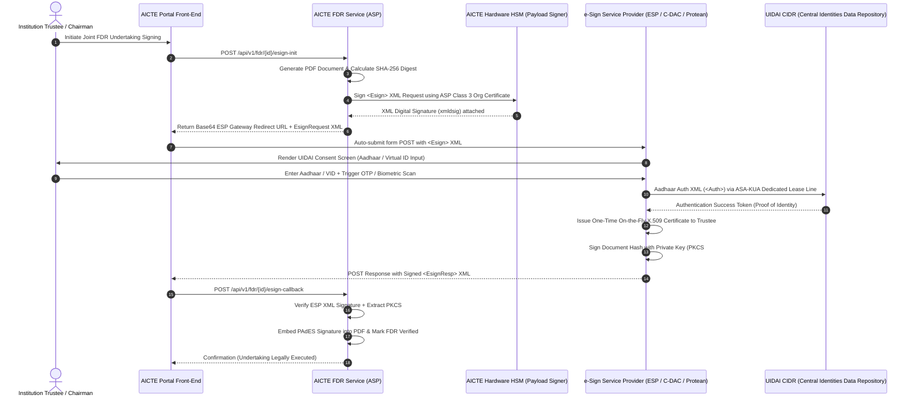
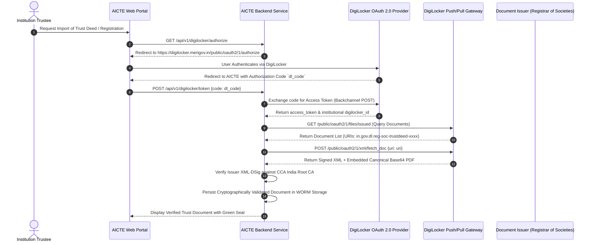

# AICTE FDR / SECURITY DEPOSIT SMART PORTAL
## Document 06: Enterprise Security Architecture, Zero Trust, Cryptography & Compliance Specification
### Problem Statement ID: SIH 26265
**Document Version:** 3.4.0-PROD  
**Classification:** RESTRICTED / AICTE CYBERSECURITY MANDATE  
**Standard Compliance:** NIST SP 800-207, ISO/IEC 27001:2022, CERT-In Direction No. 20(3)/2022-CERT-In, Indian IT Act 2000 (Amendments 2008), UIDAI Aadhaar e-Sign v2.1, CCA India Class 3 DSC, CAG WORM Guidelines

---

## 1. Executive Summary & Regulatory Authority Mandate

The All India Council for Technical Education (AICTE), as the statutory apex body under the Ministry of Education, Government of India, regulates over 10,000 technical institutions across the nation. Under the *AICTE Approval Process Handbook (APH)*, technical and management institutions are statutorily required to maintain Fixed Deposit Receipts (FDRs) / Bank Guarantees (e-BGs) as security deposits in joint accounts with the Member Secretary, AICTE. Historically, manual handling, fraudulent lien cancellations, forged paper FDR certificates, and lack of real-time auditability have created multi-crore fiduciary risks.

This specification establishes the **Enterprise Zero Trust Security, Identity Credential and Access Management (ICAM), Cryptographic Storage, Threat Modeling (STRIDE/DREAD), and Regulatory Audit Architecture** for the AICTE FDR / Security Deposit Smart Portal.

### 1.1 Legislative & Regulatory Framework

```
+-------------------------------------------------------------------------------------------------------+
|                                    INDIAN STATUTORY & CYBERSECURITY FRAMEWORK                         |
+-------------------------------------------------------------------------------------------------------+
|  Indian Information Technology Act, 2000 (Amended 2008)                                              |
|  - Section 3A & Second Schedule: Aadhaar e-Sign electronic signature parity                          |
|  - Section 43A: Sensitive Personal Data & Information (SPDI) compensation liabilities                |
|  - Section 66C/66D: Identity theft and cheating by personation punishments                           |
+-------------------------------------------------------------------------------------------------------+
|  CERT-In Directions (No. 20(3)/2022-CERT-In dated 28 April 2022)                                     |
|  - Mandatory 6-hour security incident reporting                                                       |
|  - 180-day dynamic logs retention within Indian jurisdiction                                         |
|  - NTP clock synchronization to National Physical Laboratory (NPL) / NIC                             |
+-------------------------------------------------------------------------------------------------------+
|  Digital Personal Data Protection Act, 2023 (DPDP Act)                                               |
|  - Section 8: Obligations of Significant Data Fiduciary (AICTE)                                      |
|  - Purpose limitation, storage limitation, zero data leakage of Trustee biometric/Aadhaar data       |
+-------------------------------------------------------------------------------------------------------+
|  Comptroller and Auditor General of India (CAG) Regulations for Public Fiduciary Deposits            |
|  - 10-year immutable audit log retention in WORM (Write Once Read Many) compliant storage            |
+-------------------------------------------------------------------------------------------------------+
```

---

## 2. Zero Trust Architecture (NIST SP 800-207)

The AICTE FDR Smart Portal abandons traditional perimeter-based ("castle-and-moat") security in strict compliance with **NIST Special Publication 800-207 (Zero Trust Architecture)**. No entity—whether an internal AICTE Regional Officer, an automated Bank Core Banking System (CBS) webhook, or a Trust Chairman—is implicitly trusted.

### 2.1 Core Architectural Principles
1. **Implicit Trust Elimination:** All access requests are authenticated, authorized, and cryptographically verified at every layer, regardless of network locality (Intranet vs Internet).
2. **Dynamic Policy Evaluation:** Authorization decisions are evaluated dynamically using real-time contextual telemetry (client TLS fingerprint, IP reputation, device posture, geofence, behavioral velocity, and session state).
3. **Micro-Segmentation:** Network isolation between the presentation layer, the AICTE API gateway, the core FDR business microservices, the AI/ML forensic engine, and the cryptographic key storage.
4. **Least Privilege Enforcement:** Temporal, task-bounded tokens with just-in-time privilege escalation for high-consequence operations (e.g., FDR lien encashment, release).

### 2.2 NIST SP 800-207 Component Mapping

```mermaid
flowchart TD
    subgraph Untrusted_Network["Untrusted Access Networks (Internet / External Banks / Institutions)"]
        User["User / Trustee / Bank Officer / AICTE RO"]
        Device["Client Device / Web Browser / Mobile App"]
        BankSys["Core Banking System / NeSL SFMS Gateway"]
    end

    subgraph PEP_Boundary["Policy Enforcement Point (PEP) Layer"]
        WAF["WAF & DDoS Shield (Cloudflare / NGINX Plus)"]
        EnvoyProxy["mTLS Envoy Service Proxy / Ingress Gateway"]
        AuthFilter["ExtAuthz Filter / JWT & MTLS Validator"]
    end

    subgraph Control_Plane["Zero Trust Control Plane (Policy Decision Point - PDP)"]
        PolicyEngine["Policy Engine (OPA / Rego Engine)"]
        PolicyAdmin["Policy Administrator (Keycloak IdP / HashiCorp Vault)"]
        TrustEngine["Continuous Risk & Trust Engine (Behavioral / Geofence)"]
    end

    subgraph Data_Plane["Secure Enclave Data Plane (Micro-Segmented)"]
        FDRService["FDR Core Service (Joint Lien & Life-Cycle)"]
        AuditService["Immutable Audit Service (Merkle Tree Engine)"]
        OCRService["AI/ML Forensic OCR & Tamper Engine"]
        VaultKMS["KMS / HashiCorp Vault (FIPS 140-3 HSM)"]
        WORMLog["CAG Compliance WORM Ledger (S3 Object Lock)"]
    end

    Device -->|TLS 1.3 Request| WAF
    BankSys -->|mTLS Handshake| EnvoyProxy
    WAF --> EnvoyProxy
    EnvoyProxy --> AuthFilter
    AuthFilter <-->|Check Decision (gRPC)| PolicyEngine
    PolicyEngine <--> PolicyAdmin
    PolicyEngine <--> TrustEngine
    AuthFilter -->|Allowed + Injected Claims| FDRService
    FDRService --> OCRService
    FDRService --> VaultKMS
    FDRService --> AuditService
    AuditService --> WORMLog
```

### 2.3 Policy Enforcement Point (PEP) & Policy Decision Point (PDP) Protocol
The **PEP** is implemented as an Envoy Proxy `envoy.filters.http.ext_authz` sidecar filter. Every HTTP/gRPC request triggers a sub-millisecond gRPC check to the Open Policy Agent (OPA) PDP:

```protobuf
syntax = "proto3";
package aicte.security.authz.v1;

message AuthorizationRequest {
  string subject_id = 1;
  string role = 2;
  string institution_id = 3;
  string action = 4;              // e.g., "FDR_RELEASE", "FDR_ENCASHMENT", "FDR_SUBMISSION"
  string resource_id = 5;          // FDR ID / Application ID
  string client_ip = 6;
  string user_agent = 7;
  string device_fingerprint = 8;
  string client_cert_thumbprint = 9; // mTLS X.509 thumbprint
  int64 timestamp_epoch = 10;
  bool is_biometric_authenticated = 11;
  bool is_dsc_signed = 12;
}

message AuthorizationResponse {
  enum Decision {
    DENIED = 0;
    ALLOWED = 1;
    STEP_UP_MFA_REQUIRED = 2;
    DSC_SIGNATURE_MANDATORY = 3;
  }
  Decision decision = 1;
  string rationale = 2;
  repeated string required_claims = 3;
  int64 token_ttl_seconds = 4;
}
```

---

## 3. Identity, Credential, and Access Management (ICAM)

The portal implements a hybrid **Role-Based Access Control (RBAC)** and **Attribute-Based Access Control (ABAC)** engine powered by Open Policy Agent (OPA).

### 3.1 Role & Attribute Access Matrix

| Role | Permitted Actions | Obligatory Attributes (ABAC Context) | Signing Mechanism |
| :--- | :--- | :--- | :--- |
| **`AICTE_HQ_ADMIN`** | System configuration, Global policy adjustment, Master institutional catalog update, CVO incident review | IP within AICTE HQ Subnet (`10.120.0.0/16`), Hardware FIDO2 WebAuthn token verified, Time: 09:00–19:00 IST | Class 3 DSC (HSM / Token) |
| **`AICTE_RO_OFFICER`** | Regional application scrutiny, FDR joint lien verification, Verification endorsement, Defect memo generation | `user.regional_office_id == resource.institution_ro_id`, Active duty shift, No conflict-of-interest flag | Class 3 DSC (PAdES PKCS#7) |
| **`INSTITUTION_TRUSTEE`** | Institutional profile creation, FDR scan upload, Joint lien undertaking submission, Renewal filing | `user.trustee_pan == institution.trust_pan`, Mandatory Aadhaar e-Sign validation, OTP/Biometric session | Aadhaar e-Sign v2.1 (ESP XML) |
| **`BANK_BRANCH_NODAL`** | FDR balance confirmation, Lien marking confirmation, e-BG confirmation, Encashment dispatch | `user.bank_ifsc == fdr.issuing_ifsc`, Verified Bank Corporate Domain Email (`*.sbi.co.in`, etc.), mTLS Token | Bank Corporate DSC / NeSL API |
| **`AUDITOR_CAG`** | Read-only access to immutable audit trails, Merkle tree cryptographic verification, WORM log extracts | Read-only scoped session, Dedicated CAG Virtual Private Cloud (VPC) endpoint, Temporal 30-day ticket | CAG Mutual TLS + PKI Token |

### 3.2 Dynamic ABAC Policy Implementation in Rego (OPA)

```rego
package aicte.fdr.authz

default allow = false
default require_step_up = false

# 1. AICTE RO Scrutiny Policy
allow {
    input.subject.role == "AICTE_RO_OFFICER"
    input.action == "FDR_APPROVE_SCRUTINY"
    input.subject.regional_office_id == input.resource.regional_office_id
    input.resource.status == "PENDING_RO_VERIFICATION"
    input.context.is_dsc_signed == true
    is_working_hours(input.context.timestamp)
    not is_ip_blacklisted(input.context.client_ip)
}

# 2. Institution Trustee FDR Submission Policy
allow {
    input.subject.role == "INSTITUTION_TRUSTEE"
    input.action == "FDR_SUBMIT_UNDERTAKING"
    input.subject.trust_id == input.resource.trust_id
    input.context.is_aadhaar_esign_valid == true
    input.resource.status in ["DRAFT", "DEFECT_RECTIFICATION"]
}

# 3. High-Value Encashment Mandatory Dual-Authorization
allow {
    input.subject.role == "AICTE_HQ_ADMIN"
    input.action == "FDR_INVOKE_ENCASHMENT"
    input.resource.status == "LIEN_MARKED"
    input.context.dual_approval_present == true
    input.context.cvo_clearance_id != ""
    input.context.is_dsc_signed == true
}

# Helper: IST Working Hours (08:30 to 20:00)
is_working_hours(epoch_seconds) {
    # 19800 seconds = GMT+5:30
    ist_time := time.date(epoch_seconds + 19800)
    hour := ist_time[3]
    hour >= 8
    hour < 20
}

is_ip_blacklisted(ip) {
    data.threat_intel.blacklisted_ips[ip]
}
```

---

## 4. Indian DPI Integration I: Aadhaar e-Sign v2.1 Specification

Under **Section 3A and the Second Schedule of the Information Technology Act, 2000**, electronic signatures executed via Aadhaar e-Sign hold identical legal enforceability to physical wet-ink signatures for institutional affidavits and joint FDR declarations.

### 4.1 e-Sign Service Provider (ESP) Architecture
AICTE operates as an Application Service Provider (ASP) connecting via an authorized Authentication Service Agency (ASA) / e-Sign Service Provider (ESP) (e.g., NSDL e-Governance / Protean, C-DAC, or (Sify).



### 4.2 ESP XML Payload Schemas

#### Request Payload (`EsignRequest.xml`)
```xml
<?xml version="1.0" encoding="UTF-8"?>
<Esign AuthMode="1" 
       aspId="AICTE-ASP-98210" 
       ekycMode="OTP" 
       ekycProvider="Aadhaar" 
       responseSigType="pkcs7" 
       responseUrl="https://fdr.aicte-india.org/api/v1/esign/callback" 
       ts="2026-10-28T23:45:00+05:30" 
       txn="TXN-AICTE-FDR-2026-998242" 
       ver="2.1" 
       xmlns="http://www.esigndata.gov.in/v2.1">
    <Docs>
        <InputHash docId="DOC-FDR-UNDERTAKING-7782" 
                   hashAlgorithm="SHA256" 
                   id="1">a3f9e830c29b47e52d88d1fbb605e492f2541a029304a43b190f845a7042a42b</InputHash>
    </Docs>
    <Signature xmlns="http://www.w3.org/2000/09/xmldsig#">
        <SignedInfo>
            <CanonicalizationMethod Algorithm="http://www.w3.org/2001/10/xml-exc-c14n#"/>
            <SignatureMethod Algorithm="http://www.w3.org/2001/04/xmldsig-more#rsa-sha256"/>
            <Reference URI="">
                <Transforms>
                    <Transform Algorithm="http://www.w3.org/2000/09/xmldsig#enveloped-signature"/>
                </Transforms>
                <DigestMethod Algorithm="http://www.w3.org/2001/04/xmlenc#sha256"/>
                <DigestValue>JkF7yFpZ3Y5d4N6kL9Q8m7V2c1X4z0A9B8C7D6E5F4G=</DigestValue>
            </Reference>
        </SignedInfo>
        <SignatureValue>MEQCIG8j3l9k...[AICTE ASP Signature]...K821mN9==</SignatureValue>
    </Signature>
</Esign>
```

#### Response Payload (`EsignResponse.xml`)
```xml
<?xml version="1.0" encoding="UTF-8"?>
<EsignResp errCode="0" 
           errMsg="" 
           resCode="1" 
           status="1" 
           ts="2026-10-28T23:47:12+05:30" 
           txn="TXN-AICTE-FDR-2026-998242" 
           ver="2.1" 
           xmlns="http://www.esigndata.gov.in/v2.1">
    <UserX509Certificate>MIIFhTCCBG2gAwIBAgIQ...[ESP One-Time Signer Cert]...==</UserX509Certificate>
    <Signatures>
        <DocSignature docId="DOC-FDR-UNDERTAKING-7782" id="1">
            MIAGCSqGSIb3DQEHAqCAMIACAQExCzAJBgUrDgMCGgUAMIAGCSqGSIb3DQEHAQAAoII...[PKCS#7 Detached Signature]...AAAAAA==
        </DocSignature>
    </Signatures>
</EsignResp>
```

---

## 5. Indian DPI Integration II: Digital Signature Certificate (DSC Class 3) & PAdES Architecture

For executive statutory determinations—such as AICTE Regional Directors sanctioning FDR releases or Member Secretary authorizing lien foreclosures—**Class 3 DSC (Signing & Encryption)** issued by a Controller of Certifying Authorities (CCA) licensed CA (e.g., eMudhra, SafeScrypt, Capricorn) is enforced.

### 5.1 PAdES-LTV (PDF Advanced Electronic Signature - Long-Term Validation)
Signatures are applied strictly in compliance with **ETSI EN 319 142-1 (PAdES Baseline Profile)** with **Long-Term Validation (LTV)**:
1. **DSS (Document Security Store):** All intermediate CA certificates, Root CAs, Online Certificate Status Protocol (OCSP) responses (RFC 6960), and Certificate Revocation Lists (CRL) are embedded within the PDF `/DSS` dictionary.
2. **RFC 3161 Trusted Document Timestamp:** An independent RFC 3161 Timestamp Authority (TSA) signature (National Informatics Centre TSA) seals the signature dictionary, guaranteeing evidence of existence at time $T$.

```
PDF Document Incremental Update Structure:
+-----------------------------------------------------------+
| Header & Original PDF Content (FDR Joint Order)           |
+-----------------------------------------------------------+
| PDF Signature Dictionary:                                 |
| /Type /Sig                                                |
| /Filter /Adobe.PPKLite                                     |
| /SubFilter /ETSI.CAdES.detached (PAdES B-LTV)             |
| /ByteRange [ 0, 10240, 26624, 15000 ]                     |
| /Contents <308204F2...[PKCS#7 SignedData]...>             |
| /ContactInfo "regional_director.cro@aicte-india.org"      |
| /Reason "Approval of Joint FDR Lien under APH 2026-27"    |
+-----------------------------------------------------------+
| Document Security Store (/DSS Dictionary):                |
| - Embedded OCSP Responses (RFC 6960)                      |
| - Embedded CRL (RFC 5280)                                 |
| - Full CCA India Intermediate Cert Chain                  |
+-----------------------------------------------------------+
| Document Time-Stamp Dictionary (/Type /DocTimeStamp):      |
| - RFC 3161 Cryptographic Token from NIC TSA               |
+-----------------------------------------------------------+
```

### 5.2 Python Cryptographic PAdES Engine (End-to-End Signing Implementation)

```python
"""
AICTE PAdES-LTV Hardware HSM Signing Module
Complies with ETSI EN 319 142 and CCA India Class 3 DSC Guidelines
"""
import hashlib
from datetime import datetime
from pyhanko.pdf_utils.incremental_writer import IncrementalPdfFileWriter
from pyhanko.sign import fields, signers
from pyhanko.sign.pkcs11 import open_pkcs11_session
from pyhanko.sign.timestamps import HTTPTimeStamper

class AICTEPAdESSigner:
    def __init__(self, pkcs11_lib_path: str, token_pin: str, token_label: str, tsa_url: str):
        self.pkcs11_lib = pkcs11_lib_path
        self.token_pin = token_pin
        self.token_label = token_label
        self.timestamper = HTTPTimeStamper(url=tsa_url)

    def sign_fdr_release_order(
        self,
        input_pdf_path: str,
        output_pdf_path: str,
        officer_name: str,
        officer_designation: str,
        location: str,
        reason: str
    ):
        # 1. Open Hardware Security Module / PKCS#11 Session
        session = open_pkcs11_session(
            lib_location=self.pkcs11_lib,
            slot_no=None,
            token_label=self.token_label,
            user_pin=self.token_pin
        )

        signer = signers.PKCS11Signer(
            pkcs11_session=session,
            cert_id=None,
            key_id=None,
            other_certs_to_pull=True
        )

        with open(input_pdf_path, 'rb') as inf:
            w = IncrementalPdfFileWriter(inf)
            
            # 2. Configure Signature Field on Final Page
            fields.append_signature_field(
                w,
                fields.SigFieldSpec(
                    sig_field_name='AICTE_Officer_Signature',
                    on_page=-1,
                    box=(380, 50, 570, 130)  # Visual Stamp Coordinates
                )
            )

            # 3. Build PAdES-LTV Signature Metadata
            meta = signers.PdfSignatureMetadata(
                field_name='AICTE_Officer_Signature',
                reason=reason,
                location=location,
                contact_info=officer_name,
                subfilter=fields.SigSeedSubFilter.PADES,
                validation_context=signers.ValidationContext(
                    allow_fetching=True  # Fetch OCSP / CRL for LTV
                )
            )

            # 4. Sign and Attach RFC 3161 Timestamp
            with open(output_pdf_path, 'wb') as outf:
                signers.sign_pdf(
                    w,
                    signers.PdfSigner(
                        signer=signer,
                        signature_meta=meta,
                        timestamper=self.timestamper
                    ),
                    output=outf
                )
        session.close()
        return output_pdf_path
```

---

## 6. Indian DPI Integration III: DigiLocker National Gateway

To prevent fraudulent modification of institutional trust deeds, registration certificates, and AICTE approval letters, the portal integrates with the **DigiLocker National Gateway (MeitY)** for trusted document exchange.

### 6.1 DigiLocker OAuth 2.0 & URI Exchange Protocol



### 6.2 DigiLocker Document Verification Schema
```json
{
  "$schema": "https://json-schema.org/draft/2020-12/schema",
  "title": "DigiLockerVerifiedDocument",
  "type": "object",
  "properties": {
    "digilocker_uri": {
      "type": "string",
      "pattern": "^in\\.gov\\.[a-z0-9_-]+:[a-z0-9_-]+:[0-9a-zA-Z_-]+$"
    },
    "doc_type": {
      "type": "string",
      "enum": ["TRUST_DEED", "SOCIETY_REGISTRATION", "SECTION_8_LICENCE", "AICTE_EOA_LETTER"]
    },
    "issuer_id": { "type": "string" },
    "issued_to_name": { "type": "string" },
    "trust_pan": { "type": "string", "pattern": "^[A-Z]{5}[0-9]{4}[A-Z]{1}$" },
    "cryptographic_hash": { "type": "string", "pattern": "^[a-f0-9]{64}$" },
    "xml_dsig_verified": { "type": "boolean", "const": true },
    "verification_timestamp": { "type": "string", "format": "date-time" }
  },
  "required": [
    "digilocker_uri", "doc_type", "issuer_id", "trust_pan", 
    "cryptographic_hash", "xml_dsig_verified", "verification_timestamp"
  ]
}
```

---

## 7. Data Protection, Cryptographic Envelope Encryption & Key Management

FDR certificates, bank guarantees, and joint lien agreements represent high-value financial instruments. The portal employs **Envelope Encryption** compliant with **NIST SP 800-57** and backed by FIPS 140-3 Level 3 Hardware Security Modules.

### 7.1 Cryptographic Architecture: Envelope Encryption
1. **Master Key (KEK - Key Encryption Key):** Resides exclusively within a FIPS 140-3 Level 3 HSM (AWS KMS / HashiCorp Vault Transit Engine). The raw KEK is non-exportable and subject to annual automated rotation.
2. **Data Encryption Key (DEK):** Ephemeral 256-bit symmetric key dynamically generated via cryptographically secure pseudo-random number generator (CSPRNG).
3. **Cipher Algorithm:** **AES-256-GCM (Galois/Counter Mode)**. GCM provides both confidentiality and authenticated integrity via an accompanying 128-bit Authentication Tag.
4. **Hashing & Integrity:** Pre-encryption and post-encryption SHA-512 hashes are calculated.

```
ENVELOPE ENCRYPTION WORKFLOW
+---------------------------------------------------------------------------------+
| 1. Generate Plaintext DEK (256-bit) via CSPRNG                                  |
| 2. Encrypt Plaintext DEK with KEK inside HSM  ===>  Ciphertext Encrypted DEK   |
| 3. Encrypt FDR Document with Plaintext DEK + Nonce (96-bit)                     |
|    Algorithm: AES-256-GCM                                                       |
|    Output: Ciphertext FDR Document + 128-bit Auth Tag                           |
| 4. Explicitly Zeroize Plaintext DEK from RAM buffer                             |
| 5. Package Storage Envelope:                                                    |
|    [ Encrypted DEK ] + [ 96-bit IV ] + [ 128-bit Tag ] + [ Encrypted Document ] |
+---------------------------------------------------------------------------------+
```

### 7.2 Production Envelope Encryption Module (Python / Cryptography)

```python
"""
AICTE Production Grade Envelope Encryption Module
NIST SP 800-38D (AES-GCM) & RFC 5116 Compliant
"""
import os
import hmac
import hashlib
from typing import Tuple, Dict
from cryptography.hazmat.primitives.ciphers.aead import AESGCM
from cryptography.hazmat.backends import default_backend

class EnvelopeEncryptionEngine:
    def __init__(self, vault_kms_client):
        self.kms = vault_kms_client
        self.kek_key_id = "aicte/fdr-master-kek"

    def encrypt_fdr_document(self, raw_document_bytes: bytes, fdr_metadata: Dict) -> Dict:
        """
        Performs envelope encryption over an FDR PDF/TIFF artifact.
        """
        # Step 1: Compute pre-encryption SHA-512 hash of raw document
        sha512_raw = hashlib.sha512(raw_document_bytes).hexdigest()

        # Step 2: Request new Data Encryption Key (DEK) from KMS
        kms_response = self.kms.generate_data_key(
            key_id=self.kek_key_id,
            key_spec="AES_256"
        )
        plaintext_dek = kms_response["Plaintext"]       # 32 bytes
        ciphertext_dek = kms_response["CiphertextBlob"] # Encrypted with KEK

        # Step 3: Generate 96-bit (12-byte) unique IV/Nonce for AES-GCM
        nonce = os.urandom(12)

        # Step 4: Serialize metadata as Additional Authenticated Data (AAD)
        # Prevents ciphertext relocation across different FDR records
        aad = f"FDR_ID:{fdr_metadata['fdr_id']}|INST:{fdr_metadata['institution_id']}".encode('utf-8')

        # Step 5: Execute AES-256-GCM Encryption
        aesgcm = AESGCM(plaintext_dek)
        # encrypt returns: ciphertext + 16-byte authentication tag
        encrypted_document_and_tag = aesgcm.encrypt(nonce, raw_document_bytes, aad)

        # Step 6: Cryptographic zeroization of plaintext DEK from memory
        # Overwrite memory buffer before garbage collection
        del plaintext_dek

        # Step 7: Calculate post-encryption SHA-512 hash
        sha512_encrypted = hashlib.sha512(encrypted_document_and_tag).hexdigest()

        return {
            "ciphertext_dek": ciphertext_dek,
            "nonce": nonce,
            "aad": aad,
            "payload": encrypted_document_and_tag,
            "sha512_raw": sha512_raw,
            "sha512_encrypted": sha512_encrypted,
            "cipher": "AES-256-GCM",
            "tag_len_bytes": 16
        }

    def decrypt_fdr_document(self, envelope: Dict, fdr_metadata: Dict) -> bytes:
        """
        Decrypts an FDR document using KMS backchannel decryption.
        """
        # Step 1: Decrypt DEK using HSM/KMS
        plaintext_dek = self.kms.decrypt(
            CiphertextBlob=envelope["ciphertext_dek"],
            KeyId=self.kek_key_id
        )["Plaintext"]

        # Step 2: Validate AAD to prevent substitution attack
        expected_aad = f"FDR_ID:{fdr_metadata['fdr_id']}|INST:{fdr_metadata['institution_id']}".encode('utf-8')
        if envelope["aad"] != expected_aad:
            raise PermissionError("AAD integrity violation! Document does not match claimed FDR.")

        # Step 3: Decrypt with AES-256-GCM (Verifies 16-byte auth tag)
        aesgcm = AESGCM(plaintext_dek)
        decrypted_bytes = aesgcm.decrypt(envelope["nonce"], envelope["payload"], expected_aad)

        # Step 4: Verify pre-encryption SHA-512 integrity
        current_sha512 = hashlib.sha512(decrypted_bytes).hexdigest()
        if not hmac.compare_digest(current_sha512, envelope["sha512_raw"]):
            raise ValueError("Integrity failure: SHA-512 hash mismatch on decrypted bytes.")

        # Zeroize
        del plaintext_dek
        return decrypted_bytes
```

---

## 8. Cryptographic Merkle Tree Audit Trail & Tamper Proofs

Every mutation across the FDR lifecycle (Submission $\rightarrow$ Inspection $\rightarrow$ Joint Lien Confirmation $\rightarrow$ Renewal $\rightarrow$ Encashment $\rightarrow$ Release) is written to a cryptographic **Merkle Tree**.

### 8.1 Mathematical Proof of Tamper Evidence
Let an audit log record at index $i$ be $L_i$.
The leaf hash is defined as:
$$H_i = \text{SHA-256}(\text{0x00} \parallel L_i)$$
Where $\text{0x00}$ is the RFC 6962 leaf domain separator.

For internal nodes at level $k$:
$$N_{k, j} = \text{SHA-256}(\text{0x01} \parallel N_{k-1, 2j} \parallel N_{k-1, 2j+1})$$
Where $\text{0x01}$ is the internal node domain separator, preventing second pre-image collision attacks.

```
                        Root Hash R [Epoch T]
                       /                     \
             Hash(01 || H_01 || H_23)      Hash(01 || H_45 || H_67)
             /                     \        /                     \
       H_01                        H_23   H_45                    H_67
      /    \                      /    \  /    \                 /    \
    H_0    H_1                  H_2   H_3 H_4   H_5             H_6   H_7
     |      |                    |     |   |     |               |     |
   Log_0  Log_1                Log_2 Log_3 Log_4 Log_5         Log_6 Log_7
```

#### Inclusion Proof ($O(\log N)$ Complexity)
To prove that log entry $L_3$ is contained in Root $R$ with $N=8$ leaves, the system provides the audit path:
$$\pi(L_3) = [ (H_2, \text{left}), (H_{01}, \text{left}), (H_{4567}, \text{right}) ]$$
The verifier computes:
1. $H_3 = \text{SHA-256}(0x00 \parallel L_3)$
2. $H_{23} = \text{SHA-256}(0x01 \parallel H_2 \parallel H_3)$
3. $H_{0123} = \text{SHA-256}(0x01 \parallel H_{01} \parallel H_{23})$
4. $R' = \text{SHA-256}(0x01 \parallel H_{0123} \parallel H_{4567})$

If $R' == R$, log entry $L_3$ is mathematically proven to have occurred in the exact order recorded. Any modification to a historical log entry changes its leaf hash, propagating up the tree and altering Root $R$.

### 8.2 Production Merkle Tree Audit Engine Implementation

```python
"""
AICTE High-Throughput Cryptographic Merkle Tree Engine
RFC 6962 Compliant - Domain Separated SHA-256 Hashing
"""
import hashlib
from typing import List, Tuple, Optional

class MerkleAuditTree:
    LEAF_PREFIX = b'\x00'
    NODE_PREFIX = b'\x01'

    def __init__(self):
        self.leaves: List[bytes] = []
        self.leaf_hashes: List[bytes] = []
        self.levels: List[List[bytes]] = []

    @staticmethod
    def _hash(data: bytes) -> bytes:
        return hashlib.sha256(data).digest()

    def append_log(self, log_record: bytes) -> int:
        """
        Appends an immutable log entry and returns its index.
        """
        leaf_hash = self._hash(self.LEAF_PREFIX + log_record)
        self.leaves.append(log_record)
        self.leaf_hashes.append(leaf_hash)
        self._rebuild_tree()
        return len(self.leaves) - 1

    def _rebuild_tree(self):
        current_level = self.leaf_hashes[:]
        self.levels = [current_level]

        while len(current_level) > 1:
            next_level = []
            for i in range(0, len(current_level), 2):
                left = current_level[i]
                if i + 1 < len(current_level):
                    right = current_level[i + 1]
                else:
                    right = left  # Duplicate odd node per RFC 6962
                parent = self._hash(self.NODE_PREFIX + left + right)
                next_level.append(parent)
            self.levels.append(next_level)
            current_level = next_level

    def get_merkle_root(self) -> str:
        if not self.levels or not self.levels[-1]:
            return ""
        return self.levels[-1][0].hex()

    def generate_inclusion_proof(self, index: int) -> List[Tuple[str, str]]:
        """
        Generates O(log N) inclusion proof for leaf at `index`.
        Returns: list of (direction, sibling_hash_hex)
        """
        proof = []
        idx = index
        for level in self.levels[:-1]:
            is_right_child = (idx % 2 == 1)
            sibling_idx = idx - 1 if is_right_child else idx + 1
            if sibling_idx < len(level):
                sibling_hash = level[sibling_idx].hex()
                direction = "left" if is_right_child else "right"
                proof.append((direction, sibling_hash))
            else:
                # Odd node duplicate
                proof.append(("right", level[idx].hex()))
            idx //= 2
        return proof

    @classmethod
    def verify_inclusion_proof(
        cls,
        log_record: bytes,
        proof: List[Tuple[str, str]],
        expected_root_hex: str
    ) -> bool:
        """
        Mathematically verifies if log_record belongs to the root.
        """
        current_hash = cls._hash(cls.LEAF_PREFIX + log_record)
        for direction, sibling_hex in proof:
            sibling = bytes.fromhex(sibling_hex)
            if direction == "left":
                current_hash = cls._hash(cls.NODE_PREFIX + sibling + current_hash)
            else:
                current_hash = cls._hash(cls.NODE_PREFIX + current_hash + sibling)
        return current_hash.hex() == expected_root_hex
```

---

## 9. Threat Modeling & STRIDE Analysis

A threat modeling analysis was conducted across all six stages of the Fixed Deposit Receipt (FDR) lifecycle.

### 9.1 FDR Lifecycle Attack Surface

```
[ Stage 1: Upload ] ===> [ Stage 2: Verification ] ===> [ Stage 3: Approval ]
(Trustee Scan Upload)    (Bank API / CBS Validation)    (AICTE Regional Officer)
         ||                         ||                           ||
[ Stage 4: Maintenance ] ==> [ Stage 5: Encashment ] ==> [ Stage 6: Release ]
(Auto-Renewals & Audits) (Lien Foreclosure by AICTE)   (Return to Institution)
```

### 9.2 Complete STRIDE Matrix with DREAD Scoring

**DREAD Scoring Formula:**
$$\text{Score} = \frac{\text{Damage} + \text{Reproducibility} + \text{Exploitability} + \text{Affected Users} + \text{Discoverability}}{5}$$
*Ratings: 1.0 (Lowest) to 10.0 (Highest). Severity: Critical ($\ge 8.0$), High ($6.0 - 7.9$), Medium ($4.0 - 5.9$), Low ($< 4.0$)*

| Threat ID | Lifecycle Stage | STRIDE Category | Threat Description & Attack Vector | Impact | D | R | E | A | D | Score & Rating | Architectural Mitigation |
| :--- | :--- | :--- | :--- | :--- | :---: | :---: | :---: | :---: | :---: | :---: | :--- |
| **TH-01** | Stage 1: Upload | **Spoofing** | Rogue actor uploads scanned FDR forged in the name of an existing AICTE Trust using forged PAN credentials. | Critical | 9 | 7 | 6 | 8 | 7 | **7.4 (High)** | Mandatory Aadhaar e-Sign v2.1 binding with Trustee PAN; DigiLocker pull verification; automated PAN-Aadhaar linkage check. |
| **TH-02** | Stage 1: Upload | **Tampering** | Trustee modifies amount in FDR PDF (₹15 Lakh modified to ₹1 Crore) using desktop image software before upload. | Critical | 10 | 9 | 8 | 9 | 8 | **8.8 (Critical)** | Multi-stage AI/ML Forensic Pipeline: Error Level Analysis (ELA), Copy-Move Forgery Detection (CMFD), automated NeSL/CBS bank verification. |
| **TH-03** | Stage 2: Bank Verify | **Repudiation** | Bank branch officer denies having endorsed joint lien to AICTE after institution defaults. | Critical | 9 | 5 | 4 | 7 | 5 | **6.0 (High)** | Cryptographic SFMS MT760 acknowledgment receipt, Bank Nodal Officer DSC signature, and immutable Merkle tree logging. |
| **TH-04** | Stage 3: Approval | **Elevation of Privilege** | Compromised AICTE Regional Officer account approves deficient/forged FDR without scrutiny. | Critical | 10 | 6 | 5 | 8 | 6 | **7.0 (High)** | Class 3 DSC Hardware Token enforcement for approval; ABAC policy with geolocation/time checks; mandatory Dual-Key approval for FDRs $> ₹50\text{ Lakh}$. |
| **TH-05** | Stage 4: Maintenance | **Information Disclosure** | Bank account numbers, FDR balances, and trustee Aadhaar metadata leaked via insecure API endpoint. | High | 8 | 8 | 7 | 10 | 7 | **8.0 (Critical)** | NIST SP 800-38D AES-256-GCM envelope encryption at rest; TLS 1.3 in transit; UIDAI-compliant Aadhaar tokenization (no raw Aadhaar storage). |
| **TH-06** | Stage 5: Encashment | **Denial of Service** | Volumetric DDoS or resource starvation attack on Bank Gateway to prevent AICTE from encashing FDR prior to maturity. | High | 7 | 8 | 7 | 6 | 8 | **7.2 (High)** | Cloudflare Magic Transit DDoS scrubbing; rate limiting at Envoy Ingress; NeSL asynchronous retry message queue with dead-letter queue (DLQ). |
| **TH-07** | Stage 6: Release | **Tampering / Spoofing** | Fraudulent FDR release order generated by intercepting database record, discharging lien without AICTE Council approval. | Critical | 10 | 4 | 3 | 8 | 4 | **5.8 (Medium)** | WORM storage enforcement; cryptographically signed database write-ahead log; Council Resolution DSC seal required to trigger release webhook. |

---

## 10. CERT-In & CAG Statutory Compliance Framework

### 10.1 CERT-In 6-Hour Security Incident Reporting (Direction No. 20(3)/2022-CERT-In)
AICTE is mandated to report cybersecurity incidents to CERT-In (`incident@cert-in.org.in`) within **6 hours** of detection.

#### Incident Taxonomy (20 Covered Event Types)
1. Unauthorized access to IT systems/data.
2. Defacement of website or intrusion into a website.
3. Malicious code attacks (Ransomware, Trojans, Cryptominers).
4. Attack on critical infrastructure (Bank Gateway, NeSL tunnel).
5. Data breach or data leak of institutional financial deposits.
6. Identity theft, spoofing, and phishing attacks targeting bank nodals.
7. Denial of Service (DoS) and Distributed Denial of Service (DDoS) attacks.
8. Attacks on E-Sign, DSC, or PKI infrastructure.

#### Automated Incident Dispatch Webhook (JSON Schema)
```json
{
  "$schema": "https://json-schema.org/draft/2020-12/schema",
  "title": "CERTInIncidentNotification",
  "type": "object",
  "properties": {
    "reporting_entity": { "type": "string", "const": "All India Council for Technical Education (AICTE)" },
    "contact_details": {
      "ciso_name": "Chief Information Security Officer, AICTE",
      "email": "ciso@aicte-india.org",
      "phone": "+91-11-2958-1000"
    },
    "incident_id": { "type": "string", "pattern": "^INC-CERTIN-[0-9]{4}-[0-9]{6}$" },
    "incident_type": { "type": "string" },
    "detection_timestamp": { "type": "string", "format": "date-time" },
    "reporting_timestamp": { "type": "string", "format": "date-time" },
    "elapsed_time_minutes": { "type": "integer", "maximum": 360 },
    "affected_systems": { "type": "array", "items": { "type": "string" } },
    "impact_severity": { "type": "string", "enum": ["LOW", "MEDIUM", "HIGH", "CRITICAL"] },
    "indicators_of_compromise": {
      "type": "object",
      "properties": {
        "src_ips": { "type": "array", "items": { "type": "string" } },
        "dest_ips": { "type": "array", "items": { "type": "string" } },
        "sha256_hashes": { "type": "array", "items": { "type": "string" } }
      }
    },
    "remedial_actions_taken": { "type": "string" }
  },
  "required": ["reporting_entity", "incident_id", "incident_type", "detection_timestamp", "reporting_timestamp", "impact_severity"]
}
```

### 10.2 CAG 10-Year Immutable WORM Storage Architecture
Fixed deposit records, joint encumbrance notices, and audit logs are archived under **S3 Object Lock Compliance Mode** (or MinIO Enterprise WORM).

```
                      CAG AUDIT LOG WORM ARCHITECTURE
+-------------------------------------------------------------------------------+
|  Log Generator (Audit-Service)                                                |
|  - JSON-LD Audit Event + Merkle Proof                                         |
+---------------------------------------+---------------------------------------+
                                        |
                                        v
+---------------------------------------+---------------------------------------+
|  AWS S3 / MinIO Object Storage (Bucket: `aicte-cag-audit-immutable`)          |
|  - Object Lock Mode: COMPLIANCE                                               |
|  - Retention Period: 3,652 Days (10 Years)                                    |
|  - Legal Hold: Enabled (Cannot be deleted even by AWS Root Account)           |
|  - Server-Side Encryption: aws:kms (FIPS 140-3 HSM Dedicated Key)            |
+---------------------------------------+---------------------------------------+
                                        |
                                        v
+---------------------------------------+---------------------------------------+
|  Verification Portal for CAG Auditors                                         |
|  - Read-Only Scoped Temporary STS Credentials                                |
|  - Merkle Inclusion Proof Verifier CLI                                        |
|  - Cryptographic Verification Report Generator                                |
+-------------------------------------------------------------------------------+
```

---

## 11. Cryptographic Summary & Technical Standards Reference

| Protocol / Component | Cryptographic Standard | Key Length / Algorithm | Statutory Authority / Standard |
| :--- | :--- | :--- | :--- |
| **Transport Layer Security** | TLS 1.3 (RFC 8446) | `TLS_AES_256_GCM_SHA384` | CERT-In Security Baseline |
| **Document At-Rest Cipher** | AES-GCM (RFC 5116) | 256-bit Key, 96-bit Nonce | NIST SP 800-38D |
| **Master Key Protection** | FIPS 140-3 Level 3 HSM | RSA-4096 / ECC Secp256k1 | HashiCorp Vault / AWS KMS |
| **Audit Log Integrity** | Merkle Tree (RFC 6962) | SHA-256 with Domain Separator | CAG WORM Compliance |
| **Institutional Trustee Sign** | Aadhaar e-Sign v2.1 | RSA-2048 / SHA-256 | IT Act 2000 Section 3A |
| **Executive Officer Sign** | Class 3 DSC (PAdES-LTV) | RSA-4096 / SHA-512 | CCA India / ETSI EN 319 142 |
| **NTP Time Synchronization** | Authenticated NTP (NTS) | Stratum-1 Source | National Physical Lab (NPL) |

---
*(End of Specification - Document 06)*
