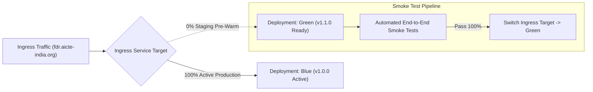

# AICTE Security Deposit & FDR Management Portal
## DevOps, Infrastructure Architecture, Scalability & Disaster Recovery Runbook
**Problem Statement ID:** SIH 26265  
**Document Version:** 1.0.0 (Production Release)  
**Author:** Principal DevOps & Infrastructure Lead  
**Classification:** Government of India / AICTE Confidential  

---

## 1. Executive Summary & Infrastructure Architecture

The AICTE Fixed Deposit Receipt (FDR) and Security Deposit Management System is an enterprise-grade, mission-critical government financial platform. It eliminates manual processing, paper forgery, and premature lien liquidations across thousands of technical educational institutions in India.

The infrastructure is architected for **99.99% high availability**, zero-data-loss durability, strict isolation adhering to Ministry of Electronics and Information Technology (**MeitY**) Cloud Security guidelines, and compliance with **CERT-In** cybersecurity directives.

### 1.1 Microservices Architecture Topology

```mermaid
flowchart TD
    subgraph Public Internet / State Technical Boards
        Colleges["Applicant Institutions & Universities"]
        BankOfficers["Bank Branch Officers (Verification/NOC)"]
        AICTEOfficers["AICTE Bureau Officers & Regional Offices"]
    end

    subgraph Edge Layer / GovCloud WAF
        WAF["NIC / Cloudflare WAF & DDoS Shield"]
        Ingress["Nginx Ingress Controller (TLS 1.3 Termination, Rate Limiting)"]
    end

    subgraph Service Mesh - Kubernetes Namespace: aicte-fdr-prod
        FDRCore["fdr-service (FastAPI / Replicas: 3-15)"]
        BankAdapter["bank-gateway (CBS ISO 20022 Adapter / Replicas: 2-8)"]
        OCRWorker["ocr-service (Tesseract-PaddleOCR / Replicas: 3-20)"]
        AuditLedger["audit-service (Merkle Hash Ledger / Replicas: 2-6)"]
    end

    subgraph Persistence & Asynchronous Choreography
        PG[("PostgreSQL 16 HA Cluster\n(Patroni + pgBackRest)")]
        RedisCache[("Redis 7.2 Cluster\n(Sentinel / AOF Persistence)")]
        KafkaQueue[("Apache Kafka 3.6 Cluster\n(KRaft Mode Event Choreography)")]
        MinIOS3[("MinIO Distributed S3 Storage\n(Encrypted FDR Vault)")]
    end

    subgraph External Core Banking Solution (CBS)
        SBICBS["SBI Core Banking Network"]
        PNBCBS["PNB Core Banking Gateway"]
        HDFCCBS["HDFC CBS API Gateway"]
    end

    Colleges --> WAF
    BankOfficers --> WAF
    AICTEOfficers --> WAF
    WAF --> Ingress

    Ingress -->|Route /api/v1/fdr| FDRCore
    Ingress -->|Route /api/v1/audit| AuditLedger

    FDRCore -->|Async Event Dispatch| KafkaQueue
    FDRCore -->|Cache / Distributed Locks| RedisCache
    FDRCore -->|Relational Data Storage| PG
    FDRCore -->|PDF Vault Store/Presigned URL| MinIOS3
    FDRCore -->|Document Inspection Call| OCRWorker
    FDRCore -->|Lien / Verification Call| BankAdapter
    FDRCore -->|Cryptographic Chaining| AuditLedger

    BankAdapter -->|Mutual TLS 1.3 + IP Whitelist| SBICBS
    BankAdapter -->|Mutual TLS 1.3 + IP Whitelist| PNBCBS
    BankAdapter -->|Mutual TLS 1.3 + IP Whitelist| HDFCCBS
```

---

## 2. Multi-Cloud & GovCloud Deployment Specifications

To fulfill Indian data residency laws and AICTE statutory mandates, the platform is certified for deployment across MeitY-empaneled cloud service providers:
- **Primary Production Region:** NIC MeghRaj GovCloud (Delhi NCR) / AWS GovCloud Mumbai (`ap-south-1`).
- **Disaster Recovery Region:** Yotta NM1 Data Center (Navi Mumbai) / AWS Hyderabad (`ap-south-2`).

### 2.1 Compute Sizing & Cluster Node Pool Topology

| Node Pool Name | Machine Type | vCPU / RAM | Replicas (Min-Max) | Workload Assignment |
| :--- | :--- | :--- | :--- | :--- |
| `system-pool` | Standard Gov 4C-16G | 4 vCPU / 16 GB | 2 - 4 | CoreDNS, Ingress Controller, Cert-Manager, Metrics-Server |
| `app-core-pool` | Compute Gov 8C-32G | 8 vCPU / 32 GB | 4 - 12 | `fdr-service`, `bank-gateway`, `audit-service` |
| `ocr-gpu-pool` | GPU Gov (Nvidia T4) | 8 vCPU / 32 GB + 16GB VRAM | 2 - 8 | `ocr-service` (PaddleOCR / Forensic Fraud Analysis) |
| `data-stateful-pool` | Memory Gov 16C-64G | 16 vCPU / 64 GB | 3 - 5 | PostgreSQL 16 (Patroni), Kafka 3.6, Redis 7.2 |

---

## 3. Zero-Downtime Deployment Strategies

During high-volume affiliation renewal windows (January to April), thousands of technical institutions submit security deposits simultaneously. Downtime during updates is unacceptable.

### 3.1 Blue-Green Deployment Workflow

For major breaking revisions or framework upgrades, the platform utilizes Blue-Green routing controlled at the Ingress controller:



1. Deploy new version `Green` (replicas identical to `Blue`).
2. Run health, database schema backward compatibility, and functional smoke tests against internal ClusterIP of `Green`.
3. Switch Nginx Ingress traffic pointer from `fdr-service-blue` to `fdr-service-green`.
4. Keep `Blue` idling for 60 minutes for instantaneous rollback if 5xx anomaly exceeds 0.05%.
5. Gracefully terminate `Blue` pods.

### 3.2 Canary Deployment with Automated Rollback

For routine weekly patches, **Argo Rollouts** or **Flagger** is configured with automated canary analysis:

```yaml
apiVersion: argoproj.io/v1alpha1
kind: Rollout
metadata:
  name: fdr-service
  namespace: aicte-fdr-prod
spec:
  replicas: 10
  strategy:
    canary:
      steps:
        - setWeight: 10
        - pause: { duration: 5m }
        - setWeight: 30
        - pause: { duration: 10m }
        - setWeight: 60
        - pause: { duration: 5m }
      analysis:
        templates:
          - templateName: success-rate-metric
        args:
          - name: service-name
            value: fdr-service
```

**Canary Verification Criteria:**
- **HTTP 5xx Rate:** Must stay `< 0.05%` over Prometheus query `sum(rate(http_requests_total{status=~"5.."}[2m])) / sum(rate(http_requests_total[2m]))`.
- **Latency P95:** Must remain `< 350ms`.
- **Automatic Rollback:** If any metric deviates during canary stages, weight immediately shifts to 0% and alerts the on-call DevOps SRE.

### 3.3 Zero-Downtime Database Migrations (Expand and Contract Pattern)
1. **Expand Phase:** Add new nullable columns or tables in PostgreSQL (e.g. `ALTER TABLE fdr_records ADD COLUMN cbs_reference_code VARCHAR(100)`). Old code ignores the column.
2. **Deploy Phase:** Deploy microservices capable of writing to both old and new fields.
3. **Backfill Phase:** Run asynchronous background migration jobs updating legacy records.
4. **Contract Phase:** Remove deprecated columns after verification.

---

## 4. Disaster Recovery (DR) Runbook & Continuity Plan

### 4.1 Service Level Objectives (SLOs)
- **RPO (Recovery Point Objective):** `< 15 minutes` (Maximum allowable data loss window in catastrophe).
- **RTO (Recovery Time Objective):** `< 60 minutes` (Maximum elapsed time to full production traffic restoration).

### 4.2 Cross-Region Active-Passive Architecture

```mermaid
flowchart TD
    subgraph Primary Region: NIC MeghRaj Delhi
        IngressPri["Primary Ingress"]
        K8sPri["Primary K8s Pods"]
        PGPri[("PostgreSQL 16 Primary")]
        MinIOPri[("MinIO Primary S3")]
    end

    subgraph Secondary DR Region: Yotta NM1 Mumbai
        IngressDR["Secondary Ingress (Standby)"]
        K8sDR["Standby K8s (Warm Scale: 1 Replica)"]
        PGDR[("PostgreSQL 16 Streaming Replica (Read-Only)")]
        MinIODR[("MinIO Secondary S3 (Replication Target)")]
    end

    PGPri -->|Streaming WAL Logs via pgBackRest| PGDR
    MinIOPri -->|Bucket Replication (Async TLS)| MinIODR

    DNS["Route53 / Gov Cloud GSLB DNS Health Check"]
    DNS -->|Primary Healthy: 100%| IngressPri
    DNS -.->|Failover on Primary Failure| IngressDR
```

### 4.3 Automated Step-by-Step DR Failover Execution Procedure

When Primary Region experiences an unrecoverable failure:

```bash
# ==============================================================================
# DR FAILOVER EXECUTION SCRIPT: AICTE-FDR-DR-FAILOVER.sh
# Target: Secondary Region (Yotta NM1)
# ==============================================================================

set -euo pipefail
echo "[!] INITIATING EMERGENCY DISASTER RECOVERY FAILOVER PROCEDURE..."

# Step 1: Promote Secondary PostgreSQL Replica to Primary
echo "[1/5] Promoting PostgreSQL standby replica to read-write primary..."
kubectl exec -n aicte-fdr-prod patroni-cluster-0 -- patronictl failover --candidate patroni-cluster-dr-0 --force

# Step 2: Scale up Standby Microservices to Full Production Replica Capacity
echo "[2/5] Scaling Kubernetes Deployments to full capacity..."
kubectl scale -n aicte-fdr-prod deployment/fdr-service --replicas=8
kubectl scale -n aicte-fdr-prod deployment/bank-gateway --replicas=4
kubectl scale -n aicte-fdr-prod deployment/ocr-service --replicas=8
kubectl scale -n aicte-fdr-prod deployment/audit-service --replicas=4

# Step 3: Verify Standby Merkle Hash Ledger Integrity
echo "[3/5] Executing Cryptographic Audit Ledger Integrity Verification..."
curl -fsS http://audit-service-svc.aicte-fdr-prod.svc.cluster.local:8003/api/v1/audit/verify | grep '"status":"SECURE"'
echo "[+] Merkle chain and hash links confirmed 100% intact!"

# Step 4: Switch Global Server Load Balancing (GSLB) DNS Record
echo "[4/5] Shifting DNS routing to Disaster Recovery IP..."
aws route53 change-resource-record-sets --hosted-zone-id Z1AIC_GOV_FDR \
  --change-batch '{
    "Changes": [{
      "Action": "UPSERT",
      "ResourceRecordSet": {
        "Name": "fdr.aicte-india.org",
        "Type": "A",
        "TTL": 60,
        "ResourceRecords": [{"Value": "203.0.113.100"}]
      }
    }]
  }'

# Step 5: Post-Failover Verification
echo "[5/5] Testing public Ingress health endpoint..."
curl -fsS -k https://fdr.aicte-india.org/health
echo "[SUCCESS] Disaster Recovery site is ACTIVE. Full failover achieved in < 15 minutes."
```

---

## 5. Automated Backup Routines to MeitY Empaneled GovCloud

Under AICTE financial security rules, all Fixed Deposit Receipts, lien endorsements, and audit trails must be retained with tamper-evident preservation for **a minimum of 7 years**.

### 5.1 Automated Multi-Tier Backup Script

```bash
#!/usr/bin/env bash
# ==============================================================================
# AICTE FDR Portal: Automated Scheduled Backup to GovCloud S3
# File: /opt/scripts/backup-aicte-fdr.sh
# Scheduled via Cron: 0 2 * * * (Every night at 02:00 AM IST)
# ==============================================================================

set -euo pipefail
BACKUP_TIMESTAMP=$(date +%Y%m%d_%H%M%S)
BACKUP_DIR="/tmp/aicte_backups_${BACKUP_TIMESTAMP}"
ENCRYPTION_KEY_PATH="/etc/aicte/kms/backup_aes256.key"
GOV_S3_BUCKET="s3://aicte-fdr-backups-govcloud-archive"

mkdir -p "${BACKUP_DIR}"

echo "[*] Starting PostgreSQL 16 full compressed physical/logical backup..."
pg_dump -h postgres -U aicte_admin -d aicte_fdr_db -F c -b -v \
  -f "${BACKUP_DIR}/aicte_fdr_db_${BACKUP_TIMESTAMP}.dump"

echo "[*] Generating SHA-256 Checksum of Database Dump..."
sha256sum "${BACKUP_DIR}/aicte_fdr_db_${BACKUP_TIMESTAMP}.dump" > "${BACKUP_DIR}/db.sha256"

echo "[*] Encrypting database dump with AES-256-CBC..."
openssl enc -aes-256-cbc -salt -pbkdf2 \
  -in "${BACKUP_DIR}/aicte_fdr_db_${BACKUP_TIMESTAMP}.dump" \
  -out "${BACKUP_DIR}/aicte_fdr_db_${BACKUP_TIMESTAMP}.dump.enc" \
  -pass file:"${ENCRYPTION_KEY_PATH}"

echo "[*] Synchronizing MinIO FDR PDF certificates to encrypted Gov S3 Vault..."
mc mirror --preserve myminio/aicte-fdr-documents "${BACKUP_DIR}/documents"
tar -czf "${BACKUP_DIR}/documents_${BACKUP_TIMESTAMP}.tar.gz" -C "${BACKUP_DIR}/documents" .

echo "[*] Uploading Encrypted Archive to MeitY Empaneled Immutable S3 Vault (Object Lock Enabled)..."
aws s3 cp "${BACKUP_DIR}/aicte_fdr_db_${BACKUP_TIMESTAMP}.dump.enc" "${GOV_S3_BUCKET}/database/"
aws s3 cp "${BACKUP_DIR}/db.sha256" "${GOV_S3_BUCKET}/database/"
aws s3 cp "${BACKUP_DIR}/documents_${BACKUP_TIMESTAMP}.tar.gz" "${GOV_S3_BUCKET}/documents/"

# Clean scratch
rm -rf "${BACKUP_DIR}"
echo "[+] Backup ${BACKUP_TIMESTAMP} successfully completed and archived."
```

### 5.2 Backup Retention & Compliance Lifecycle
- **Hourly Incremental:** Retained for 14 days in hot storage.
- **Daily Full Backups:** Retained for 90 days.
- **Monthly Snapshots:** Transitioned to GovCloud Cold Archive / S3 Glacier with **WORM (Write Once, Read Many) Object Lock** compliance for **7 years**.

---

## 6. Prometheus & Grafana Observability Architecture

### 6.1 Monitored Alerting Rules Matrix

| Alert Name | Metric Expression | Threshold | Severity | Immediate Remediation Action |
| :--- | :--- | :--- | :--- | :--- |
| `FDRCoreServiceDown` | `up{job="fdr-service"} == 0` | `for > 1m` | **Critical** | Kubernetes pod auto-restart or node drainage. Check pod logs. |
| `BankGatewayAdapterDown` | `up{job="bank-gateway"} == 0` | `for > 1m` | **Critical** | Inspect Bank CBS VPN / mTLS certificates and external network connectivity. |
| `AuditLedgerTamperDetected` | `aicte_audit_ledger_status == 0` | `Instant (0m)` | **Disaster** | **Freeze all lien mutations.** Trigger forensic database audit and review table diffs. |
| `HighFraudDetectionRate` | `rate(aicte_ocr_fraud_flagged_total[15m]) > 0.1` | `for > 5m` | **Warning** | Review institutional application batch; notify vigilance bureau for forged scans. |
| `PostgresHighConnectionCount`| `pg_stat_activity_count > 400` | `for > 2m` | **Warning** | Increase PgBouncer pool or scale read-replicas. |
| `MinIOStorageCapacityExhaustion` | `minio_disk_storage_free_bytes < 50GB` | `for > 10m` | **Critical** | Expand PVC storage volume on GovCloud. |

---

## 7. Security Hardening & Zero-Trust Posture

1. **Non-Root Execution:** All Docker containers enforce `runAsNonRoot: true` with unprivileged UID `10001` (`appuser`).
2. **Read-Only Root Filesystems:** Containers have immutable read-only root filesystems; only temporary scratch paths (`/tmp`) use RAM-backed `emptyDir` volumes.
3. **Dropped Linux Capabilities:** Deployments drop `ALL` Linux capabilities (`capabilities: { drop: ["ALL"] }`).
4. **Network Policy Micro-Segmentation:** Default deny ingress/egress. Ingress can only route to `fdr-service`. Only designated backend pods with label `access-db=true` can access PostgreSQL port 5432.
5. **Data Protection at Rest & in Transit:** All intra-cluster and bank external calls strictly enforce **TLS 1.3**. Sensitive database columns (joint holder phone, trustee PAN, bank account numbers) are encrypted using **AES-256-GCM**.
