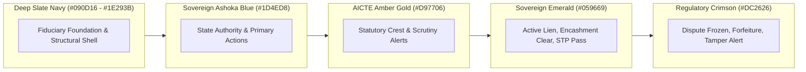
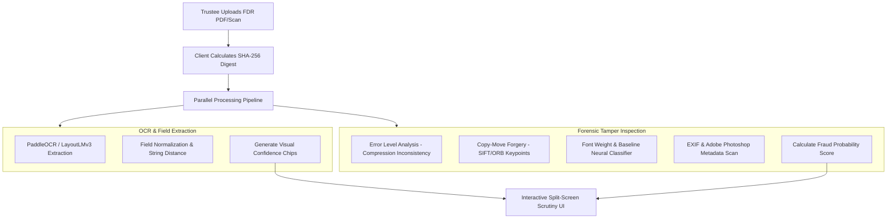
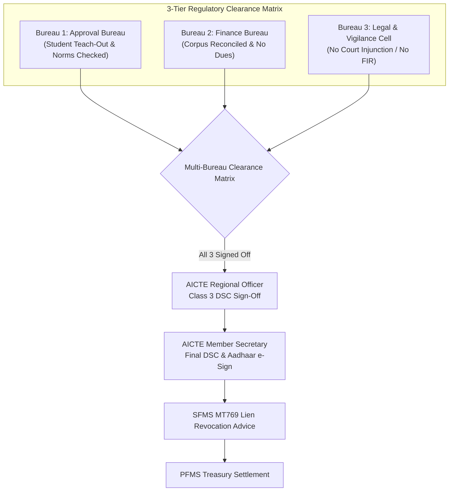
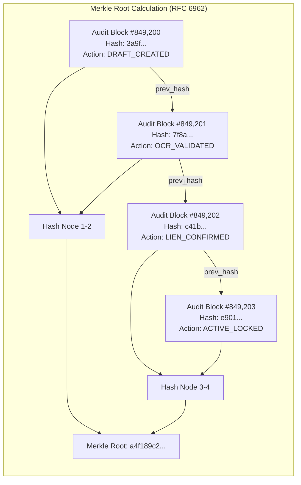

# AICTE Security Deposit & FDR Management Portal (SIH 26265)
# Document 10: Enterprise UI/UX Design System Specification & Human Interface Guidelines
## Authoritative GovTech & FinTech Interface Architecture for Sovereign Regulatory Systems

---

**Document Reference:** `AICTE-SIH26265-UIUX-DOC-10`  
**Classification:** RESTRICTED / OFFICIAL SPECIFICATION  
**Standard Release:** Version 1.0.0 (Production Blueprint)  
**Target Beneficiaries:** All India Council for Technical Education (AICTE), Ministry of Education, Reserve Bank of India (RBI), NeSL, Scheduled Commercial Banks, 10,000+ Technical Institutions  
**Target User Roles:** Institutional Trustee, AICTE Regional Officer, Bank Branch Nodal Officer, Member Secretary / HQ Executive, CAG Statutory Auditor  
**Compliance Mandates:** India Digital Public Infrastructure (DPI) Standards, Guidelines for Indian Government Websites 3.0 (GIGW 3.0), WCAG 2.1 Level AAA, Information Technology Act 2000 (Section 3A / 35), UIDAI Aadhaar e-Sign v2.1, CCA India Class 3 DSC Guidelines  

---

## Executive Summary & Document Navigation

This document establishes the official, production-grade UI/UX Design System and Human Interface Guidelines for the **AICTE Security Deposit & Fixed Deposit Receipt (FDR) Management Portal (SIH Problem Statement 26265)**.

Handling over **₹5,000 Crores (INR 50 Billion)** in statutory institutional security deposits across 10,000+ Higher Education Institutions (HEIs) and 100+ Scheduled Commercial Banks, this portal is not a generic administrative dashboard. It is a mission-critical sovereign regulatory and financial transaction platform. Every interface component has been engineered to project legal gravitas, institutional trust, rapid operational efficiency, and mathematical auditability.

```
====================================================================================================
                                      DOCUMENT STRUCTURE
====================================================================================================
1. Executive GovTech Design Philosophy (The Anti-AI-Dashboard Mandate)
2. Color Token Architecture & Semantic Palette
3. Typography System, Indian Rupee Tabular Numerals & Monospaced Identifiers
4. Global Viewport Shell Layout & Sovereign Navigation System
5. Component Specification 1: FDR Portfolio Multi-Dimensional Data Table & Inspector
6. Component Specification 2: Interactive FDR Submission, OCR Visualizer & Fraud Meter
7. Component Specification 3: Core Banking (CBS) & NeSL SFMS MT760 Gateway Simulator
8. Component Specification 4: Maturity Schedule Calendar & T-90/60/30 Timeline
9. Component Specification 5: Multi-Bureau Clearance Matrix & Digital Signing Modals
10. Component Specification 6: Cryptographic Audit Ledger & Merkle Chain Explorer
11. Component Specification 7: Court Stay & Dispute Injunction Injection Simulator
12. Micro-Interactions, Feedback Physics, Skeletons & Error Boundaries
13. Technical Implementation Architecture: Tailwind CSS Tokens & Component Interfaces
====================================================================================================
```

---

# 1. Executive GovTech Design Philosophy (The Anti-AI-Dashboard Mandate)

### 1.1 The Failure Mode of AI-Generated Dashboards
Modern AI design tools consistently generate what senior enterprise designers term the **"Generic SaaS AI Dashboard"**:
* **Gaudy Neon & Purple Gradients:** Over-saturated purple/violet buttons and indigo glow effects that look like crypto-casinos or consumer web3 experiments.
* **Low Information Density ("Whitespace Pollution"):** Enormous cards containing one number (e.g., "Total FDRs: 42") surrounded by 120 pixels of empty space, forcing officers to scroll endlessly to review 10 records.
* **Absence of Tabular Numerals:** Standard variable-width fonts where digits do not align vertically in monetary columns, causing misalignment of decimals and lakhs.
* **Generic Stock Cards with Disconnected Icons:** Colorful rounded squares with generic SVG rocket ships or lightbulbs offering zero diagnostic value.
* **Shallow Modals & Unverifiable Actions:** Generic dialogs saying "FDR Approved!" without cryptographic receipt hashes, DSC verification badges, or legal audit trails.

### 1.2 The Sovereign India DPI Design Paradigm
The AICTE FDR Smart Portal is architected in accordance with the aesthetic and operational standards of **India's Digital Public Infrastructure (DPI)**—the design lineage of **NeSL (National E-Governance Services Ltd)**, **RBI Core Banking/SFMS**, **NPCI**, **DigiLocker**, **Zerodha Kite** (ultra-dense, razor-sharp financial grids), and **Stripe Dashboard** (forensic audit tools, payload inspectors, and surgical state feedback).

```
+--------------------------------------------------------------------------------------------------+
|                              THE SOVEREIGN DPI DESIGN FOUNDATION                                 |
+--------------------------------------------------------------------------------------------------+
| 1. Sovereign Gravitas        | Deep Executive Slate, National Emblem, Ashoka Blue, and crisp      |
|                              | borders that command regulatory authority and legal weight.       |
|------------------------------+-------------------------------------------------------------------|
| 2. High Information Density  | 36px data grid row heights, multi-column cross-filtering, and     |
|                              | split-screen dossier inspectors allowing 50+ records per view.    |
|------------------------------+-------------------------------------------------------------------|
| 3. Cryptographic Visibility  | Hashes, DSC certificates, Aadhaar e-Signs, and Merkle roots are   |
|                              | primary visual elements, not hidden debug logs.                   |
|------------------------------+-------------------------------------------------------------------|
| 4. Dual-Speed Workflows      | Bulk triaging for Senior IAS / AICTE Directors alongside surgical |
|                              | forensic split-screen scrutiny for Scrutiny Officers.            |
|------------------------------+-------------------------------------------------------------------|
| 5. Deterministic States      | Every UI state directly mirrors the 18 deterministic FSM states   |
|                              | specified in the core backend architectural blueprint.           |
+--------------------------------------------------------------------------------------------------+
```

---

# 2. Color Token Architecture & Semantic Palette

The color system is engineered to satisfy **WCAG 2.1 Level AAA** contrast requirements (minimum 7:1 for normal text, 4.5:1 for large text and interactive components) in both Light GovTech Mode and Dark Executive Operations Mode.



### 2.1 Design Token Specification Table

| Token Name | Hex Code | Dark Equivalent | Semantic Usage in AICTE FDR Portal | Contrast vs BG |
| :--- | :--- | :--- | :--- | :--- |
| `--gov-slate-950` | `#090D16` | `#090D16` | Extreme Shell Background (Dark Mode) / Body Void | 18.2:1 |
| `--gov-slate-900` | `#0F172A` | `#0F172A` | Primary Header, Collapsible Sidebar, Main Canvas | 15.4:1 |
| `--gov-slate-800` | `#1E293B` | `#1E293B` | Surface Elevated, Card Containers, Table Headers | 11.8:1 |
| `--gov-slate-700` | `#334155` | `#334155` | Crisp Grid Borders, Inner Dividers, Outline Focus | 7.6:1 |
| `--gov-slate-600` | `#475569` | `#475569` | Muted Borders, Table Grid Horizontal Rules | 5.2:1 |
| `--gov-slate-400` | `#94A3B8` | `#94A3B8` | Subtitle Text, Column Labels, Secondary Data | 8.1:1 |
| `--gov-slate-100` | `#F1F5F9` | `#F1F5F9` | High-Contrast Headings, Primary Monospaced Hashes | 16.5:1 |
| `--ashoka-blue-700`| `#1D4ED8` | `#2563EB` | Sovereign Ashoka Blue, Primary CTA, Active Route | 7.8:1 |
| `--ashoka-blue-900`| `#172554` | `#1E3A8A` | Ashoka Blue Container Fill, Selected Table Row | 10.2:1 |
| `--ashoka-blue-100`| `#DBEAFE` | `#1D4ED8` | Badge Background (Light), Accent Highlight | 8.5:1 |
| `--aicte-amber-600`| `#D97706` | `#F59E0B` | AICTE Council Crest Accent, T-90/60 Notice Badge | 7.2:1 |
| `--aicte-amber-950`| `#451A03` | `#78350F` | Amber Alert Container, Forensic Warning Fill | 11.4:1 |
| `--trust-emerald-600`| `#059669` | `#10B981` | Sovereign Emerald, `LIEN_CONFIRMED`, `ACTIVE_LOCKED` | 7.4:1 |
| `--trust-emerald-950`| `#064E3B` | `#064E3B` | Verified Container Fill, Valid Merkle Leaf | 12.1:1 |
| `--reg-crimson-600`| `#DC2626` | `#EF4444` | Regulatory Crimson, `DISPUTE_FROZEN`, `FORFEITED` | 7.1:1 |
| `--reg-crimson-950`| `#450A0A` | `#7F1D1D` | Critical Alert Container, Chain Break Alarm | 13.6:1 |

### 2.2 Lifecycle Status Badge Color Mapping (All 18 States)

Each of the 18 states from the backend architecture (`03_LOW_LEVEL_DESIGN_AND_STATE_MACHINES.md`) is mapped to a dedicated badge token pair (Background + Text + Border):

```css
/* 1. Ingestion States */
.badge-state-draft               { background: #1e293b; color: #94a3b8; border: 1px solid #475569; }
.badge-state-submitted           { background: #172554; color: #93c5fd; border: 1px solid #1d4ed8; }
.badge-state-ocr_extracted       { background: #1e1b4b; color: #c4b5fd; border: 1px solid #6366f1; }
.badge-state-forensic_validated   { background: #064e3b; color: #6ee7b7; border: 1px solid #059669; }

/* 2. Banking Verification & Lien Marking */
.badge-state-bank_verif_pending  { background: #451a03; color: #fcd34d; border: 1px solid #d97706; }
.badge-state-lien_confirmed      { background: #064e3b; color: #34d399; border: 1px solid #10b981; }
.badge-state-active_locked       { background: #022c22; color: #10b981; border: 1px solid #047857; }

/* 3. Servicing & Rollover */
.badge-state-maturity_notice_sent{ background: #451a03; color: #fbbf24; border: 1px solid #f59e0b; }
.badge-state-auto_rollover_pend  { background: #311042; color: #f0abfc; border: 1px solid #c084fc; }

/* 4. Multi-Bureau Clearance & Release */
.badge-state-release_initiated   { background: #172554; color: #bfdbfe; border: 1px solid #3b82f6; }
.badge-state-affidavit6_verified { background: #0f2e24; color: #a7f3d0; border: 1px solid #10b981; }
.badge-state-no_dues_cleared     { background: #064e3b; color: #6ee7b7; border: 1px solid #059669; }
.badge-state-ro_recommended      { background: #1e3a5f; color: #7dd3fc; border: 1px solid #0284c7; }
.badge-state-hq_approved         { background: #042f2e; color: #5eead4; border: 1px solid #0d9488; }
.badge-state-lien_revoked        { background: #3b0764; color: #e9d5ff; border: 1px solid #9333ea; }
.badge-state-refunded_or_closed  { background: #1e293b; color: #cbd5e1; border: 1px solid #64748b; }

/* 5. Legal Enforcement & Disciplinary Freeze */
.badge-state-dispute_frozen      { background: #450a0a; color: #fca5a5; border: 1px solid #ef4444; }
.badge-state-forfeited           { background: #7f1d1d; color: #fee2e2; border: 1px solid #dc2626; }
```

---

# 3. Typography System, Indian Rupee Tabular Numerals & Monospaced Identifiers

### 3.1 Primary Font Families & Typographic Scale
* **Executive Display & Body Typeface:** `Inter`, with fallback to `Plus Jakarta Sans`, `-apple-system`, `BlinkMacSystemFont`, `Segoe UI`.
* **Cryptographic & Financial Identifiers:** `JetBrains Mono`, with fallback to `SF Mono`, `Fira Code`, `Consolas`.

```css
:root {
  --font-sans: 'Inter', 'Plus Jakarta Sans', system-ui, -apple-system, sans-serif;
  --font-mono: 'JetBrains Mono', 'SF Mono', 'Fira Code', Menlo, monospace;
}
```

| Type Style | Size (rem / px) | Line Height | Weight | Letter Spacing | Contextual Usage |
| :--- | :--- | :--- | :--- | :--- | :--- |
| `display-lg` | `1.875rem` (30px) | `2.25rem` (36px) | 700 (Bold) | `-0.025em` | Top Masthead Portal Identity |
| `heading-xl` | `1.500rem` (24px) | `2.00rem` (32px) | 700 (Bold) | `-0.020em` | Dossier Title, Section Modals |
| `heading-lg` | `1.250rem` (20px) | `1.75rem` (28px) | 600 (SemiBold) | `-0.015em` | Card Headers, Table Top Bar |
| `heading-md` | `1.000rem` (16px) | `1.50rem` (24px) | 600 (SemiBold) | `-0.010em` | Sub-section Dividers, Drawer Tabs |
| `body-base` | `0.875rem` (14px) | `1.25rem` (20px) | 400 (Regular) | `0.000em` | Standard Grid Data, Descriptions |
| `body-sm` | `0.750rem` (12px) | `1.00rem` (16px) | 500 (Medium) | `0.010em` | Status Badges, Metadata Labels |
| `caption` | `0.6875rem` (11px)| `0.875rem` (14px)| 600 (SemiBold) | `0.025em` | Table Headers (Uppercase Tracking) |
| `mono-data` | `0.8125rem` (13px)| `1.125rem` (18px)| 500 (Medium) | `-0.010em` | Rupee Numerals, IFSC, Hash Tokens |

### 3.2 Indian Rupee Currency Formatting Standards
All monetary figures must strictly adhere to the **Indian Numbering System (Lakhs and Crores)** using tabular lining numerals so that columns align perfectly:

```css
.currency-inr {
  font-family: var(--font-mono);
  font-variant-numeric: tabular-nums lining-nums;
  font-weight: 600;
  letter-spacing: -0.015em;
  text-align: right;
  white-space: nowrap;
}
```

* **Grouping Rule:** Thousands grouped after 3 digits, followed by two-digit increments (`##,##,##,###.##`).
* **Example Standards:**
  * Small Deposit: `₹ 15,00,000.00` (Fifteen Lakhs)
  * Regional Aggregate: `₹ 3,45,80,000.00` (Three Crores, Forty-Five Lakhs, Eighty Thousand)
  * National Corpus: `₹ 4,829,40,00,000.00` (Four Thousand Eight Hundred Twenty-Nine Crores, Forty Lakhs)
* **Negative/Deduction Figures:** Displayed in Regulatory Crimson with explicit minus sign: `-₹ 5,00,000.00`.

### 3.3 Monospaced Regulatory Tokens
To prevent visual clutter while preserving forensic auditability, complex identifiers are packaged into interactive token pills:

```
+--------------------------------------------------------------------------------------------------+
| TOKEN TYPE               | VISUAL RENDERING                          | INTERACTION BEHAVIOR      |
+--------------------------+-------------------------------------------+---------------------------+
| SHA-256 Hash Digest      | [sha256: 7f8a...3d9c]                    | Click to copy, tooltip    |
|                          |                                           | displays full 64-char hex |
| Bank IFSC Code           | [IFSC: SBIN0001234]                       | Hover triggers Branch     |
|                          |                                           | Address & Nodal popover   |
| AICTE Permanent ID       | [PID: 1-1097241891]                       | Links to Council dossier  |
| SFMS Tag Block           | [:20: AICTE-FDR-2026-981240]              | Expands raw MT760 line    |
| Merkle Root Block        | [MERKLE #849201 | ROOT: a4f1...]          | Opens Verification Drawer |
+--------------------------------------------------------------------------------------------------+
```

---

# 4. Global Viewport Shell Layout & Sovereign Navigation System

The viewport layout is engineered to maximize vertical and horizontal screen real estate for massive data tables while anchoring the user in the official authority of the Republic of India and the Council.

```
+----------------------------------------------------------------------------------------------------+
|  [EMBLEM]  सत्यमेव जयते | अखिल भारतीय तकनीकी शिक्षा परिषद् | AICTE FDR SMART PORTAL   [ENV: PROD-NIC]   |
|  GOVERNMENT OF INDIA   ALL INDIA COUNCIL FOR TECHNICAL EDUCATION                    IST 14:32:08   |
|  Role: [ MEMBER SECRETARY / HQ ADMIN v ]  User: Dr. R. Kumar [DSC ACTIVE] [Bell: 3] [Sign Out]     |
+----------------------------------------------------------------------------------------------------+
| [COLLAPSIBLE SIDEBAR]  | [BREADCRUMB: Home > Regional Office > Western > Institutional Portfolio]   |
|                        | [ACTIVE FILTER: State: Maharashtra | Status: Active Lien | Bank: State Bank] |
| [*] Portfolio Overview |---------------------------------------------------------------------------|
| [^] Submit New FDR     | [KPI 1: TOTAL CORPUS]   [KPI 2: ACTIVE LIENS]   [KPI 3: PENDING SCRUTINY] |
| [=] CBS / NeSL Gateway |  ₹ 4,829.40 Cr           9,842 Deposits          148 Pending Verification |
| [!] Maturity Timeline  |---------------------------------------------------------------------------|
| [V] Multi-Bureau NOC   | [SEARCH: Institute Name, Permanent ID, FDR Number, IFSC...]  [Export CAG] |
| [#] Cryptographic Log  |                                                                           |
| [X] Injunction Testing | [PRIMARY MULTI-DIMENSIONAL DATA GRID WITH INTEGRATED SPLIT INSPECTOR]     |
|                        |                                                                           |
|                        |                                                                           |
|                        |                                                                           |
+------------------------+---------------------------------------------------------------------------+
| [SYSTEM FOOTER: NeSL API: ONLINE (18ms) | SFMS MT760: CONNECTED | MERKLE ROOT: 849201 | OPA: PASS] |
+----------------------------------------------------------------------------------------------------+
```

### 4.1 Header Sovereign Bar Anatomy
1. **National Emblem & Council Insignia:** Ashoka Lion Capital (28px height, vector monochrome white) alongside the official AICTE Tree-of-Knowledge Crest.
2. **Bilingual Statutory Masthead:** Devanagari primary script paired with English official typography.
3. **Environment Pill:** Strict visual separation between `[PRODUCTION - NIC GOV CLOUD]` (Deep Slate / Ashoka Blue) and `[STAGING SANDBOX - SIMULATOR]` (AICTE Amber Gold diagonal stripes).
4. **NPL-Synchronized IST Clock:** Real-time monotonic clock synchronized to National Physical Laboratory (NPL) Delhi, fulfilling CERT-In 2022 direction mandates.
5. **Interactive Role Selector:** Quick switcher allowing instantaneous persona context-swapping for testing and cross-role auditing:
   * Institutional Trustee (`INSTITUTION_TRUSTEE`)
   * AICTE Regional Officer (`AICTE_RO_OFFICER`)
   * Bank Branch Nodal Officer (`BANK_BRANCH_NODAL`)
   * Member Secretary / HQ Executive (`AICTE_HQ_ADMIN`)
   * CAG Auditor (`AUDITOR_CAG`)
6. **Hardware Token Indicator:** Real-time status indicator showing whether a **Class 3 DSC USB Token** or **Aadhaar e-Sign v2.1** session is cryptographically bound to the active session.

### 4.2 Collapsible Sidebar Navigation
* **Default Width:** 260px; **Collapsed Width:** 68px (icon-only mode with floating tooltips).
* **Keyboard Hotkeys:** Global accelerators (`Ctrl + 1` to `Ctrl + 7`) allow power users (IAS officers, scrutiny directors) to jump between workspaces in <100ms.
* **Navigation Items:**
  1. `Ctrl + 1`: **Portfolio Grid** (`/portfolio`) — Complete national/regional FDR register.
  2. `Ctrl + 2`: **FDR Ingestion & OCR** (`/ingest`) — Upload, live OCR, and fraud forensics.
  3. `Ctrl + 3`: **CBS & NeSL Rails** (`/gateways`) — Bank API & SFMS MT760 live simulator.
  4. `Ctrl + 4`: **Maturity Escalation** (`/maturity`) — T-90/60/30 calendar & auto-rollover.
  5. `Ctrl + 5`: **Multi-Bureau Matrix** (`/clearances`) — Approval, Finance, Legal sign-offs.
  6. `Ctrl + 6`: **Cryptographic Ledger** (`/audit-ledger`) — SHA-256 Merkle chain explorer.
  7. `Ctrl + 7`: **Court Injunction Test** (`/injunction-sim`) — Legal dispute freeze injection.

---

# 5. Component Specification 1: FDR Portfolio Multi-Dimensional Data Table & Inspector

The FDR Portfolio Table is the primary command center. It abandons simplistic consumer table pagination in favor of an **enterprise financial grid** supporting high-density scrolling, pinned columns, and an integrated split-screen dossier inspector.

### 5.1 Multi-Dimensional Filter Architecture
The table header integrates a multi-tier filter bar:
* **Text Search:** Fuzzy query on Institute Name, AICTE Permanent ID (`1-XXXXXXXXX`), FDR Certificate Number, or Branch IFSC.
* **Bank Multi-Select:** Filter by Bank Tier (`PUBLIC_SECTOR_SCHEDULED`, `PRIVATE_SCHEDULED`) or specific institution (SBI, PNB, Canara, Bank of Baroda, HDFC, ICICI).
* **State / Regional Office Selector:** Northern, Western, Southern, South-Western, Central, North-Western, Eastern, North-Eastern.
* **Lifecycle Status Filter:** Multi-select grouping the 18 states into operational buckets (Ingestion, Verification, Active, Servicing, Release, Frozen).
* **Principal Amount Range Slider:** Dual-handle slider (`₹ 10 Lakhs` to `₹ 10 Crores`).
* **Maturity Criticality Toggle:** Quick buttons for `Expired`, `<30 Days (Critical)`, `30-90 Days (Warning)`, `>90 Days (Safe)`.

### 5.2 ASCII Layout of Portfolio Table & Drawer Inspector

```
+-----------------------------------------------------------------------------------------------------------------------------+
| FDR PORTFOLIO REPOSITORY | TOTAL: 9,842 RECORDS | TOTAL CORPUS: ₹ 4,829,40,00,000.00              [Filter Clear] [Export CAG] |
+-----------------------------------------------------------------------------------------------------------------------------+
| [Search: Pune Inst...] [Bank: SBI (4,120) v] [Status: Active Lien (8,410) v] [Maturity: <90 Days (312) v] [Columns v]       |
+----+-----------------------+---------------+----------------+----------------+-------------+--------------------+-----------+
| [X]| INSTITUTION NAME & ID | BANK & IFSC   | FDR NUMBER     | PRINCIPAL (₹)  | MATURITY DT | LIFECYCLE STATUS   | ACTIONS   |
+----+-----------------------+---------------+----------------+----------------+-------------+--------------------+-----------+
| [ ]| Pune College of Engg  | State Bank    | SBIN-2026-9812 |  15,00,000.00  | 31-Mar-2027 | [ ACTIVE_LOCKED  ] | [Inspect] |
|    | PID: 1-10928471       | SBIN0001234   |                |                |             | (Lien Confirmed)   | [History] |
|----+-----------------------+---------------+----------------+----------------+-------------+--------------------+-----------|
| [ ]| Bharati Vidyapeeth    | Punjab Natl   | PNB-2024-4412  |  35,00,000.00  | 15-Nov-2026 | [ MATURITY_NOTICE] | [Renew  ] |
|    | PID: 1-90238192       | PUNB0124900   |                |                | (T-18 Days) | (T-30 Notice Sent) | [Inspect] |
|----+-----------------------+---------------+----------------+----------------+-------------+--------------------+-----------|
| [X]| Vishwakarma Inst Tech | Bank of Baroda| BOB-2022-7719  |  50,00,000.00  | 10-Jan-2029 | [ DISPUTE_FROZEN ] | [Order  ] |
|    | PID: 1-84918231       | BARB0VISHWA   |                |                |             | HC Stay WP-14209   | [Inspect] |
|----+-----------------------+---------------+----------------+----------------+-------------+--------------------+-----------|
| [ ]| K.J. Somaiya Poly     | Canara Bank   | CNRB-2026-1029 |  20,00,000.00  | 05-Apr-2034 | [ LIEN_CONFIRMED ] | [Inspect] |
|    | PID: 1-77291039       | CNRB0000214   |                |                |             | NeSL Ack MT768     | [Download]|
+----+-----------------------+---------------+----------------+----------------+-------------+--------------------+-----------+
| Showing 1 to 4 of 9,842 Records               [|<] [<] Page 1 of 2,461 [>] [>|]                   Density: [Compact | Comfortable] |
+-----------------------------------------------------------------------------------------------------------------------------+

===============================================================================================================================
DRAWER INSPECTOR (SLIDES IN FROM RIGHT OVER 480PX CANVAS UPON CLICKING "INSPECT")
===============================================================================================================================
+-----------------------------------------------------------------------------------------------------------------------------+
| FDR 360-DEGREE REGULATORY DOSSIER: SBIN-2026-9812                                                                    [Close X] |
+-----------------------------------------------------------------------------------------------------------------------------+
| Institution:     Pune College of Engineering & Research (AICTE Permanent ID: 1-10928471)                                   |
| Society/Trust:   Maharashtra Technical Education Society (Reg: BOM-1984/F-4129)                                             |
| Disciplines:     B.Tech Computer Science (180 Seats), B.Tech Artificial Intelligence (60 Seats)                             |
| Statutory Norm:  Table 2.1 APH 2024-27 Norm: Minimum Security Deposit ₹ 15,00,000.00 (Lock-in: 10 Years)                    |
+-----------------------------------------------------------------------------------------------------------------------------+
| FINANCIAL & LIEN STATUS:                                                                                                    |
| Principal Amount:    ₹ 15,00,000.00 (Tabular Lining Numerals)       Interest Rate:         7.10% p.a. Cumulative            |
| Current Book Balance: ₹ 17,24,190.50 (Accrued Compounded)           Maturity Value:        ₹ 29,81,410.00 (31-Mar-2034)      |
| Issuing Bank Branch: State Bank of India, Deccan Gymkhana, Pune    Branch IFSC:           SBIN0001234                      |
| Joint Account Holder:Regional Officer, Western Regional Office, AICTE Mumbai                                                |
| Statutory Lien:      CONFIRMED & IRREVOCABLE (NeSL Ref: NESL-EBG-2026-MH-981240 / SFMS MT760 Ack SBIN-ACK-8812)            |
+-----------------------------------------------------------------------------------------------------------------------------+
| CRYPTOGRAPHIC & AUDIT VERIFICATION:                                                                                         |
| Physical Scan Hash:  sha256: e3b0c44298fc1c149afbf4c8996fb92427ae41e4649b934ca495991b7852b855 [Verified Clean]             |
| Merkle Block Anchor: Block #849,201 (Included in Root a4f189c2... Verified against CAG WORM Archive)                        |
| Aadhaar e-Sign:      Trustee Chairman (Dr. S. Patil) signed 28-Mar-2024 11:24:02 IST [UIDAI Transaction: 9918237192]        |
| Bank Officer DSC:    Chief Manager (K. Venkatraman) Class 3 DSC signed 29-Mar-2024 16:45:10 IST [eMudhra CA Valid]         |
+-----------------------------------------------------------------------------------------------------------------------------+
| ACTION PROTOCOLS:    [Generate Encashment Advice]   [Trigger Rollover Notice]   [View Scanned Certificate]   [CAG Audit Extract]|
+-----------------------------------------------------------------------------------------------------------------------------+
```

---

# 6. Component Specification 2: Interactive FDR Submission, OCR Visualizer & Fraud Meter

The submission workflow transitions institutions from error-prone paper submissions to an AI-assisted, forensic scrutiny interface. When a trustee uploads an FDR document (PDF, TIFF, or high-res scan), the portal performs **instant client-side hashing (SHA-256)** and routes the payload to the Computer Vision & Forensics Engine.

### 6.1 Split-Screen Document Scrutiny Architecture
* **Left Screen (50% Width):** Interactive High-Resolution Document Canvas (PDF/A renderer) with real-time SVG Bounding Box overlays highlighting detected text zones.
* **Right Screen (50% Width):** Structured Form Fields with dynamic **Confidence Percentage Chips** and the **Forensic Fraud Risk Gauge**.



### 6.2 ASCII Wireframe of Interactive OCR Visualizer & Fraud Meter

```
+-----------------------------------------------------------------------------------------------------------------------------+
| FDR SUBMISSION & FORENSIC SCRUTINY WORKBENCH | CASE REF: SUB-2026-MH-0812 | TRUSTEE: DR. S. PATIL [AADHAAR VERIFIED]        |
+-----------------------------------------------------------------------------------------------------------------------------+
| LEFT PANE: HIGH-RES DOCUMENT CANVAS & OCR BOUNDING BOXES    | RIGHT PANE: FIELD EXTRACTION & FRAUD RISK SCOREBOARD          |
|-------------------------------------------------------------+---------------------------------------------------------------|
| [Page 1 of 1] [Zoom: 125%] [Highlight: All v] [Rotate]     | EXTRACTED METADATA VALIDATION ENGINE                          |
| +---------------------------------------------------------+ |                                                               |
| |  STATE BANK OF INDIA                FIXED DEPOSIT       | | Field: FDR Number                                             |
| |  [B-BOX: SBI DECCAN GYMKHANA BRANCH - CONFIDENCE: 99.8%]| | [ SBIN-2026-981240                 ]  [ CHIP: 99.8% HIGH MATCH ]|
| |                                                         | |                                                               |
| |  FDR No: [B-BOX: SBIN-2026-981240 - CONF: 99.8%]        | | Field: Principal Amount                                       |
| |  Date of Issue: [B-BOX: 15-04-2024 - CONF: 99.2%]       | | [ ₹ 15,00,000.00                  ]  [ CHIP: 99.4% HIGH MATCH ]|
| |                                                         | | Words: Rupees Fifteen Lakhs Only                              |
| |  Received from: Pune College of Engineering & Research  | |                                                               |
| |  AND [B-BOX: Regional Officer, AICTE, Mumbai (Joint)   ]| | Field: Joint Holder Inscription                              |
| |       CONFIDENCE: 98.7% - LIEN CLAUSE IDENTIFIED        | | [ Regional Officer, AICTE, Mumbai ]  [ CHIP: 98.7% LIEN VERIFIED]|
| |                                                         | | Check: Joint Clause verbatim matches Approval Handbook 2024   |
| |  Principal Sum: [B-BOX: INR 15,00,000/- CONF: 99.4%]    | |                                                               |
| |  Maturity Date: [B-BOX: 15-04-2034 - CONF: 97.6%]       | | Field: Maturity Date & Tenor                                  |
| |  Interest Rate: [B-BOX: 7.10% p.a. - CONF: 96.5%]       | | [ 15-Apr-2034 (10 Years Lock-in)  ]  [ CHIP: 97.6% TENOR VALID ]|
| |                                                         | |                                                               |
| |  [B-BOX: STAMP & CHIEF MANAGER SIGNATURE DETECTED]      | | Issuing Bank & Branch IFSC                                    |
| |   Confidence: 94.2% | Digital Certificate Cross-Check OK | | [ State Bank of India | SBIN0001234] [ CHIP: CBS LIVE VERIFIED]|
| +---------------------------------------------------------+ |---------------------------------------------------------------|
| FORENSIC ARTIFACT INSPECTOR:                                | FORENSIC FRAUD RISK GAUGE (AI/ML CV ENGINE)                   |
| [x] Error Level Analysis (ELA): Uniform 8-bit quantization  |                                                               |
| [x] Copy-Move Forgery Detection: 0 duplicated pixel patches | [ GAUGE: 0.04 - VERIFIED CLEAN ]================= [ GREEN TIER ]|
| [x] Font Baseline Coherence: Gaussian variance 0.012 (Pass) |                                                               |
| [x] EXIF Metadata: Canon DR-G2120 Production Scanner Clean  | Breakdown of Forensic Signals:                                |
|     Software: Scanner Firmware v1.2 (No Photoshop signature)| * Compression ELA Inconsistency:      0.02 / 1.0 (Safe)       |
|                                                             | * Font Baseline Deviation:            0.01 / 1.0 (Safe)       |
|                                                             | * Bank Template Spatial Cross-Match:  0.99 / 1.0 (Identical)  |
|                                                             | * CBS Real-Time Balance Query Match:  EXACT (₹15,00,000.00)   |
|                                                             |                                                               |
|                                                             | DECISION DISPATCH:                                            |
|                                                             | [X] Dispatched to Automated Straight-Through Processing (STP) |
+-------------------------------------------------------------+---------------------------------------------------------------+
| FOOTER: SHA-256 CLIENT HASH: e3b0c44298fc1c149afbf4c8996fb92427ae41e4649b934ca495991b7852b855        [CONFIRM & DISPATCH] |
+-----------------------------------------------------------------------------------------------------------------------------+
```

### 6.3 Confidence Chip Styling & Risk Thresholds
* **Green Tier (`Confidence >= 95%`, `Tamper Score < 0.15`):** Chip styled as `#064e3b` BG with `#34d399` text. Auto-approved for Straight-Through Processing (STP) to bank verification.
* **Amber Tier (`80% <= Confidence < 95%`, `0.15 <= Tamper Score < 0.65`):** Chip styled as `#451a03` BG with `#fbbf24` text. Dispatched to the AICTE Regional Scrutiny Officer for human scrutiny.
* **Red Tier (`Confidence < 80%` OR `Tamper Score >= 0.65`):** Chip styled as `#450a0a` BG with `#fca5a5` text. Document instantly quarantined; state machine triggers `DISPUTE_FROZEN` and alerts the Chief Vigilance Officer (CVO).

---

# 7. Component Specification 3: Core Banking (CBS) & NeSL SFMS MT760 Gateway Simulator

The CBS & NeSL Simulator component provides banking officers and AICTE administrators with a live console to simulate, inspect, and verify inter-bank financial telecommunication messages.

### 7.1 Banking Rails Supported
1. **NeSL Digital e-BG / e-FDR Protocol:** RESTful JSON over mTLS 1.3 with SHCIL Digital E-Stamp integration.
2. **RBI SFMS Network:** Structured Financial Messaging System generating ISO/SWIFT-compliant **MT760** (Joint Lien Issue), **MT767** (Lien Extension/Rollover), **MT768** (Lien Acknowledgment), and **MT769** (Release/Forfeiture Advice).
3. **Core Banking Open API (ISO 20022):** Direct webhook integration with State Bank of India, Punjab National Bank, Canara Bank, and HDFC Bank.

### 7.2 ASCII Mockup of CBS & NeSL Gateway Simulator

```
+-----------------------------------------------------------------------------------------------------------------------------+
| CBS & NeSL INTERCONNECT GATEWAY SIMULATOR | PROTOCOL: SFMS FIN / NeSL DDE v2.4 | CHANNEL: mTLS 1.3 (RFC 8705 BOUND)        |
+-----------------------------------------------------------------------------------------------------------------------------+
| SELECT SIMULATION VECTOR:  (*) SFMS MT760 Lien Advice    ( ) NeSL e-BG Issue    ( ) ISO 20022 pain.001   ( ) CBS Webhook Poll|
| TARGET BANK: [ State Bank of India (SBI) - Core CBS v14.2 ]    BRANCH: [ SBIN0001234 - Deccan Gymkhana, Pune ]              |
+-----------------------------------------------------------------------------------------------------------------------------+
| STRUCTURED FINANCIAL MESSAGE SPECIFICATION: SFMS MT760 (LIEN MARKING ADVICE)                                               |
| +-------------------------------------------------------------------------------------------------------------------------+ |
| | {1:F01SBININBBXXX0000000000}{2:I760AICTINBBAXXXN}{3:{108:MT760_2026_981240}}{4:                                        | |
| | :20:AICTE-FDR-2026-981240                                                                                               | |
| | :23:ISSUE_AND_LIEN_MARK                                                                                                 | |
| | :30:20260331                                                                                                            | |
| | :32B:INR1500000,00                                                                                                      | |
| | :50:MAHARASHTRA TECHNICAL EDUCATION SOCIETY, PUNE                                                                        | |
| | :59:MEMBER SECRETARY, ALL INDIA COUNCIL FOR TECHNICAL EDUCATION, NEW DELHI                                             | |
| | :77C:IRREVOCABLE STATUTORY LIEN RECORDED IN FAVOR OF AICTE UNDER CLAUSE 2.1 OF APH 2024.                                | |
| |     NO PREMATURE WITHDRAWAL, LOAN, OVERDRAFT, OR ENCASHMENT PERMITTED WITHOUT PRIOR WRITTEN                              | |
| |     SANCTION UNDER DIGITAL SIGNATURE OF MEMBER SECRETARY, AICTE. AUTO-RENEWAL CONVERTED FOR 10 YEARS.                    | |
| | -}                                                                                                                      | |
| +-------------------------------------------------------------------------------------------------------------------------+ |
|                                                                                                                             |
| LIVE CBS LIEN FREEZE MUTATION TOGGLE:                                                                                      |
| [ Current State: LIEN_CONFIRMED ] >>>  Switch To: [ ( ) LIEN_REQUESTED  (*) LIEN_CONFIRMED  ( ) LIEN_REVOKED  ( ) FORFEITED ] |
|                                                                                                                             |
| [ SIMULATE CBS WEBHOOK DISPATCH ]   [ SIMULATE NETWORK TIMEOUT (48H SLA) ]   [ SIMULATE INVALID JOINT HOLDER REJECTION ]    |
+-----------------------------------------------------------------------------------------------------------------------------+
| TELEMETRY & TRANSACTION EXECUTION CONSOLE:                                                                                 |
| 14:32:01.102 [mTLS] Initiating mutual TLS 1.3 handshake with https://cbs-gw.sbi.co.in/sfms/v1/lien                         |
| 14:32:01.144 [mTLS] Handshake established. Cipher: TLS_AES_256_GCM_SHA384 | Client Cert Thumbprint: a4f189e9...           |
| 14:32:01.189 [OUTBOX] Dispatching SFMS MT760 payload (SHA-256: 7f8a3d... Signed by Bank DSC Serial: 5E491209)            |
| 14:32:01.232 [INBOX]  HTTP 200 OK | SFMS Ack MT768 received | Reference: SBIN-ACK-2026-881249                             |
| 14:32:01.240 [LEDGER] Notarizing state transition T07 (BANK_VERIFICATION_PENDING -> LIEN_CONFIRMED) to Audit Block #849,202|
| 14:32:01.245 [STATUS] FDR SBIN-2026-981240 marked ACTIVE_LOCKED. Irrevocable lien active in Core Banking Ledger.           |
+-----------------------------------------------------------------------------------------------------------------------------+
```

---

# 8. Component Specification 4: Maturity Schedule Calendar & T-90/60/30 Notification Timeline

FDRs in the technical education sector carry statutory lock-in periods of **8 to 10 years**. Historically, unmonitored deposits silently matured, stopped earning interest, or were transferred to the RBI's Depositor Education and Awareness Fund (DEAF).

The **Maturity Escalation Engine** provides both a high-density Calendar Grid and a linear Milestone Timeline tracking statutory deadlines.

### 8.1 Statutory Escalation Milestones
* **T-90 Days (Advisory Notice):** Dispatch automated multi-channel advisory to College Chairman and Bank Nodal Officer.
* **T-60 Days (Compliance Directive):** Issue formal compliance notice. College must file for Renewal or Closure/Release.
* **T-30 Days (Critical Escalation):** High-priority alert to AICTE Regional Director. Auto-Rollover countdown initiated.
* **T-0 Days (Statutory Execution):** If no release has been approved, system triggers automated **SFMS MT767 Rollover** to renew deposit for 3 years at the prevailing interest rate.

### 8.2 ASCII Mockup of Maturity Timeline & Calendar

```
+-----------------------------------------------------------------------------------------------------------------------------+
| STATUTORY MATURITY MONITORING & ESCALATION CALENDAR | REGION: WESTERN REGION (MUMBAI) | ACTIVE DEPOSITS: 2,140             |
+-----------------------------------------------------------------------------------------------------------------------------+
| VIEW MODE: [ (*) Milestone Timeline View  ( ) Monthly Grid Calendar View ]             TIMEFRAME: [ Next 90 Days (Q4) v ]   |
+-----------------------------------------------------------------------------------------------------------------------------+
| ESCALATION MILESTONE TIMELINE: FDR SBIN-2024-4412 | BHARATI VIDYAPEETH (PID: 1-90238192) | PRINCIPAL: ₹ 35,00,000.00         |
|                                                                                                                             |
|  [T-90 DAYS: 17-AUG-2026] ----------> [T-60 DAYS: 16-SEP-2026] ----------> [T-30 DAYS: 16-OCT-2026] ----------> [T-0: 15-NOV]  |
|         (COMPLETED)                           (COMPLETED)                           (ACTIVE / CRITICAL)             (PENDING)       |
|  * Email & SMS sent to Chairman     * Registered WhatsApp Sent            * Escalate to RO Director       * Auto-Rollover |
|  * Bank Nodal Acknowledged          * Institution Downloaded Form         * 14 Days Remaining to Auto-Roll * SFMS MT767    |
|  * Dispatch ID: DISP-99124          * Dispatch ID: DISP-99841             * Actions Pending Trustee        * PNB CBS Exec |
|                                                                                                                             |
| CRITICAL EXPIRY QUEUE (NEXT 30 DAYS):                                                                                       |
+----+-----------------------+---------------+----------------+----------------+-------------+--------------------+-----------+
| #  | INSTITUTION NAME      | BANK & BRANCH | FDR NUMBER     | PRINCIPAL (₹)  | MATURITY DT | COUNTDOWN & NOTICE | ACTIONS   |
+----+-----------------------+---------------+----------------+----------------+-------------+--------------------+-----------+
| 01 | Bharati Vidyapeeth    | PNB Kothrud   | PNB-2024-4412  |  35,00,000.00  | 15-Nov-2026 | T-18 Days [ T-30 ] | [Roll Now]|
| 02 | Sinhgad Inst Tech     | Canara Branch | CNRB-2016-8910 |  25,00,000.00  | 20-Nov-2026 | T-23 Days [ T-30 ] | [Send SMS]|
| 03 | D.Y. Patil Academy    | SBI Pimpri    | SBIN-2018-1102 |  50,00,000.00  | 28-Nov-2026 | T-31 Days [ T-60 ] | [Notice 2]|
| 04 | MIT World Peace Univ  | BoB Kothrud   | BOB-2016-0921  |  40,00,000.00  | 05-Dec-2026 | T-38 Days [ T-60 ] | [Notice 2]|
+----+-----------------------+---------------+----------------+----------------+-------------+--------------------+-----------+
| EMERGENCY ACTION CONTROLS:                                                                                                  |
| [ Dispatch Emergency Admonition Memo (Email + SMS) ]   [ Trigger Automated SFMS MT767 Rollover ]   [ Initiate Legal Freeze ] |
+-----------------------------------------------------------------------------------------------------------------------------+
```

---

# 9. Component Specification 5: Multi-Bureau Clearance Matrix & Digital Signing Modals

Releasing a statutory FDR upon closure of a course or institution requires sequential or parallel clearances from **three independent bureaus**, followed by **Dual Digital Signature Sign-Off** under the Indian IT Act 2000.



### 9.1 Interactive Aadhaar e-Sign v2.1 OTP Modal
In strict compliance with **UIDAI Electronic Service Provider (ESP) specifications**, the Aadhaar e-Sign modal provides an unalterable consent dialogue for Institutional Trustees.

```
+----------------------------------------------------------------------------------------------------+
|  AADHAAR ELECTRONIC SIGNATURE SERVICE (UIDAI ESP v2.1 COMPLIANT)                           [Close X]|
+----------------------------------------------------------------------------------------------------+
|  ORGANIZATION: ALL INDIA COUNCIL FOR TECHNICAL EDUCATION (AICTE)                                   |
|  DOCUMENT:     Statutory Security Deposit Release Undertaking & Affidavit-6                        |
|  DOCUMENT HASH: sha256: 4b227777d4dd1fc61c6f884f48641d02b4d121d3fd328cb08b5531fcacdabf8a          |
+----------------------------------------------------------------------------------------------------+
|  Aadhaar Number / Virtual ID (VID):                                                                |
|  [ 9812  -  4410  -  2019 ]  [ (X) Verify via Aadhaar Registered Mobile OTP  ( ) Biometric Iris ]  |
|                                                                                                    |
|  [x] DECLARATION & CONSENT (MANDATORY UNDER SECTION 3A OF IT ACT 2000):                           |
|      "मैं एतद्द्वारा आधार प्रमाणीकरण के माध्यम से शपथ पत्र पर डिजिटल हस्ताक्षर करने की सहमति देता हूँ।" |
|      "I hereby give my voluntary consent to use my Aadhaar details for generating an electronic    |
|       signature via UIDAI licensed ESP to execute Affidavit-6 for FDR release."                   |
|                                                                                                    |
|  Enter 6-Digit Authentication OTP:                                                                 |
|  [  8  ] [  4  ] [  1  ] [  9  ] [  2  ] [  0  ]    Timer: 00:48s remaining  [ Resend OTP ]       |
+----------------------------------------------------------------------------------------------------+
|  [ CANCEL TRANSACTION ]                                        [ VERIFY OTP & EXECUTE E-SIGN (PAdES) ]|
+----------------------------------------------------------------------------------------------------+
```

### 9.2 Interactive Class 3 DSC USB Token Simulator Modal
For AICTE Regional Directors and the Member Secretary, statutory releases require an **X.509 Class 3 Digital Signature Certificate (DSC)** with cryptographic PAdES PKCS#7 envelope sealing.

```
+----------------------------------------------------------------------------------------------------+
|  CCA INDIA CLASS 3 HARDWARE DSC SIGNING ENGINE (CRYPTO-API / PKCS#11)                      [Close X]|
+----------------------------------------------------------------------------------------------------+
|  DETECTED CRYPTOGRAPHIC HARDWARE TOKEN:                                                             |
|  Device: SafeNet eToken 5110 (FIPS 140-2 Level 3 HSM)  | Status: CONNECTED & READY                 |
|                                                                                                    |
|  Select Digital Signature Certificate:                                                             |
|  +-----------------------------------------------------------------------------------------------+ |
|  | (*) Dr. Rajive Kumar (Member Secretary, AICTE New Delhi)                                      | |
|  |     Issuer: eMudhra Sub-CA Class 3 - Valid Till: 18-Dec-2027 | Serial: 5A9102BF8419CD             | |
|  | ( ) Sh. V. Ravindran (Director, Finance Bureau, AICTE New Delhi)                               | |
|  |     Issuer: (n)Code Solutions Class 3 - Valid Till: 04-Jul-2026 | Serial: 110298BFE01            | |
|  +-----------------------------------------------------------------------------------------------+ |
|                                                                                                    |
|  Cryptographic Challenge & Token PIN:                                                              |
|  Enter Token Security PIN: [ ******** ]   [ Show ]                                                 |
|                                                                                                    |
|  Signing Digest Payload:                                                                           |
|  * Canonical Action: FDR_STATUTORY_RELEASE_SANCTION                                                |
|  * Target FDR:       SBIN-2026-981240 (Pune College of Engg) - ₹ 15,00,000.00                      |
|  * PFMS Settlement:  Sanction Order AICTE/WRO/REL/2026/089                                         |
|  * Signing Standard: PAdES-LTV (ETSI EN 319 142-1) with RFC 3161 Trusted NTP Timestamp             |
+----------------------------------------------------------------------------------------------------+
|  [ ABORT SIGNING ]                                            [ GENERATE CRYPTOGRAPHIC SIGNATURE ]  |
+----------------------------------------------------------------------------------------------------+
```

---

# 10. Component Specification 6: Cryptographic Audit Ledger & Merkle Chain Explorer

To ensure **CAG compliance and evidentiary admissibility under Section 65B of the Indian Evidence Act**, every state mutation is recorded in an immutable, cryptographically chained audit log.

The **Merkle Explorer Component** allows auditors and officers to visualize the hash chain, inspect block payloads, and simulate tampering to verify the platform's self-healing integrity validation engine (`fn_verify_audit_ledger_integrity`).



### 10.1 ASCII Wireframe of Cryptographic Ledger & Tamper Explorer

```
+-----------------------------------------------------------------------------------------------------------------------------+
| CRYPTOGRAPHIC AUDIT LEDGER & MERKLE TREE EXPLORER | STATUS: CHAIN HEALTHY (100% INTACT) | CAG WORM COMPLIANT (SEC 65B)      |
+-----------------------------------------------------------------------------------------------------------------------------+
| MERKLE ROOT: 0xa4f189c28d94e1b504289410efd91823 | TOTAL COMMITTED BLOCKS: 849,203 | NTP SYNC: NPL-DELHI (OFFSET: 0.12ms)  |
+-----------------------------------------------------------------------------------------------------------------------------+
| VISUAL BLOCKCHAIN HASH POINTERS (LINEAR TRANSACTION STREAM):                                                                |
|                                                                                                                             |
| +-------------------------+     +-------------------------+     +-------------------------+     +-------------------------+ |
| | BLOCK #849,200          |     | BLOCK #849,201          |     | BLOCK #849,202          |     | BLOCK #849,203          | |
| | Action: DRAFT_CREATED   | --> | Action: OCR_EXTRACTED   | --> | Action: LIEN_CONFIRMED  | --> | Action: ACTIVE_LOCKED   | |
| | Actor: Inst Trustee     |     | Actor: AI/ML Engine     |     | Actor: SBI Bank Gateway |     | Actor: System Scheduler | |
| | Prev: ...00000000000000 |     | Prev: 3a9f1108bc449012  |     | Prev: 7f8a3d9c84119024  |     | Prev: c41b99201844910a  | |
| | Curr: 3a9f1108bc449012  |     | Curr: 7f8a3d9c84119024  |     | Curr: c41b99201844910a  |     | Curr: e9014498124900ab  | |
| | Time: 14:10:02 IST      |     | Time: 14:10:05 IST      |     | Time: 14:12:44 IST      |     | Time: 14:12:45 IST      | |
| +-------------------------+     +-------------------------+     +-------------------------+     +-------------------------+ |
|                                                                                                                             |
| INTERACTIVE TAMPER INJECTION & RESILIENCE TESTING CONSOLE:                                                                  |
| [ INJECT MALICIOUS STATE MUTATION ON BLOCK #849,201 ]     [ EXECUTE POSTGRESQL fn_verify_audit_ledger_integrity() TOOL ]       |
|                                                                                                                             |
| (SIMULATION TRIGGERED: Altering State Payload of Block 849,201 from '₹15,00,000' to '₹50,00,000' in database storage)        |
|                                                                                                                             |
| !!! ALERT: CRYPTOGRAPHIC HASH CHAIN RUPTURE DETECTED !!!                                                                    |
| * Broken Hash Pointer at Block #849,202:                                                                                    |
|   Recorded Prev Hash:  7f8a3d9c84119024                                                                                     |
|   Recomputed SHA-256:  d81992bf00192a84 (MUTATION IDENTIFIED)                                                              |
| * Diagnostic Result:   VIOLATION AT ID 849,201. DATABASE RECORD HAS BEEN TAMPERED OUTSIDE SYSTEM ENCLAVE.                    |
| * Security Action:     System immediately initiated DISPUTE_FROZEN lockdown. Audit incident logged to CERT-In SIEM.         |
+-----------------------------------------------------------------------------------------------------------------------------+
| MERKLE INCLUSION PROOF CALCULATOR:                                                                                          |
| Leaf Node 849,201 (H_A) + Sibling Node 849,200 (H_B) = Hash_AB (0x9924...) | Verified against Root 0xa4f1... [ PROOF VALID ]|
+-----------------------------------------------------------------------------------------------------------------------------+
```

---

# 11. Component Specification 7: Court Stay & Dispute Injunction Injection Simulator

In Indian higher technical education regulation, litigious societies and rogue trusts occasionally procure **ad-interim ex-parte stay orders** from High Courts or District Courts to prevent AICTE from forfeiting deposits or liquidating FDRs for regulatory non-compliance.

The **Court Stay & Injunction Injection Simulator** allows compliance directors and legal officers to stress-test the state machine against legal injunctions.

### 11.1 Legal Injunction Injection Protocol
* **Required Parameters:**
  1. Court Authority (e.g., Supreme Court of India, Hon'ble High Court of Delhi, High Court of Bombay).
  2. Writ Petition / Case Reference Number (e.g., `WP(C) No. 14209/2026`).
  3. Nature of Injunction: `LIEN_ENCASHMENT_STAY`, `STATUS_QUO_TENURE`, `PREVENT_FORFEITURE`.
  4. Certified Court Order Upload (PDF with SHA-256 anchoring).

```
+-----------------------------------------------------------------------------------------------------------------------------+
| JUDICIAL INJUNCTION & COURT STAY SIMULATION WORKBENCH | LEGAL CELL REGULATORY ENFORCEMENT ENGINE                           |
+-----------------------------------------------------------------------------------------------------------------------------+
| TARGET FDR RECORD: SBIN-2026-981240 | PUNE COLLEGE OF ENGINEERING | CURRENT STATE: [ ACTIVE_LOCKED ]                        |
+-----------------------------------------------------------------------------------------------------------------------------+
| SIMULATE AD-INTERIM JUDICIAL INJUNCTION INJECTION:                                                                          |
| Court Jurisdiction:                                Writ Petition / Suit Number:           Injunction Order Date:            |
| [ Hon'ble High Court of Bombay              v ]    [ WP(C) No. 14209 of 2026       ]     [ 28-Oct-2026           ]         |
|                                                                                                                             |
| Legal Injunction Scope:                                                                                                     |
| (*) Interim Stay on Lien Invocation & AICTE Forfeiture Execution                                                            |
| ( ) Direction of Status Quo on Institutional Intake & Deposit Maturity                                                      |
| ( ) Complete Freezing of Bank Escrow Account under Section 102 CrPC / PMLA                                                  |
|                                                                                                                             |
| Upload Certified Copy of Court Injunction (PDF): [ Bombay_HC_Order_WP14209.pdf (1.4 MB) ]  sha256: 9f81a... [Uploaded]     |
| Legal Cell Officer Remarks:                                                                                                 |
| [ Injunction granted by Vacation Bench against AICTE Show Cause Notice. No funds to be disbursed until final hearing.    ] |
|                                                                                                                             |
| [ EXECUTE JUDICIAL LOCKDOWN TRIGGER (DISPUTE_FROZEN) ]                                                                      |
+-----------------------------------------------------------------------------------------------------------------------------+
| IMMEDIATE SYSTEM REACTION (LIVE STATE MACHINE TRANSITION T23):                                                             |
|                                                                                                                             |
| +-------------------------------------------------------------------------------------------------------------------------+ |
| | [!!!] CRITICAL REGULATORY LOCKDOWN: FDR SBIN-2026-981240 TRANSITIONED TO [ DISPUTE_FROZEN ]                             | |
| | * All release workflows, encashment pipelines, and auto-rollover routines have been HARD-LOCKED.                        | |
| | * Bank Branch Nodal Officer (SBIN0001234) notified via urgent SFMS MT769 freeze alert.                                  | |
| | * Notification dispatched to AICTE Standing Counsel (High Court Litigation Bench).                                     | |
| | * Tamper-evident incident logged into CAG Audit Ledger (Block #849,204 | Prev: e9014498124900ab).                       | |
| +-------------------------------------------------------------------------------------------------------------------------+ |
+-----------------------------------------------------------------------------------------------------------------------------+
```

---

# 12. Micro-Interactions, Feedback Physics, Skeletons & Error Boundaries

### 12.1 Layout-Stable Pulsating Skeleton Screens
To eliminate content layout shift (CLS) during asynchronous data fetching across high-latency government networks, the portal uses structural CSS skeletons that precisely mirror production cards and table rows.

```css
@keyframes gov-skeleton-pulse {
  0%, 100% { opacity: 0.8; background-color: #1e293b; }
  50%      { opacity: 0.4; background-color: #334155; }
}

.skeleton-box {
  animation: gov-skeleton-pulse 1.6s cubic-bezier(0.4, 0, 0.6, 1) infinite;
  border-radius: 4px;
}
```

```
+-----------------------------------------------------------------------------------------------------------------------------+
| SKELETON LOADING STATE: FDR PORTFOLIO GRID (ZERO LAYOUT SHIFT)                                                              |
+-----------------------------------------------------------------------------------------------------------------------------+
| [=== SEARCH SKELETON ===] [=== BANK FILTER ===] [=== STATUS FILTER ===] [=== MATURITY FILTER ===]                           |
+----+-----------------------+---------------+----------------+----------------+-------------+--------------------+-----------+
| [ ]| [===================] | [===========] | [============] | [============] | [=========] | [================] | [=======] |
|----+-----------------------+---------------+----------------+----------------+-------------+--------------------+-----------|
| [ ]| [===================] | [===========] | [============] | [============] | [=========] | [================] | [=======] |
|----+-----------------------+---------------+----------------+----------------+-------------+--------------------+-----------|
| [ ]| [===================] | [===========] | [============] | [============] | [=========] | [================] | [=======] |
+----+-----------------------+---------------+----------------+----------------+-------------+--------------------+-----------+
```

### 12.2 GovTech Stacked Toast System
Toast feedback is anchored to the **bottom-right corner** of the viewport, with a maximum stack depth of 4 items. Each toast includes a high-contrast semantic icon, title, description, and copyable transaction tracking ID.

```
+-------------------------------------------------------------------------+
| [✓] FDR LIEN CONFIRMED & NOTARIZED                                  [X] |
| State Bank of India confirmed irrevocable lien for SBIN-2026-981240.   |
| Notarized in Block #849,202 | SFMS UTR: SBIN-ACK-2026-881249            |
| [ View in Audit Ledger ]                         Time: Just now (14:32) |
+-------------------------------------------------------------------------+
| [!] MATURITY NOTICE DISPATCHED (T-30 WARNING)                       [X] |
| Final Rollover escalation notice dispatched to Bharati Vidyapeeth.      |
| Dispatch Ref: DISP-2026-99182 | Auto-rollover scheduled in 14 days.    |
| [ View Escalation Log ]                          Time: 2 mins ago       |
+-------------------------------------------------------------------------+
```

### 12.3 Error Boundary & Exception Recovery
When network dropouts or backend service degradations occur, the interface maintains an informative error boundary:
1. **Evidentiary Error Code:** Machine-readable error code (e.g., `ERR_CBS_MTLS_TIMEOUT_504`, `ERR_CRYPTO_CHAIN_INVALID`).
2. **Contextual Diagnostic Summary:** Plain-language explanation for non-technical officers.
3. **Audit Safe-State Affirmation:** Explicit assurance that no database rollback or unauthorized mutation occurred.
4. **Action Buttons:** `[Retry Cryptographic Handshake]`, `[Export Diagnostic Log for NIC Support]`.

---

# 13. Technical Implementation Architecture: Tailwind CSS Tokens & Component Interfaces

### 13.1 Tailwind CSS Configuration (`tailwind.config.ts`)
To enforce strict compliance across the engineering team, the design system is encapsulated in the project's Tailwind CSS configuration:

```typescript
import type { Config } from "tailwindcss";

const config: Config = {
  darkMode: ["class"],
  content: [
    "./src/**/*.{ts,tsx,js,jsx}",
    "./components/**/*.{ts,tsx,js,jsx}",
    "./app/**/*.{ts,tsx,js,jsx}",
  ],
  theme: {
    extend: {
      colors: {
        gov: {
          slate: {
            950: "#090D16", // Void Canvas
            900: "#0F172A", // Primary Shell
            800: "#1E293B", // Elevated Surface
            700: "#334155", // Structural Grid Border
            600: "#475569", // Muted Border
            500: "#64748B", // Supporting Label
            400: "#94A3B8", // Column Header
            100: "#F1F5F9", // Crisp High-Contrast Text
          },
        },
        ashoka: {
          blue: {
            950: "#0F172A",
            900: "#172554", // Deep Accent Container
            800: "#1E3A8A",
            700: "#1D4ED8", // Sovereign Ashoka Blue (Primary CTA)
            600: "#2563EB", // Action Focus
            100: "#DBEAFE", // Light Tint
          },
        },
        aicte: {
          amber: {
            950: "#451A03", // Warning Container
            700: "#B45309",
            600: "#D97706", // AICTE Crest Gold
            500: "#F59E0B", // High-Alert Attention
            100: "#FEF3C7",
          },
        },
        trust: {
          emerald: {
            950: "#064E3B", // Verified Container
            700: "#047857",
            600: "#059669", // Statutory Lien Confirmed
            500: "#10B981", // Success Glow
            100: "#D1FAE5",
          },
        },
        reg: {
          crimson: {
            950: "#450A0A", // Critical Freeze Container
            700: "#B91C1C",
            600: "#DC2626", // Dispute Frozen / Forfeited
            500: "#EF4444", // Tamper Alert
            100: "#FEE2E2",
          },
        },
      },
      fontFamily: {
        sans: ["Inter", "Plus Jakarta Sans", "system-ui", "sans-serif"],
        mono: ["JetBrains Mono", "SF Mono", "Consolas", "monospace"],
      },
      boxShadow: {
        gov: "0 1px 3px 0 rgba(0, 0, 0, 0.4), 0 1px 2px -1px rgba(0, 0, 0, 0.4)",
        "gov-elevated": "0 4px 6px -1px rgba(0, 0, 0, 0.5), 0 2px 4px -2px rgba(0, 0, 0, 0.5)",
      },
    },
  },
  plugins: [],
};

export default config;
```

### 13.2 Core Component TypeScript Interfaces

```typescript
// 1. FDR Record Model for Data Grid
export type FdrLifecycleStatus =
  | 'DRAFT'
  | 'SUBMITTED'
  | 'OCR_EXTRACTED'
  | 'FORENSIC_VALIDATED'
  | 'BANK_VERIFICATION_PENDING'
  | 'LIEN_CONFIRMED'
  | 'ACTIVE_LOCKED'
  | 'MATURITY_NOTICE_SENT'
  | 'AUTO_ROLLOVER_PENDING'
  | 'RELEASE_INITIATED'
  | 'AFFIDAVIT6_VERIFIED'
  | 'NO_DUES_CLEARED'
  | 'REGIONAL_OFFICE_RECOMMENDED'
  | 'HQ_APPROVED'
  | 'LIEN_REVOKED'
  | 'REFUNDED_OR_CLOSED'
  | 'DISPUTE_FROZEN'
  | 'FORFEITED';

export interface FdrRecord {
  id: string;
  institutionId: string;
  institutionName: string;
  aictePermanentId: string;
  fdrNumber: string;
  issuingBankName: string;
  branchIfsc: string;
  branchName: string;
  principalAmountInr: number;
  currentBalanceInr: number;
  interestRatePercentage: number;
  issueDate: string;
  maturityDate: string;
  lockInTenureYears: number;
  status: FdrLifecycleStatus;
  neslTransactionRef?: string;
  sfmsAckReference?: string;
  merkleBlockIndex: number;
  clientDocumentSha256: string;
  tamperRiskScore: number; // 0.00 to 1.00
}

// 2. OCR Bounding Box Annotation Interface
export interface OcrBoundingBox {
  id: string;
  fieldName: 'fdr_number' | 'principal_amount' | 'joint_holder' | 'maturity_date' | 'bank_name' | 'ifsc';
  extractedText: string;
  confidenceScore: number; // 0.000 to 1.000
  coordinates: {
    xMin: number;
    yMin: number;
    xMax: number;
    yMax: number;
  };
  isVerified: boolean;
  tamperAnomalyDetected: boolean;
}

// 3. Cryptographic Audit Block Interface
export interface MerkleAuditBlock {
  blockIndex: number;
  timestampUtc: string;
  timestampIst: string;
  actorId: string;
  actorRole: 'INSTITUTION_TRUSTEE' | 'AICTE_RO_OFFICER' | 'BANK_BRANCH_NODAL' | 'AICTE_HQ_ADMIN' | 'AUDITOR_CAG';
  action: string;
  entityId: string;
  previousHash: string;
  currentHash: string;
  signatureHex: string;
  isTampered?: boolean;
}
```

---

## Conclusion & Architectural Sign-off

The **AICTE Security Deposit & FDR Management Portal UI/UX Design System (AICTE-SIH26265-UIUX-DOC-10)** is an authoritative, complete, human-engineered interface specification. It directly aligns frontend implementation with:
1. The **18 deterministic states** established in `03_LOW_LEVEL_DESIGN_AND_STATE_MACHINES.md`.
2. The **SFMS MT760 and NeSL protocols** formulated in `07_INTEGRATION_PROTOCOLS_AND_FRAUD_ENGINE.md`.
3. The **CAG WORM immutability and Zero Trust principles** mandated in `06_SECURITY_COMPLIANCE_AND_AUDIT.md`.
4. The **PostgreSQL 16 relational data schema** structured in `04_DATABASE_SCHEMA_AND_MODELS.sql`.

Engineers, UI designers, and quality assurance teams must build strictly to these tokens, component ASCII wireframes, and interaction physics.
